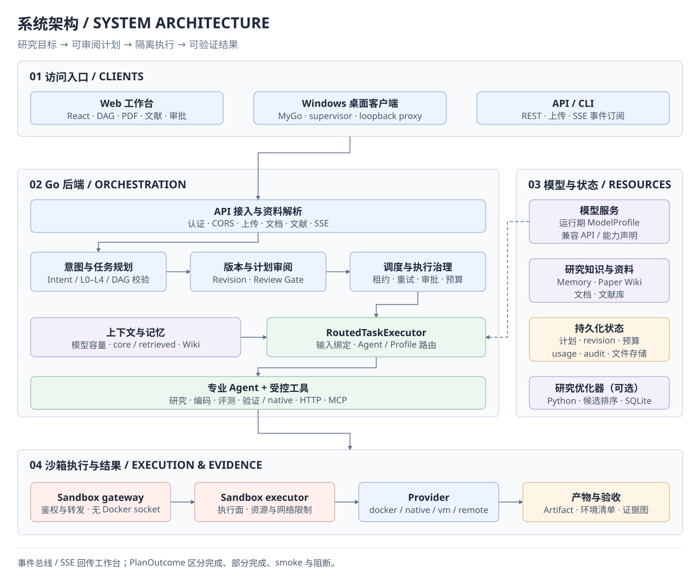
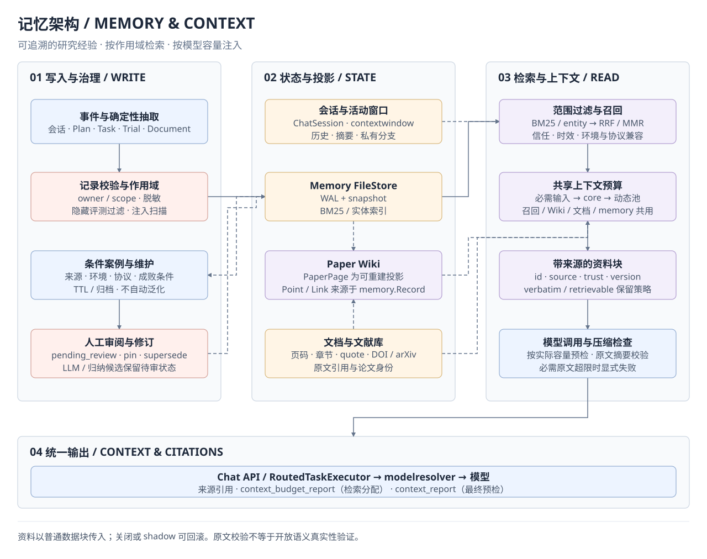
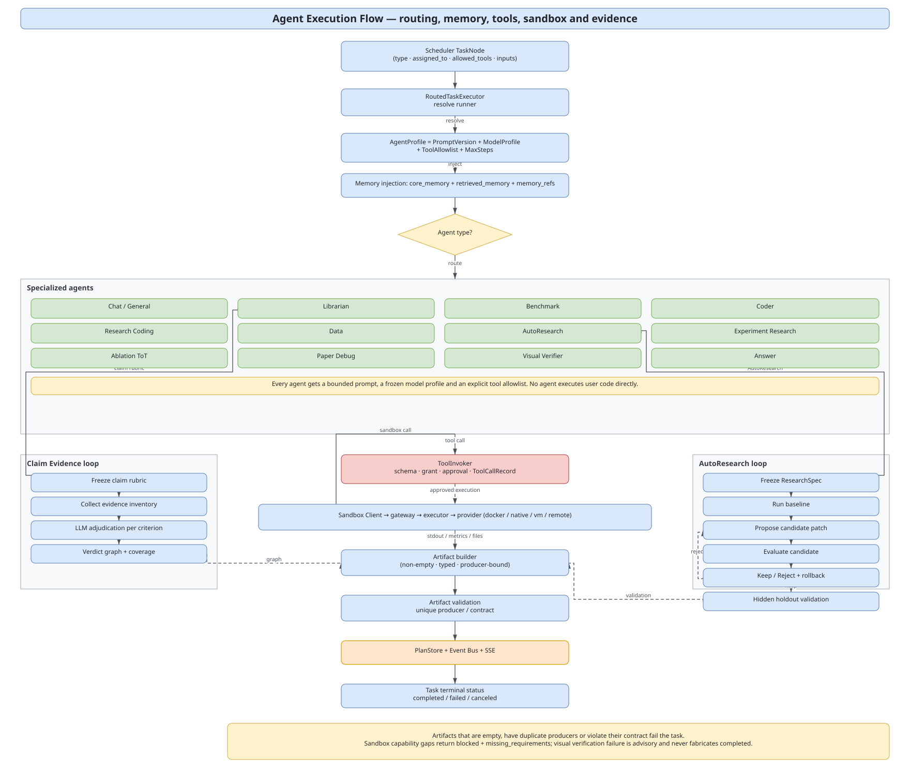

# Research Assistant Agent

**A multi-agent research execution system for paper reproduction, data evaluation, and budget-constrained AutoResearch.**

[简体中文](README.md) | English · `v0.9.0` · [MIT License](LICENSE)

Research results need to be executable, reproducible, and verifiable. Research Assistant Agent organizes papers, repositories, datasets, runtime environments, metrics, and budgets into a reviewable DAG. It executes tasks in a sandbox and returns artifacts, environment manifests, and evidence graphs.

> From research goal to experimental result: understand context → plan → review → execute in isolation → verify evidence.

## Reading guide

| Goal | Start here |
|---|---|
| Understand the project | [Project capabilities](#project-capabilities) · [System architecture](#system-architecture) · [Agents and collaboration](#agents-and-collaboration) |
| Get started | [Quick start](#quick-start) · [Task examples](#task-examples) · [Desktop client](#desktop-client) |
| Explore implementation | [Sandbox and runtime](#sandbox-and-runtime) · [Context and memory](#context-and-memory) · [Tool ecosystem and MCP](#tool-ecosystem-and-mcp) |
| Configure and develop | [Configuration reference](#configuration-reference) · [API reference](#api-reference) · [Development and testing](#development-and-testing) |
| Deploy and look up details | [Operating boundaries and security](#operating-boundaries-and-security) · [Documentation index](#documentation-index) |

## Project capabilities

| Area | Core capabilities |
|---|---|
| Research planning | Paper reproduction, code execution, data evaluation, AutoResearch, and research Q&A; intent recognition, L0–L4 routing, typed context, and DAG validation |
| Multi-agent execution | Seven built-in runner types or custom AgentProfiles; dependency scheduling, bounded repair, retries, cancellation, and optional native tool loops |
| Experiments and acceptance | Pinned repository revisions, RuntimeSpec, real sandbox execution, environment manifests, hidden-label metric recomputation, claim-level evidence, and reproducible export |
| Context and memory | Persistent sessions, model active windows, shared retrieval budgets, layered memory, sourced experience cases, and Paper Wiki |
| Tools and extensions | native / HTTP / MCP tools, JSON Schema, permission intersection, approvals, audit, and replay |
| Governance and interaction | Plan library, immutable revisions, human review, structured questions, budgets, SSE workbench, and a Windows desktop shell |

`PlanOutcome` distinguishes `completed / partial / smoke / mock / blocked / failed / needs_review` and lists missing requirements. Lightweight smoke results retain their actual scope.

<details>
<summary>Expand full capabilities: Research tasks and planning</summary>

| Capability | Description |
|---|---|
| Multi-type research tasks | Paper reproduction, code execution, framework comparison, data evaluation, budget-constrained AutoResearch, general research Q&A |
| Intent recognition | `rule` / `llm` / `hybrid` / `shadow` modes; rule fast path + optional Python intent service + post-validation |
| Complexity routing | L0–L4: L0/L1 use a fast path, L2 uses standard templates, L3/L4 use skeleton + agent planner with one structured repair pass |
| Unified DAG planning | Template registry, simple/standard/full variants, General direct/research/paper/literature shapes, node contracts, and artifact validation |
| Typed context | `ResearchContext` + `InputBindings` unify attachments, paper metadata, documents, literature, constraints, and memory instead of hand-assembled template inputs |
| Plan library | Project grouping, title/intent search, status/type filters, keyset pagination, rename, archive/restore, duplicate, export, and delete |
| Immutable revisions | Every edit creates an r1/r2… snapshot; `base_revision` optimistic locking; running plans reject edits or execution of a new revision |

</details>

<details>
<summary>Expand full capabilities: Execution and acceptance</summary>

| Capability | Description |
|---|---|
| Specialized agent routing | Seven built-in runner types selected by `assigned_to`, plus custom AgentProfiles; domain workflows include AutoResearch, experiment search, ablation design, paper debugging, and visual verification |
| Real isolated execution | Independent Go sandbox service with Docker / Native / VM / Remote providers; persistent workspaces, streaming logs, and artifact return |
| Runtime approvals | `confirm_important` (default) pauses before image pulls, dependency installs, data/model downloads, GPU use, or network access; `full_access` auto-executes within boundaries and records audit events |
| Paper-reproduction runtime | RuntimeSpec, image/dependency probing, real installation, `EnvironmentManifest` (image digest, Python/pip freeze, GPU, data hashes, commands, working directory) |
| Repository-first reproduction | Discover or use a specified Git repository, pin the revision, generate RuntimeSpec, install dependencies, and run controlled minimal/full experiments |
| Budget-constrained AutoResearch | Freeze ResearchSpec and metrics, generate code patches or parameter candidates within a restricted file scope, execute for real, then Keep/Reject, roll back regressions, and validate on a hidden holdout |
| Trustworthy Benchmark | Dataset audit, reproducible splits, leakage checks, Metric/Reward contracts, and backend recomputation on hidden labels |
| Layered candidate search | Bounded exhaustive search, route UCB, Top-K Beam, UCT-style parameter trees, virtual visits, and hidden holdout validation |
| Claim-level evidence | Freeze a hierarchical rubric and bind paper claims, criteria, and real artifacts into an evidence graph with coverage |
| Semantic outcomes | `PlanOutcome` distinguishes completed / partial / smoke / mock / blocked / failed / needs_review and lists missing requirements |
| Waiting and block semantics | Approvals/questions stay `awaiting_*` without blocking dependents; `block_info` keeps the root cause, the forwarding node and the epoch, so the reason survives a refresh |
| Partial acceptance | A plan can declare an `acceptance` contract (core goals + required artifacts) and `optional` work; when only optional work is lost the run ends `completed/partial` with the losses listed |
| Visual verification | Image structure gate + multimodal visual verdict (pass / fail / inconclusive); visual failure never fabricates completed |
| Reproducible export | `manifest.json` + `checksums.sha256` + `environment/*` + `provenance/*`; missing key evidence marks the bundle partial and lists what is missing |

</details>

<details>
<summary>Expand full capabilities: Memory, tools, and governance</summary>

| Capability | Description |
|---|---|
| Agent memory | Layered memory (profile/fact/episode/procedure/constraint/negative/document/working/reflection), BM25 + entity index, RRF/MMR, core/retrieved budgets, citations and trust levels, owner isolation, redaction, and injection scanning |
| Chat memory | Persistent Session / ChatSession, source-grounded summaries, explicit model capacity, and a separately managed active window with current materials and citations |
| Plan/task memory | Plan episodes, conditional failure/retry cases, document and AutoResearch trial records; deterministic case compilation preserves scope and sources, with new reflections pending review |
| Paper Wiki | Implemented paper pages, points, evidence-backed links, review decisions, rebuildable projections, optional PDF-reference links, and source-checked LLM summaries |
| Tool registry | native / HTTP / MCP stdio / MCP HTTP; JSON Schema validation, connection tests, and schema fingerprints |
| Tool permissions | `AllowedTools` + AgentProfile `ToolAllowlist` + `ToolGrant`; unauthorized calls return `tool_forbidden` with no side effects |
| Tool approval and audit | `SideEffect` or approval policy creates a `tool_call` RuntimeAction; `ToolCallRecord` stores argument hash, result hash, duration, and approval ID; dry-run and real replay are supported |
| AgentProfile / PromptVersion | Immutable prompts, active-pointer rollback, rendering, and evaluation; optional native tool loops with durable checkpoints and step/call limits; unknown profiles fail plan validation |
| Cost and budget | token / USD / sandbox / download limits; soft overage pauses, hard overage cancels; 80% warnings, 100% rejection; pricing follows the model profile |
| Observability | Prometheus metrics, structured audit events, SSE plan/node/log/artifact events, diagnostics bundles, and log rotation |

</details>

## System architecture

The application combines a **React + TypeScript workbench, Go orchestration backend, and standalone sandbox service**. The Windows desktop shell uses **MyGo**. The three views below cover system components, memory and context, and agent execution.

### System overview

The backend turns research goals into DAGs, applies plan review and budget controls, and dispatches specialized agents. Code runs through the sandbox gateway, executor, and provider. Artifacts, environment manifests, and evidence are collected and reported to the workbench through SSE. The backend manages access to models, research knowledge, and persistent state.



[Editable draw.io source](docs/diagrams/architecture.drawio) · [Full-size diagram](docs/diagrams/architecture.svg)

### Memory architecture

Research events pass scope and content checks before entering memory. Paper Wiki provides a paper knowledge projection, while sessions and active windows retain conversation state. Retrieval, Wiki, and documents share a dynamic context budget and enter model calls as source-labelled data, with citations and budget reports. Consolidated cases retain their conditions and sources; inferred experience remains subject to review.



[Editable draw.io source](docs/diagrams/memory-system.drawio) · [Full-size diagram](docs/diagrams/memory-system.svg)

### Agent architecture

`RoutedTaskExecutor` binds inputs, context, and model settings, then chooses a built-in runner or custom `AgentProfile`. Specialized agents host reading, coding, AutoResearch, evaluation, and verification workflows. Model, tool, and sandbox calls remain subject to permissions, approvals, and budgets. Artifact contracts and execution evidence determine the results written back to the plan.



[Editable draw.io source](docs/diagrams/agent-execution-flow.drawio) · [Full-size diagram](docs/diagrams/agent-execution-flow.svg)

<details>
<summary>Expand layers, the request lifecycle, and design principles</summary>

### Layers

```text
Researcher / Paper / Repository / Dataset
                    │
        ┌───────────┴────────────┐
        │                        │
Windows Desktop (MyGo)      Web Browser / API Client
  ├─ MyGo window            └─ nginx BFF (static assets + /api proxy)
  ├─ bridge (mygo.Bind)
  ├─ supervisor (backend.exe / sandbox.exe)
  ├─ loopback proxy (SSE / uploads / downloads)
  ├─ settings + DPAPI
  ├─ updater + diagnostics
  └─ tray / single instance
        │
        └──────────► React Workbench (embedded or served)
                    │ REST / Upload / SSE
                    ▼
        Go Backend (API + Orchestration)
        ├─ API: auth / CORS / rate limit / OpenAPI
        ├─ Cognition: Intent Router → Complexity Router → Planner + DAG Validator
        ├─ Governance: Plan Store / Revision / Review gate / Budget / Audit
        ├─ Scheduling: Scheduler (lease / retry / cancel / budget / approval)
        ├─ Execution: RoutedTaskExecutor → specialized agents
        ├─ Memory: Memory Store + Retrieval/Injection + Paper Wiki
        ├─ Tools: ToolRegistry / ToolInvoker (native / HTTP / MCP)
        └─ Events: Event Bus → SSE
                    │
                    ▼
        Sandbox Client → docker-sandbox gateway → executor
                    ├─ Docker Provider (containers / images / GPU / network)
                    ├─ Native Provider (uv CPython + venv + AppContainer/lowil)
                    ├─ VM Provider (WSL2 / Docker in VM)
                    └─ Remote Provider (OpenSandbox)
                    │
                    ▼
        Artifact / EnvironmentManifest / PlanOutcome / Claim-Evidence
                    │
                    ▼
        Event Bus / SSE → React Workbench
```

| Layer | Main components | Responsibility |
|---|---|---|
| Client | Windows desktop shell, web frontend, API/CLI | Submit goals, upload material, inspect DAGs, approve, read results |
| Access | Gin API, auth, CORS, rate limiting, OpenAPI | Unified REST/SSE contract, identity, quotas |
| Cognition | Intent Router, Complexity Router, Planner, DAG Validator | Turn intent into a valid, executable PlanGraph |
| Governance | Plan Store, Revision Store, Review Gate, Budget, Audit | Plan persistence, versioning, review, cost, audit |
| Scheduling | Scheduler, lease, Runtime Gate, retry/cancel | Advance the DAG safely and recoverably |
| Execution | RoutedTaskExecutor, specialized agents, ToolInvoker | Select agents, inject memory, call tools and sandboxes |
| Sandbox | gateway, executor, docker/native/vm/remote providers | Real isolated execution and capability negotiation |
| State | Plan/Revision/Memory/Upload/Document/Literature/Budget/Audit | Durable, replayable state |
| External | LLM provider, Research Optimizer, literature sources | Models, candidate ranking, literature retrieval |

### Lifecycle of one request

1. **Input and context** — the user submits a goal, uploads PDFs/CSVs, or links a repository; the backend resolves `AttachmentRef` / `DocumentRef` / `PaperMetadata`, writes `ResearchContext`, and retrieves relevant memory.
2. **Intent and complexity** — the Intent Router returns a type and confidence; the Complexity Router makes the final L0–L4 decision after context resolution and selects a template variant or agent planner.
3. **Planning** — PlanBuilder emits nodes, dependencies, `assigned_to`, `InputBindings`, and artifact contracts; the DAG Validator checks acyclicity, dependencies, unique producers, and required nodes.
4. **Revision and review** — the plan is saved and a revision is created; if the review gate applies (`PLAN_REVIEW_MODE=always`, cost threshold, high-risk nodes, missing requirements, L4), the plan enters `awaiting_review` for edit/validate/diff/approve/reject.
5. **Execution** — the Scheduler computes in-degrees, dispatches ready nodes, and acquires leases; the runtime gate creates `RuntimeActionRequest` records before image/dependency/GPU/network operations.
6. **Agent execution** — RoutedTaskExecutor resolves the AgentProfile (PromptVersion + ModelProfile + ToolAllowlist + MaxSteps), resolves current materials and injects core / retrieved memory within shared budgets, and invokes the agent; the agent uses ToolInvoker for tools or the Sandbox Client for code execution.
7. **Sandbox execution** — the gateway authenticates and proxies; the executor selects a provider; the provider executes according to its `Capabilities` and returns stdout/stderr/usage/artifacts; missing capabilities return a structured `blocked`.
8. **Acceptance** — artifacts are validated (non-empty, typed, producer-bound); PlanFinalizer combines node states, EnvironmentManifest, TrialLedger, and Claim-Evidence into `PlanOutcome`; memory records plan/task/trial lessons.
9. **Feedback** — the event bus persists and streams over SSE; the UI updates the DAG, execution sidebar, evidence graph, and result panel; the plan can be exported as a reproducible bundle.

### Design principles

- **Real execution**: code, commands, dependency installation, and evaluation run in sandboxes; final metrics bind to execution evidence.
- **Explicit outcomes**: unavailable resources or capabilities yield `blocked` and `missing_requirements`; smoke, partial, and full completion remain distinct.
- **Evidence first**: paper claims bind to locatable artifacts, pages, sections, or run records.
- **Controlled execution**: Compose defaults to offline networking, with image allowlists, resource limits, leases, and important-operation approvals; check actual network settings in local deployments.
- **Reversible changes**: plan revisions, memory injection switches, prompt versions, model profiles, and tool grants support explicit rollback or revocation.

</details>

## Quick start

Choose a deployment mode. All three share the React workbench and Go backend.

| Mode | Best suited to | Prerequisites |
|---|---|---|
| [Docker Compose](#docker-compose) | Running the complete service stack or deploying on a server | Git, Docker Engine 20.10+, Compose v2 |
| [Windows desktop](#windows-desktop) | Personal use without setting up Docker first | Windows 10/11, WebView2 Runtime, a built installer |
| [Run from source](#run-from-source) | Debugging or extending the project | Go 1.27.3, Node.js 22+, Make; Docker for container tasks |

The research optimizer, optional intent service, and Python tests also require Python 3.12.

Model setup requires an API key, endpoint, model name, and the context capacity supported by that deployment. The default integration uses a Chat Completions-compatible service. See [model configuration](docs/design/runtime-model-config-and-visual-verification.md) for other protocols and capabilities.

### Docker Compose

**1. Prepare configuration files**

After cloning this repository, run from its root:

```bash
cd research-assistant
cp .env.example .env
cp backend.env.example backend.env
```

**2. Configure the services**

| File | Required settings |
|---|---|
| `.env` | Replace `SANDBOX_API_TOKEN`, `RESEARCH_OPTIMIZER_API_TOKEN`, and `API_AUTH_TOKEN` with separate random secrets |
| `backend.env` | Set `OPENAI_API_KEY`, `OPENAI_BASE_URL`, `OPENAI_MODEL_NAME`, and `MODEL_CONTEXT_WINDOW_TOKENS`; use the actual context capacity of your model deployment |

To save model profiles through Settings, set your own `MODEL_PROFILE_ENCRYPTION_KEY` in `.env` (a Base64-encoded random 32-byte key is recommended). Otherwise, leave it empty. `ADMIN_TOKEN` controls global model profile management; replace its placeholder if enabling that feature.

Compose injects internal service URLs and authentication tokens from `.env` and the Compose file. Check the example model endpoint, name, and credentials against your own deployment.

**3. Start and check the stack**

From `research-assistant/`, run:

```bash
docker compose up --build -d
curl http://localhost:8080/api/health
```

Open the **[research workbench](http://localhost:5173)**. The default backend is at [http://localhost:8080](http://localhost:8080). Health checks do not require a Bearer token; inspect the `backend`, `repository`, `sandbox`, and `research_optimizer` results.

<details>
<summary>Service ports and common operations</summary>

Override ports with `*_HOST_PORT` variables in `.env`. Published ports bind to loopback by default.

| Service | Default host port |
|---|---|
| Web workbench | `5173` |
| Backend API | `8080` |
| Sandbox gateway | `8082` |
| Research Optimizer | `8090` |

```bash
docker compose ps
docker compose logs -f
docker compose down
```

See the [application guide](research-assistant/README.en.md) for deployment and configuration details.

</details>

### Windows desktop

The desktop shell starts the backend and sandbox and provides tray controls, settings, diagnostics, and updates.

1. Run a built `ResearchAssistant-0.9.0-Setup.exe`. The default build output is `desktop/dist/`; see the [packaging guide](desktop/build/README.en.md) to build it.
2. Enter your model endpoint, model name, and API key during onboarding, then confirm its context capacity in model settings.
3. Select a Sandbox Provider under Settings → Runtime Mode. `auto` prefers Docker and selects native when Docker is unavailable and native is supported.
4. Start a chat, enter a goal or upload material, select execution permissions, and send.

The native path supports Python tasks without Docker. System dependencies, specific images, and GPU environments require a suitable provider. See the [desktop guide](desktop/README.en.md) and [sandbox guide](research-assistant/docker-sandbox/README.en.md) for capabilities and data locations.

### Run from source

<details>
<summary>Local startup steps (Linux / macOS)</summary>

Run from the repository root:

```bash
cd research-assistant
cp backend.env.example backend.env
make install
```

Complete the model settings described above in `backend.env` and set a random `SANDBOX_API_TOKEN`. Both backend and sandbox startup scripts load this file. If skipping the optional Python services, leave `RESEARCH_OPTIMIZER_URL` and `INTENT_SERVICE_URL` empty and set `INTENT_ROUTER_MODE=rule`.

Run each command in a separate terminal, all from `research-assistant/`:

```bash
make run-sandbox     # Terminal 1
make run-backend     # Terminal 2
make run-frontend    # Terminal 3
```

To use the research optimizer, start `make run-optimizer` separately and configure its URL and token. For Windows, prefer the desktop client or Compose. See the [startup scripts](research-assistant/scripts/README.en.md) for platform limits and parameters.

</details>

## Task examples

### Paper reproduction

Enter this in the web UI or desktop client:

```text
Reproduce "Attention Is All You Need" using
https://github.com/harvardnlp/annotated-transformer in smoke mode,
run a lightweight attention ablation, and do not run full WMT14 training.
```

Choose "Confirm important operations" or "Full access" before sending. The system builds and executes the chain: parse paper → freeze claim rubric → discover repository → prepare workspace → resolve dependencies → generate RuntimeSpec → probe sandbox capabilities → prepare image → prepare runtime → install dependencies → validate runtime / write EnvironmentManifest → run experiment → compare with paper claims → claim-evidence graph.

### Custom data evaluation

Upload CSV/TSV/JSON/JSONL and enter:

```text
Run a benchmark using https://github.com/OWNER/REPOSITORY.
The input column is review, the label column is label, and use at most 500 samples.
```

The Benchmark Agent audits column mapping, creates leakage-safe train/validation/test splits, freezes the Metric/Reward contract, and recomputes final metrics on hidden labels the model never sees.

### Budget-constrained AutoResearch

```text
Run AutoResearch on https://github.com/OWNER/REPOSITORY using autoresearch.json,
at most 3 rounds, a 15-minute wall-clock budget, and 3 final validation runs.
```

The system freezes ResearchSpec and the repository revision, generates candidates within the allowed file scope, and performs Keep/Reject, regression rollback, and hidden-holdout validation against real metrics.

## Agents and collaboration

The system uses a **DAG-based, centrally orchestrated multi-agent architecture**. The planner decomposes tasks; the scheduler advances nodes under dependency and concurrency rules; `RoutedTaskExecutor` binds inputs and context and selects a runner through `assigned_to`. Artifacts, input bindings, events, and sourced memory references connect the work.

### Built-in runners

There are 7 independently routable built-in runner types. `sandbox_agent` reuses the Coder runner.

| Runner | Routing ID | Responsibility |
|---|---|---|
| Chat / General | `general_agent` | General questions, scope clarification, lightweight research, and synthesis |
| Librarian | `librarian_agent` | Paper parsing, source retrieval, literature import, claim and rubric extraction |
| Coder | `coder_agent` / `sandbox_agent` | Code, plots, images and runtimes, dependencies, execution, and bounded repair |
| Research Coding | `research_coding_agent` | Repositories, paper code, benchmark adapters, experiments, and AutoResearch loops |
| Benchmark | `benchmark_agent` | Data audits, splits, leakage checks, metric/reward contracts, and evaluation validation |
| Data | `data_agent` | Metrics, paper comparisons, evidence graphs, reports, ablations, and visual-verification orchestration |
| Answer | `answer_agent` | Final user-facing answers and citations |

### Domain workflows and verification

These capabilities run within the corresponding runner, with task-specific execution boundaries.

| Capability | Host | Tasks or mechanisms |
|---|---|---|
| AutoResearch | Research Coding | `autoresearch_spec` / `autoresearch_run` / `autoresearch_validate`; frozen goals, keep/reject, rollback, holdout |
| Experiment Research | Research Coding | `experiment_spec` / `experiment_run` / `experiment_validate`; configuration search and adapters |
| Paper Debug | Research Coding paper execution | Debugging state machine, bounded patches, and execution validation |
| Ablation ToT | Data | `ablation_design`; bounded Tree-of-Thoughts ablation design |
| Visual Verifier | Verification component called by Data | `verify_result`; structural gates and multimodal pass / fail / inconclusive |

### Custom agents and recovery

`profile:<id>` selects ProfileRunner, configured through `PromptVersion + ModelProfile + ToolAllowlist + MaxSteps` and related fields. Optional `execution_mode=tool_loop` supports native tool calls, durable checkpoints, and step/tool-call limits; the model must explicitly support tool calling.

Classified recovery, local repair, and outer retries share a recovery allowance. Repair experience becomes a procedure candidate only when environment, protocol, and execution evidence satisfy the requirements. Retrieval, adoption, execution, and verification are recorded separately.

Implementation: [agents](research-assistant/backend/internal/agent/README.en.md) · [task routing](research-assistant/backend/internal/scheduler/executor.go) · [AgentProfile](research-assistant/backend/internal/agentprofile/runner.go).

## Sandbox and runtime

### Provider matrix

The sandbox service abstracts execution behind a single `Provider` interface selected by `SANDBOX_PROVIDER`; `auto` prefers Docker and selects native only when Docker is unavailable and the native runtime is available.

| Provider | Isolation | Image/environment | Network control | GPU | Best for |
|---|---|---|---|---|---|
| `docker` | Container | OCI image + digest | OS-level; Compose defaults to offline `none` | NVIDIA runtime passthrough | Servers, existing Docker, image-level reproduction |
| `native` | Process (AppContainer / lowil / Job Object) | uv-managed CPython + per-plan venv | AppContainer dual profiles (offline/online) | Host GPU, subject to runtime and dependency probes | Windows desktop, zero-Docker start, pure-Python tasks |
| `vm` | Virtual machine (WSL2, etc.) | Bundled Docker Engine / OCI | VM network | GPU inside VM (config-dependent) | No Docker Desktop but full OCI semantics required |
| `remote` | Remote sandbox service | Provided by the service | Provided by the service | Provided by the service | GPU, large memory, long-running jobs |

Providers report their real capability matrix through `GET /api/v1/capabilities` (images, network, GPU, Python versions, probe results). When a task needs a capability that is unavailable, the system returns `blocked` with `missing_requirements=[sandbox_capability]` and actionable guidance instead of silently degrading.

### Runtime chain

Paper-reproduction main chain:

```text
reproduction_spec -> runtime_probe -> image_prepare -> prepare_runtime
-> install_dependencies -> runtime_validate -> paper_code_execute
```

- `runtime_validate` emits `EnvironmentManifest`: image digest (or native runtime hash), Python/pip freeze, GPU, data hashes, run command, and working directory.
- Insufficient resources never turn smoke into success; `outcome` explicitly marks `smoke`, `partial`, or `blocked`.
- Runtime permission only decides whether important operations auto-run; it never bypasses image allowlists, resource limits, sandbox isolation, or plan ownership checks.

### Security boundaries

- In Compose, the gateway mounts neither the Docker socket nor the host workspace; only the internal, unpublished executor holds the socket.
- Compose defaults to `network=none`; local environment settings must be checked separately. Approved temporary networking is reverted after the command.
- CPU, memory, PID, capabilities, image allowlists, mount paths, and TTL are limited by default; `strict` enables non-root, read-only rootfs, and tmpfs.
- The native provider uses AppContainer / lowil plus Job Object limits; isolation is weaker than containers, so keep `confirm_important` and never use `full_access` on untrusted code.
- Desktop API keys persist as Windows DPAPI ciphertext in `secrets.dat` and are passed to child processes through the environment; plaintext keys are not placed on the command line.

## Context and memory

Research memory has two layers: **Memory (M0–M3)** stores reusable experience, while **Paper Wiki (W0–W3 / W2.5)** provides a paper-oriented knowledge projection. Session history and model active windows are persisted separately. Memory and Wiki share owner isolation, trust/status lifecycles, token budgets, and safety checks; switches support disabling writes/injection or using shadow mode.

### Memory types

| Type | Content |
|---|---|
| `profile` | User preferences, research domain, output style |
| `fact` | Paper metadata, metrics, environment facts |
| `episode` | The course and conclusion of a plan/task |
| `procedure` | Conditional steps with environment, protocol, and execution evidence; new candidates normally require review |
| `constraint` | Provider, image, Python, GPU, network constraints |
| `negative` | Failures, rejected candidates, infeasible paths |
| `document` | Page counts, sections, parsing status, references |
| `working` | Short-term session memory |
| `reflection` | Sourced case compilations retaining success/failure conditions; pending review with no automatic generalization |

### Write pipeline

| Trigger | Stored information |
|---|---|
| Chat turns | ChatSessionStore user/assistant turns, summaries, and retained windows |
| Plan creation/terminal state | RecordPlan episodes, paper facts, environment constraints, negatives; cancellation is recorded too |
| Task success/failure | Task experience; verified repair actions may produce procedure candidates |
| AutoResearch trials | Rejected/failed trials become negatives; kept trials become episodes or pending procedures based on independent runs, patches, protocol, and environment evidence |
| Document parsing | Page counts, sections, parsing status, references |
| User edits | Explicit user facts and notes |
| Paper Wiki W3 | LLM TLDR and method/limitation/open-question points, pending review by default |
| Paper Wiki W2.5 | Optional PDF-reference parsing and cites-link candidates; off by default |

Writes pass `ValidateRecord`: owner required, secret/private-key/large-base64 rejection, hidden-benchmark filtering, bounded quotes, and injection scanning.

### Retrieval and shared budgets

- **Index and recall**: mixed Chinese/English tokenization with CJK bigrams, BM25 and entity/kind/status indexes; RRF fusion, trust/importance/recency/confidence/scope weighting, normalized MMR.
- **Scope**: owner, project, session, plan, agent, and status filters; repair memories also require environment/protocol compatibility. Fixed bilingual aliases cover selected research terms. The main retrieval path uses BM25, entities, and rules.
- **Shared capacity**: chat and DAG execution use `ResolveContextBudget`. Required task input is reserved before core memory and the dynamic retrieved pool. History recall, Wiki, documents, and retrieved memory share that pool.
- **Wiki and documents**: `BudgetTokens()` retains its 2% target / 3% cap defaults, but callers also supply shared-pool limits. Injection is bounded by remaining capacity, owner settings, and final model preflight.
- **Citations and diagnostics**: preserve memory/Wiki/document sources and record recall/ranking/budget exclusions. Read `context_budget_report` (retrieval allocation) together with `context_report.materials` (final selection).

### Materials and model active windows

Current evidence travels in `contextwindow.Material`, carrying `id / kind / source / trust / version / retention`. Memory, history recall, Wiki, and documents enter calls as ordinary user data blocks, separate from durable conversation history. New retrieval replaces current materials.

| Retention | Behavior |
|---|---|
| `verbatim` | Required original evidence remains complete; exceeding capacity fails explicitly |
| `retrievable` | Re-retrievable evidence is selected as whole blocks; optional blocks may be omitted with final selection recorded |

Active-window capacity comes from the actual ModelProfile, reserving output and protocol overhead. Environment models require `MODEL_CONTEXT_WINDOW_TOKENS` (legacy `PROMPT_CONTEXT_WINDOW` supported); there is no implicit 128k fallback. Chat Completions can use text summaries; Responses/native compaction requires capability declarations and provider support.

Text summaries use `context.summary/v1` and original-history checks for complete excerpts, sources, key numbers, negation, and corrections, retaining original anchors. Invalid summaries fall back to original history when capacity allows; required evidence exceeding capacity fails explicitly. Extractive grounding does not establish open-ended semantic truth.

### Case consolidation and repair memory

The consolidator performs deterministic TTL/archival and case compilation without background LLM calls. Cases retain scope, problem, action, environment, protocol, outcome, excerpts, and sources. New reflections remain `TrustInferred / pending_review` with `generalization=not_established`.

Procedure use records `retrieved / adopted / executed / verified` separately and deduplicates execution identities. Retrieval or mention alone does not count as successful validation. Automatic candidate activation is controlled by explicit policy such as `MEMORY_PROCEDURE_PROMOTION`, disabled by default.

### Paper Wiki

**PaperPage is a rebuildable projection; Point and Link are views over memory.Record.** Paper Wiki is implemented, with source/acceptance details in the [implementation report](docs/improvement-2026-11-02/IMPLEMENTATION.md) and [test report](docs/improvement-2026-11-02/TEST-REPORT.md).

| Concept | Content |
|---|---|
| PaperPage | Title/authors/year/venue/DOI/arXiv, TLDR, section map, point/link IDs, reproduction state, revision |
| Point | claim / method / result / limitation / task / procedure / negative / open_question / user_note / constraint |
| Link | Evidence-backed cites / extends / contradicts / uses_same_dataset / uses_same_method / same_repo / reproduces / related / supersedes relationships |

- **Identity**: DOI, then arXiv, then normalized title/year; owner-scoped IDs and aliases.
- **W3 summaries**: `WIKI_LLM_MODE=summary` or `all` generates TLDR/points with strict JSON and bounded retries. Quotes must locate in the document; ungrounded quotes are removed and candidates remain pending review.
- **W2.5 references**: `WIKI_PDF_REFS=true` parses references and matches known papers; disabled by default.
- **Rebuilds**: restore paper projections from paper/document memory and retain points, links, review decisions, and persisted TLDR records.
- **Governance**: LLM-only points/links default to pending review; link confirm/reject/revision/supersede, point pin/edit/soft-delete are supported.

### Switches and rollback

<details>
<summary>Memory / Paper Wiki settings and defaults</summary>

| Variable | Default | Description |
|---|---|---|
| `MEMORY_ENABLED` | `true` | Disable memory initialization, injection, and writes with false |
| `MEMORY_MODE` | `on` | shadow retrieves without injection |
| `MEMORY_DIR` | Beside PLAN_STORE_PATH / memory | Separate memory directory |
| `MEMORY_CONSOLIDATE_INTERVAL_SECONDS` | Empty / 0 | Background maintenance disabled |
| `MEMORY_PROCEDURE_PROMOTION` | `false` | Automatic activation of qualifying procedure candidates |
| `WIKI_ENABLED` / `WIKI_MODE` | `true` / `on` | Wiki switch; shadow builds without injection |
| `WIKI_DIR` | Beside PLAN_STORE_PATH / wiki | Projection directory |
| `WIKI_LLM_MODE` | `summary` | off / summary / links / all |
| `WIKI_LINK_MODE` | `explicit` | explicit / hybrid / llm; W4 semantic-ablation work remains separate |
| `WIKI_PDF_REFS` | `false` | PDF-reference cites candidates |
| `WIKI_BUDGET_TOKENS` | Empty | Budget override, still constrained by caller/shared/model limits |
| `DOCUMENT_CONTEXT_BUDGET_TOKENS` | `1200` | Wiki-linked document budget; zero disables |

</details>

Settings → Memory provides CRUD, search, pin, settings, and export/import. Settings → Papers provides PaperPage/Point/Link review and rebuild. Plan details show the memory references used.

## Tool ecosystem and MCP

A shared registry and invoker provide tools with schemas, permissions, approvals, and audit records.

- **Registry** — `GET/POST /api/tools`, `GET/PUT/DELETE /api/tools/:id`, `POST /api/tools/:id/test`, `GET /api/tools/:id/schema`; supports native / HTTP / MCP stdio / MCP HTTP.
- **MCP onboarding** — registration runs `initialize` + `tools/list` and stores the schema fingerprint; MCP HTTP rejects private networks by default and requires an explicit allowlist.
- **Permission boundary** — execution enforces node `AllowedTools`, AgentProfile `ToolAllowlist`, and `ToolGrant`; violations return `tool_forbidden` with no side effects.
- **Approval** — tools with `SideEffect=true` or `Approval=always/write` create a `tool_call` RuntimeAction before dispatch; rejection prevents the call, approval executes it with an `ApprovalID`.
- **Audit/replay** — every call is recorded in `PlanGraph.ToolCalls` (argument hash, result hash, duration, approval ID, error code); `GET /api/plans/:id/tool-calls` and `POST .../tool-calls/:callId/replay` support dry-run hash comparison and approval-gated real replay.
- **AgentProfile/PromptVersion** — `AgentProfile = PromptVersion + ModelProfile + ToolAllowlist + MaxSteps`; prompts are immutable and the active pointer can roll back; optional `execution_mode=tool_loop` enables ProfileRunner's native tool loop with durable steps/checkpoints, model-capability checks, and step/call limits.

Literature search and Paper Wiki have their own implementations. The N-14 literature MCP / Skill ecosystem remains a [design draft](docs/design/n14-literature-mcp-skill-ecosystem.md); its planned extensions should not all be listed as shipped capabilities.

## Desktop client

The Windows desktop client is the flagship 0.9.0 delivery form, located in `desktop/` (a standalone Go module).

### Packages

| Package | Responsibility |
|---|---|
| `desktop/paths` | Per-user install/data/log directories |
| `desktop/settings` | `settings.json`, environment injection, DPAPI secret store |
| `desktop/supervisor` | Single-instance lock, OS-assigned ports, child-process startup and health checks, Windows Job Object cleanup |
| `desktop/proxy` | Fixed-loopback-origin reverse proxy with SSE `FlushInterval=-1`, Host/Origin guards, and SPA fallback |
| `desktop/shell` | Orchestrates settings → ports → tokens → supervisor → proxy; crash restart; `/desktop/state`, `/desktop/diagnostics`, `/desktop/retry`, and the error page |
| `desktop/diagnostics` | Redacted support bundle (log tail, settings, health, system info, failed plans) |
| `desktop/updater` | `latest.json` check, semver comparison, SHA-256 + Ed25519 verification, staged download |
| `desktop/onboarding` | First-run state, credential validation, and a minimal completion test |
| `desktop/bridge` | Desktop API bound with `mygo.Bind`; the Wails fallback still exposes `window.go.main.API` |
| `desktop/mygo` | MyGo adapter (tray, dialogs, notifications, shell); business code depends only on this layer |
| `desktop/tray` | Tray/notification contract (MyGo driver, systray fallback, memory driver for tests) |

### Runtime layout

```text
%LOCALAPPDATA%\Programs\ResearchAssistant\   ResearchAssistant.exe backend.exe sandbox.exe uv.exe
%LOCALAPPDATA%\ResearchAssistant\            settings.json secrets.dat lock data\ runtimes\ workspaces\ logs\
```

### Build

Building requires Go 1.27.3, Node.js 22+, and NSIS `makensis` on `PATH`. From the repository root:

```powershell
npm --prefix research-assistant/frontend ci
powershell -ExecutionPolicy Bypass -File desktop/build/build.ps1 -Version 0.9.0
```

See [development and testing](#development-and-testing) for pure-logic tests and Windows cross-builds, and the [build guide](desktop/build/README.en.md) for packaging options.

The default entry point is `desktop/main_mygo.go` (build tag `!wails && !headless`); the Wails fallback uses `-tags "desktop wails"`; the headless stub uses `-tags headless`. Builds land in `desktop/dist/ResearchAssistant-<version>-Setup.exe`.

### Updates and diagnostics

- `RA_UPDATE_ENDPOINT` + `RA_UPDATE_PUBLIC_KEY` enable signed updates; installers and manifests use SHA-256 + Ed25519.
- Crash dumps are registered through WER LocalDumps under `%LOCALAPPDATA%\ResearchAssistant\crashes`.
- "Export diagnostics" produces a redacted zip with logs, settings (secrets redacted), health checks, and failed-plan summaries.

## Configuration reference

Check endpoint, protocol, context capacity, output reservation, and compaction policy together. Native Responses/tool-calling/compaction capabilities require explicit confirmation.

See [backend.env.example](research-assistant/backend.env.example), [docker-compose.yml](research-assistant/docker-compose.yml), and [backend/README.md](research-assistant/backend/README.md) for the full list. Common variables by area:

### LLM and models

<details>
<summary>Expand configuration variables</summary>

| Variable | Required | Description |
|---|---:|---|
| `OPENAI_API_KEY` | Yes | Compatible-service API key |
| `OPENAI_BASE_URL` | No | API base URL; uses the deployment default when unset |
| `OPENAI_MODEL_NAME` | No | Model name; verify deployment and example defaults |
| `MODEL_CONTEXT_WINDOW_TOKENS` / `PROMPT_CONTEXT_WINDOW` | Environment models | Actual capacity; the latter is a legacy alias, with no implicit 128k fallback |
| `PROMPT_MAX_OUTPUT_TOKENS` / `PROMPT_SAFETY_TOKENS` | No | Output and safety reservations; output must be smaller than capacity |
| `CONTEXT_STORE_DIR` / `AGENT_RUN_STORE_DIR` | No | Private persistent active-window and optional tool-loop checkpoint directories |
| `MODEL_PROFILE_DIR` / `MODEL_PROFILE_ENCRYPTION_KEY` | No | Runtime model-profile storage and encryption; saving profiles is disabled without a key |
| `ADMIN_TOKEN` | No | Operator token for global model profiles |
| `LLM_MAX_ATTEMPTS` / `LLM_ATTEMPT_TIMEOUT_SECONDS` / `LLM_RETRY_BASE_MS` / `LLM_RETRY_MAX_MS` | No | LLM retry and timeout policy |

</details>

### Intent and planning

<details>
<summary>Expand configuration variables</summary>

| Variable | Description |
|---|---|
| `INTENT_SERVICE_URL` | Optional intent-service URL; empty means rule-only routing |
| `INTENT_ROUTER_MODE` | `rule` / `llm` / `hybrid` / `shadow`; Compose defaults to `hybrid` |
| `INTENT_LLM_CONFIDENCE_THRESHOLD` | Minimum model confidence before falling back to rules (default 0.65) |
| `INTENT_CLIENT_TIMEOUT_SECONDS` | Per-call timeout for the intent service |
| `GENERAL_PLAN_FAST_PATH` | Default `true`: General plans use direct/research/paper/literature shapes |
| `COMPLEXITY_ROUTER_ENABLED` | Default `true`: enable L0–L4 complexity routing |
| `PLANNER_MAX_NODES_L3` / `PLANNER_MAX_NODES_L4` | Node caps for the agent planner at L3/L4 (default 16 / 24) |

</details>

### Sandbox and runtime

<details>
<summary>Expand configuration variables</summary>

| Variable | Description |
|---|---|
| `SANDBOX_URL` / `SANDBOX_API_TOKEN` | Sandbox address and Bearer token; gateway and executor fail closed |
| `SANDBOX_PROVIDER` | `auto` / `docker` / `native` / `vm` / `remote` |
| `SANDBOX_DEFAULT_IMAGE` / `SANDBOX_IMAGE_ALLOWLIST` | Default runtime image and allowed image prefixes |
| `SANDBOX_NETWORK_MODE` / `SANDBOX_ALLOW_NETWORK` | Network mode and approved networking; Compose defaults to none, local example settings must be checked separately |
| `SANDBOX_SECURITY_PROFILE` | `standard` / `strict` (non-root + read-only rootfs + tmpfs) |
| `SANDBOX_WINDOWS_RUNNER` | `auto` / `appcontainer` / `lowil` / `raw` (native provider) |
| `SANDBOX_DEFAULT_PYTHON` | Default Python version for the native provider |
| `SANDBOX_WORKSPACE_ROOTS` | Allowed workspace roots for mounts |
| `SANDBOX_TTL_MINUTES` / `SANDBOX_REAPER_INTERVAL_SECONDS` | Sandbox TTL and reaper interval |
| `OPEN_SANDBOX_URL` / `ENABLE_OPENSANDBOX_FALLBACK` | OpenSandbox URL and fallback switch |

</details>

### Storage and memory

<details>
<summary>Expand configuration variables</summary>

| Variable | Description |
|---|---|
| `PLAN_STORE_PATH` | Base path for plan snapshots (`<path>.d`) and the JSONL index/event log |
| `REVISION_STORE_PATH` | Immutable revision storage; defaults to `<PLAN_STORE_PATH>.revisions.json` |
| `UPLOAD_ROOT` / `UPLOAD_MAX_MB` | Upload directory and per-file size limit |
| `UPLOAD_USER_QUOTA_MB` / `UPLOAD_MAX_FILES` / `UPLOAD_TTL_DAYS` | Per-user quota, file count, and retention |
| `BLOB_STORE_PATH` | Content-addressed artifact store |
| `MEMORY_ENABLED` / `MEMORY_MODE` / `MEMORY_DIR` | Memory switch, mode, and directory |
| `MEMORY_CONSOLIDATE_INTERVAL_SECONDS` | Background maintenance; empty or zero disables |
| `MEMORY_PROCEDURE_PROMOTION` | Automatic procedure-candidate activation; false by default |
| `WIKI_ENABLED` / `WIKI_MODE` / `WIKI_DIR` | Wiki switch, injection mode, projection directory |
| `WIKI_LLM_MODE` / `WIKI_LINK_MODE` / `WIKI_PDF_REFS` / `WIKI_BUDGET_TOKENS` | Wiki summaries, link policy, PDF references, budget override |
| `DOCUMENT_CACHE_DIR` / `LITERATURE_CACHE_DIR` / `LITERATURE_LIBRARY_DIR` | Document cache, literature cache, and library |
| `PROJECT_STORE_PATH` / `BUDGET_STORE_PATH` | Plan projects and cost ledger; created beside `PLAN_STORE_PATH` by default |

</details>

### Approval, budget, and security

<details>
<summary>Expand configuration variables</summary>

| Variable | Description |
|---|---|
| `API_AUTH_TOKEN` / `REQUIRE_API_AUTH` | Static API Bearer; Compose forces `REQUIRE_API_AUTH=true` and fails closed on an empty token |
| `CORS_ALLOWED_ORIGINS` | Allowed frontend origins |
| `APPROVAL_TIMEOUT_SECONDS` | Runtime approval window |
| `REQUIRE_PLAN_APPROVAL` / `PLAN_REVIEW_MODE` / `REVIEW_COST_THRESHOLD_USD` | Plan approval and review gate |
| `QUESTION_TIMEOUT_SECONDS` | Default structured-question timeout (900 s) |
| `PLAN_MAX_COST_USD` / `PLAN_MAX_TOKENS` / `PLAN_MAX_SANDBOX_SECONDS` / `PLAN_MAX_DOWNLOAD_BYTES` / `PLAN_BUDGET_POLICY` | Plan budgets; soft / hard (default soft) |
| `PLAN_MAX_TASK_ATTEMPTS` / `PLAN_MAX_DURATION_SECONDS` | Task attempt and duration budgets |
| `AGENT_CLASSIFIED_RECOVERY` | Classified recovery/shared allowance; enabled by default, false restores legacy outer retries |
| `PLAN_RATE_LIMIT_PER_MINUTE` / `PLAN_RATE_LIMIT_BURST` / `PLAN_MAX_ACTIVE_PER_USER` | Plan creation rate limits and per-user active-plan cap |
| `EXPORT_MAX_FILE_MB` / `EXPORT_MAX_TOTAL_MB` | Reproducible-export per-file and total limits (16 / 128 MB) |

</details>

### Literature and documents

<details>
<summary>Expand configuration variables</summary>

| Variable | Description |
|---|---|
| `LITERATURE_PROVIDER_TIMEOUT_SECONDS` / `LITERATURE_MAX_RETRIES` | Literature provider timeout and retries |
| `WEB_FETCH_MAX_MB` / `WEB_FETCH_TIMEOUT_SECONDS` / `WEB_FETCH_RESPECT_ROBOTS` | Web-content extraction limits |
| `PDF_PARSE_MAX_MB` / `PDF_PARSE_TIMEOUT_SECONDS` | PDF parsing budgets |
| `PDF_OCR_MAX_PAGES` / `PDF_OCR_LANG` / `PDF_OCR_TIMEOUT_SECONDS` / `PDF_OCR_MIN_TEXT_CHARS` | OCR budget, language, and text threshold |
| `VISION_MAX_EDGE_PX` / `VISION_MAX_IMAGES` / `VISION_TIMEOUT_SECONDS` / `FEATURE_VISION_VERIFICATION` | Visual-verification budget and switch |

</details>

> `VITE_API_AUTH_TOKEN` is only for local Vite development. Production Compose builds do not embed the token; nginx injects `Authorization` at request time.

## API reference

The backend defaults to `:8080`. Apart from `GET /ping`, `GET /api/health`, and `GET /openapi.json`, API routes pass through authentication middleware; Compose enforces static-token authentication. The plan stream also accepts a 60-second HMAC ticket. Common routes are listed below; see [OpenAPI](research-assistant/backend/internal/api/openapi.json) and the [backend guide](research-assistant/backend/README.en.md) for request/response fields.

### Health, identity, and metadata

<details>
<summary>Show endpoint table</summary>

| Method | Endpoint | Description |
|---|---|---|
| `GET` | `/ping` | Liveness |
| `GET` | `/api/health` | Component health |
| `GET` | `/api/me` | Server-derived user/session identity |
| `GET` | `/openapi.json` | Public OpenAPI; /api/openapi.json is authenticated |
| `GET` | `/api/sandbox/capabilities` | Sandbox provider capabilities |
| `GET` | `/api/metrics` | Prometheus metrics; /metrics also requires auth |
| `GET` | `/api/audit/export` | Caller-scoped audit export |

</details>

### Plans, revisions, and approvals

<details>
<summary>Show endpoint table</summary>

| Method | Endpoint | Description |
|---|---|---|
| `POST` | `/api/plan` | Create plan |
| `GET` | `/api/plans` | List, search, paginate plans |
| `GET / PATCH / DELETE` | `/api/plans/:id` | Read / rename / delete |
| `POST` | `/api/plans/:id/duplicate` | Duplicate |
| `POST` | `/api/plans/:id/execute` | Execute |
| `POST` | `/api/plans/:id/pause` | Pause |
| `POST` | `/api/plans/:id/resume` | Resume |
| `POST` | `/api/plans/:id/cancel` | Cancel |
| `POST` | `/api/plans/:id/approve` | Plan approval |
| `GET / POST` | `/api/plans/:id/revisions` | List / create immutable revisions |
| `GET` | `/api/plans/:id/revisions/:revision` | Read revision |
| `GET` | `/api/plans/:id/diff` | Revision diff |
| `POST` | `/api/plans/:id/revisions/:revision/validate` | Validate revision |
| `POST` | `/api/plans/:id/revisions/:revision/approve` | Approve revision |
| `POST` | `/api/plans/:id/revisions/:revision/reject` | Reject revision |
| `POST` | `/api/plans/:id/revisions/:revision/execute` | Execute revision |
| `GET / POST` | `/api/plans/:id/questions` | List / create structured questions |
| `POST` | `/api/plans/:id/questions/:questionId/answer` | Answer question |
| `GET` | `/api/approvals` | Approval inbox |
| `POST` | `/api/approvals/bulk` | Low-risk bulk decisions |
| `POST` | `/api/plans/:id/tasks/:taskId/retry` | Retry node |
| `POST` | `/api/plans/:id/tasks/:taskId/reassign` | Reassign node |
| `POST` | `/api/plans/:id/tasks/:taskId/run` | Rerun from node |
| `POST` | `/api/plans/:id/tasks/:taskId/execute` | Execute one node |
| `GET` | `/api/plans/:id/export` | Export; format=md / json / zip |
| `POST` | `/api/plans/:id/reproduce/verify` | Static reproducibility-bundle validation |
| `GET / POST` | `/api/projects` | List / create projects |
| `PATCH / DELETE` | `/api/projects/:id` | Update / delete projects |

</details>

### Events, runtime, and tools

<details>
<summary>Show endpoint table</summary>

| Method | Endpoint | Description |
|---|---|---|
| `GET` | `/api/plans/:id/events` | Event history |
| `GET` | `/api/plans/:id/stream-ticket` | 60-second HMAC SSE ticket |
| `GET` | `/api/plans/:id/stream` | SSE; supports ?ticket= |
| `GET` | `/api/plans/:id/runtime-actions` | Runtime actions |
| `POST` | `/api/plans/:id/runtime-actions/:actionId/decision` | Approve / reject action |
| `GET / POST` | `/api/tools` | List / register tools |
| `GET / PUT / DELETE` | `/api/tools/:id` | Read / update / delete tools |
| `POST` | `/api/tools/:id/test` | Connection test |
| `GET` | `/api/tools/:id/schema` | Tool JSON Schema |
| `GET / POST` | `/api/tool-grants` | List / create grants |
| `DELETE` | `/api/tool-grants/:id` | Revoke grant |
| `GET / POST` | `/api/agent-profiles` | List / create profiles |
| `PUT / DELETE` | `/api/agent-profiles/:id` | Update / delete profiles |
| `POST` | `/api/agent-profiles/:id/eval` | Evaluate profile |
| `GET / POST` | `/api/prompt-versions` | List / create prompt versions |
| `GET` | `/api/prompt-versions/:id` | Read prompt version |
| `POST` | `/api/prompt-versions/:id/activate` | Activate prompt version |
| `POST` | `/api/prompt-versions/:id/eval` | Evaluate prompt |
| `GET` | `/api/plans/:id/tool-calls` | Tool-call audit |
| `POST` | `/api/plans/:id/tool-calls/:callId/replay` | Dry-run / approved real replay |

</details>

### Memory, Wiki, and sessions

<details>
<summary>Show endpoint table</summary>

| Method | Endpoint | Description |
|---|---|---|
| `GET / POST` | `/api/memories` | List / create memories |
| `GET / PATCH / DELETE` | `/api/memories/:id` | Read / update / delete memory |
| `POST` | `/api/memories/search` | Memory search |
| `POST` | `/api/memories/:id/feedback` | Feedback on one memory |
| `GET` | `/api/memories/stats` | Statistics |
| `GET` | `/api/memories/export` | Export |
| `POST` | `/api/memories/import` | Import |
| `GET / PUT` | `/api/memories/settings` | Read / update settings |
| `POST` | `/api/memories/consolidate` | Consolidate cases and retention |
| `GET / POST` | `/api/wiki/papers` | List / create paper pages |
| `GET / PATCH / DELETE` | `/api/wiki/papers/:paperID` | Read / update / archive paper |
| `GET / POST` | `/api/wiki/papers/:paperID/points` | List / create points |
| `PATCH / DELETE` | `/api/wiki/points/:pointID` | Update / soft-delete point |
| `GET` | `/api/wiki/papers/:paperID/links` | Paper links |
| `GET` | `/api/wiki/links` | Cross-paper links |
| `POST` | `/api/wiki/links/:linkID/confirm` | Confirm link |
| `POST` | `/api/wiki/links/:linkID/reject` | Reject link |
| `POST` | `/api/wiki/build` | Incremental / full rebuild |
| `GET` | `/api/wiki/build/:jobID` | Rebuild progress |
| `GET` | `/api/wiki/stats` | Paper / point / link stats |
| `GET / POST` | `/api/sessions` | List / create sessions |
| `DELETE` | `/api/sessions/:id` | Delete session |
| `POST` | `/api/sessions/:id/activate` | Activate session |
| `POST` | `/api/chat` | Multi-turn chat, citations, context reports |

</details>

### Uploads, documents, and translation

<details>
<summary>Show endpoint table</summary>

| Method | Endpoint | Description |
|---|---|---|
| `POST` | `/api/uploads` | Upload, SHA-256 dedup, quota, optional scanning |
| `GET / DELETE` | `/api/uploads/:id` | Read / delete upload and derived data |
| `GET` | `/api/uploads/:id/content` | Uploaded content |
| `GET` | `/api/uploads/:id/document` | Document summary and pages |
| `GET` | `/api/uploads/:id/document/pages/:page` | Read page |
| `GET` | `/api/uploads/:id/document/sections/:section` | Read section |
| `GET` | `/api/uploads/:id/document/search` | Document search |
| `GET` | `/api/uploads/:id/document/quality` | Quality report |
| `GET` | `/api/uploads/:id/document/pages/:page/layout` | Page layout |
| `GET` | `/api/uploads/:id/document/locate` | Locate quote |
| `GET` | `/api/uploads/:id/document/tables/:tableId` | Table JSON / CSV |
| `GET` | `/api/uploads/:id/document/figures/:figureId` | Figure caption / image |
| `POST` | `/api/uploads/:id/assist` | Selection translation / explanation |
| `GET / POST` | `/api/uploads/:id/translation-jobs` | List / create translation jobs |
| `GET` | `/api/uploads/:id/translation-jobs/:jobId` | Translation status |
| `GET` | `/api/uploads/:id/translation-jobs/:jobId/pages/:page` | Translated page |
| `POST` | `/api/uploads/:id/translation-jobs/:jobId/cancel` | Cancel translation |

</details>

### Literature, models, and usage

<details>
<summary>Show endpoint table</summary>

| Method | Endpoint | Description |
|---|---|---|
| `GET` | `/api/literature/search` | Multi-source search and relevance ranking |
| `POST` | `/api/literature/import` | Import DOI / arXiv / PDF URL |
| `GET` | `/api/literature/records` | Literature library |
| `GET / DELETE` | `/api/literature/records/:id` | Read / delete literature record |
| `POST / DELETE` | `/api/literature/records/:id/attach` | Attach / detach session |
| `GET` | `/api/literature/records/:id/bibtex` | BibTeX export |
| `GET` | `/api/literature/citations/*doi` | Citation / cited-by graph |
| `POST` | `/api/web/fetch` | Public web extraction with SSRF/robots/content limits |
| `GET` | `/api/pdf-proxy` | PDF proxy |
| `GET / POST` | `/api/model-profiles` | List / create model profiles |
| `PUT / DELETE` | `/api/model-profiles/:id` | Update / delete model profile |
| `POST` | `/api/model-profiles/:id/test` | Model connection test |
| `POST` | `/api/model-profiles/:id/probe-vision` | Vision capability probe |
| `GET / PUT` | `/api/model-routing` | Read / update model routing |
| `GET` | `/api/usage/summary` | Usage summary |
| `GET` | `/api/usage/timeseries` | Usage time series |
| `GET` | `/api/plans/:id/usage` | Plan usage |
| `GET / PUT` | `/api/budgets` | Read / update budget |
| `GET` | `/api/budgets/alerts` | Budget alerts |

</details>

The standalone sandbox defaults to `:8082` and provides health, capabilities, image preparation, sandbox, Python/command execution, network, usage, and runtime management endpoints. See the [sandbox API](research-assistant/docker-sandbox/README.en.md).

## Development and testing

### Local checks

Use Go 1.27.3, Node.js 22+, Python 3.12, and Make. Install Go / npm dependencies as described in [Run from source](#run-from-source); consult each Python module's README for additional dependencies. Run these entry points from the repository root (Bash / Linux / macOS):

```bash
make -C research-assistant test
make -C research-assistant lint
make -C research-assistant build
```

`make test` covers the backend, sandbox, frontend, offline examples, and Research Optimizer. Check `docker-core` and desktop modules separately using the commands below.

<details>
<summary>Expand checks by module</summary>

These Bash commands all start at the repository root. Each command changes directories inside a subshell.

```bash
# Backend
(cd research-assistant/backend && go test ./... && go vet ./...)

# Frontend
(cd research-assistant/frontend && npm test && npm run lint && npm run build && npm run check:bundle)

# Sandbox and docker-core
(cd research-assistant/docker-sandbox && go test ./...)
(cd docker-core && go test ./...)

# Desktop pure-logic tests and Windows cross-build
(cd desktop && go test ./...)
(cd desktop && GOOS=windows GOARCH=amd64 go build ./...)

# Python Research Optimizer
(cd research-assistant/research-optimizer && python3 -m unittest discover -s tests -p 'test_*.py')
```

On Windows PowerShell, run the same Go / npm / Python commands from the target module directory; `GOOS=...` uses Bash syntax. Use the PowerShell build script above for the installer.

</details>

### CI coverage

- **Go** — Linux/Windows matrix; gofmt, backend tests/race/security regressions/coverage gate, sandbox and docker-core tests, Windows cross-build.
- **Desktop** — Linux pure-logic tests + Windows cross-build; Windows MyGo build, generated-client consistency check, and executable artifacts.
- **Frontend** — build, bundle budget, ESLint, unit/component tests, CLI syntax, accessibility, and visual regression.
- **Python** — Research Optimizer, paper-reproduction example, AutoResearch example.
- **Docker** — backend/sandbox/frontend image builds; Compose smoke on the main branch.
- **Hygiene** — UTF-8/mojibake check and mock audit.

See [docs/verification.md](docs/verification.md) for dated verification records and known issues. Each report states its scope; a documentation update does not imply that the full test suite was rerun.

### End-to-end tests

<details>
<summary>Expand E2E scripts and coverage</summary>

E2E scripts live in `research-assistant/test/e2e/` and use `RA_API_URL` / `RA_API_TOKEN`. Coverage:

- Basics: `http-smoke`, `routing-and-prompts`, `literature`, `literature-plan`, `document-intelligence`, `model-profiles`, `verification`, `sandbox-network`, `round6-*`
- Plan governance: `plan-library`, `repro-bundle`, `cost-budget`, `budget-recovery`, `plan-revisions`, `review-hitl`
- Tool ecosystem: `tool-ecosystem`
- Deep suites: `round7-api-coverage`, `round7-real-scenarios`, `round7-paper-reproduction`, `round7-autoresearch`, `round7-task-execute`, `round7-doc-assist`, `round7-sandbox-deep`
- Desktop/commands: `desktop-smoke`, `sandbox-command`

</details>

### Repository layout

<details>
<summary>Expand directory tree</summary>

```text
Research Assistant Agent/
├── README.md                     # Simplified Chinese
├── README.en.md                  # This file (English)
├── .github/workflows/ci.yml      # Go / frontend / Python / Docker / Compose CI
├── docs/                         # Diagrams, designs, ADRs, CHANGELOG, verification
│   ├── diagrams/                 # draw.io / SVG / Archify HTML
│   ├── design/                   # Design documents (including unimplemented drafts)
│   ├── audit/                    # Context-system audit
│   └── improvement-*/            # Per-round fix and test reports
├── desktop/                      # Windows desktop client (standalone Go module)
│   ├── mygo/                     # MyGo adapter
│   ├── shell/ supervisor/ proxy/ settings/ bridge/ tray/
│   ├── diagnostics/ updater/ onboarding/ crashdump/ paths/
│   └── build/                    # MyGo + NSIS packaging pipeline
├── docker-core/                  # Docker/gVisor sandbox kernel experiments
│   ├── checkpoint/               # Snapshots, rollback, negative feedback
│   ├── config/                   # TOML configuration
│   ├── executor/                 # DAG scheduling, node racing, resource gateway
│   ├── sandbox/                  # Persistent TTY sandbox
│   └── watchdog/                 # Semantic circuit breaker and timeouts
├── research-assistant/           # Main product implementation
│   ├── backend/                  # Go API, planner, scheduler, agents, memory, tools
│   ├── frontend/                 # React + TypeScript workbench
│   ├── docker-sandbox/           # Standalone Go sandbox service (gateway/engine/providers)
│   ├── research-optimizer/       # Python candidate policy and experience service
│   ├── ai-services/              # Optional Python AI services (intent recognition)
│   ├── examples/                 # Runnable examples and acceptance scripts
│   ├── test/                     # E2E, golden tests, and fixtures
│   ├── scripts/                  # Unix / Windows startup and maintenance scripts
│   ├── backend.env.example
│   ├── docker-compose.yml
│   └── Makefile
└── tool/                         # Zero-dependency Go Function Calling example
```

</details>

## Operating boundaries and security

- This is a research prototype; APIs and data structures may change without backward-compatibility guarantees.
- Single-node persistence uses "atomic per-plan snapshots + a small append-only JSONL index/event log"; multi-replica deployment needs a shared transactional database and leader election.
- Static API tokens, plan ownership, and plan-level approvals exist, but this is not OIDC, RBAC, or production multi-tenant authentication.
- In Compose, the gateway mounts neither the Docker socket nor the host workspace; only the internal executor holds the socket, and it remains a high-privilege execution boundary.
- The default runtime image is a CPU/general Python image; GPU passthrough requires NVIDIA Container Toolkit and `SANDBOX_DOCKER_GPUS=all`.
- The native provider is weaker than a container; do not use `full_access` on untrusted code, and do not share one desktop data directory across tenants.
- Paper reproduction focuses on lightweight smoke tests and structural ablations, not large-scale dataset training; insufficient resources return `blocked/partial`.
- Framework_Evaluation keeps a deterministic offline baseline; it is not a real agent-framework performance benchmark.
- Candidate search is layered UCB, Top-K Beam, and UCT-style search driven by real validation reward — not full MCTS or a general RL policy.
- General-chat LLM memory extraction is off by default. Paper Wiki defaults to `WIKI_LLM_MODE=summary` with generated points pending review; case compilation is deterministic. Embedding and semantic-graph extensions are not the default retrieval path.

## Documentation index

### Module READMEs

| Module | Chinese | English |
|---|---|---|
| Main product | [research-assistant](research-assistant/README.md) | [English](research-assistant/README.en.md) |
| Go backend | [backend](research-assistant/backend/README.md) | [English](research-assistant/backend/README.en.md) |
| React workbench | [frontend](research-assistant/frontend/README.md) | [English](research-assistant/frontend/README.en.md) |
| Sandbox service | [docker-sandbox](research-assistant/docker-sandbox/README.md) | [English](research-assistant/docker-sandbox/README.en.md) |
| Python optimizer | [research-optimizer](research-assistant/research-optimizer/README.md) | [English](research-assistant/research-optimizer/README.en.md) |
| AI services | [ai-services](research-assistant/ai-services/README.md) | [English](research-assistant/ai-services/README.en.md) |
| Examples | [examples](research-assistant/examples/README.md) | [English](research-assistant/examples/README.en.md) |
| Scripts | [scripts](research-assistant/scripts/README.md) | [English](research-assistant/scripts/README.en.md) |
| Desktop client | [desktop](desktop/README.md) | [English](desktop/README.en.md) |
| Sandbox kernel experiments | [docker-core](docker-core/README.md) | [English](docker-core/README.en.md) |
| Tool-calling example | [tool](tool/README.md) | [English](tool/README.en.md) |

### Project documents

- [docs/README.md](docs/README.md): diagram, design, ADR, and round-report index
- [docs/diagrams/README.md](docs/diagrams/README.md): diagram files and editing guide
- [docs/CHANGELOG.md](docs/CHANGELOG.md): commit-oriented change log
- [docs/verification.md](docs/verification.md): dated verification records and known issues
- [Memory stress-test plan](docs/test/2026-11-03-memory-stress-test-plan.md): long tasks, long papers, and cross-paper scenarios
- [reports/README.md](reports/README.md): local acceptance-report directory
- [Context and memory implementation notes](docs/design/2026-11-12-context-memory-implementation.md): active windows, shared budgets, summary validation, and case compilation
- [Context and memory review](docs/review/2026-11-12-context-memory-review.md): implementation boundaries and acceptance evidence
