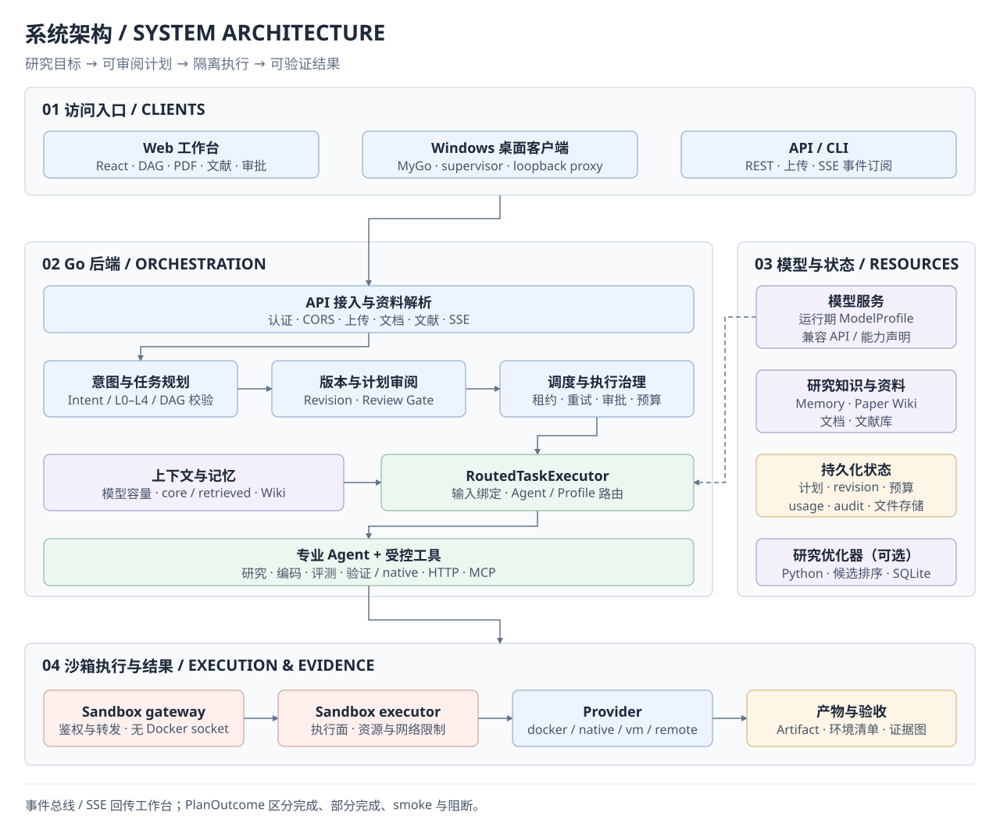
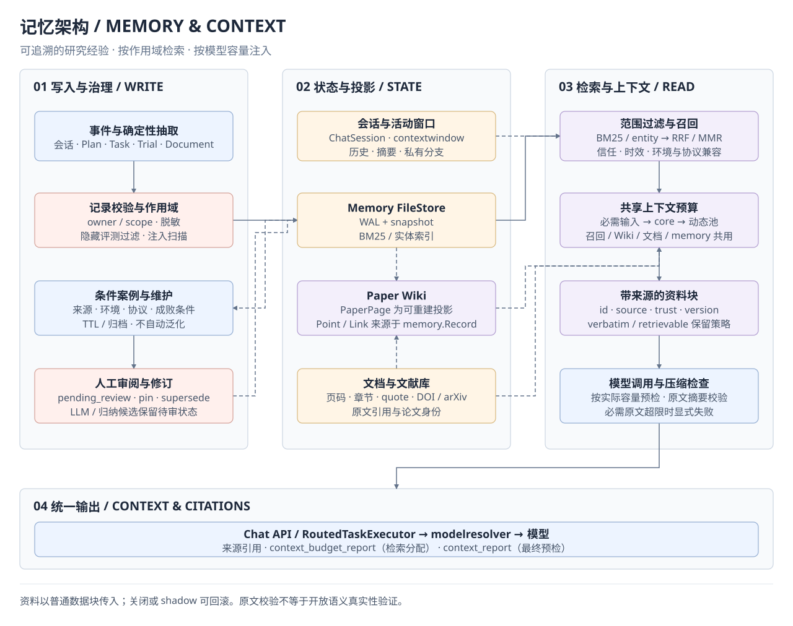
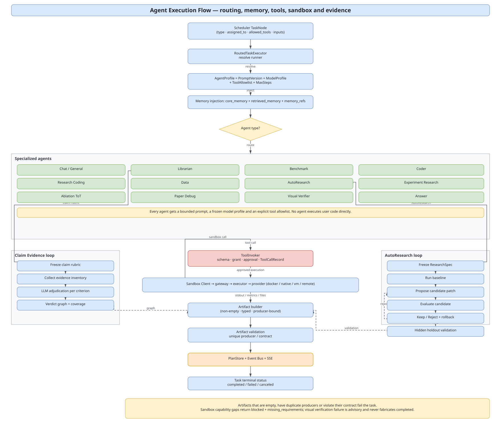

# Research Assistant Agent

**面向论文复现、数据评测与预算受限自动研究的多智能体科研执行系统**

简体中文 | [English](README.en.md) · `v0.9.0` · [MIT License](LICENSE)

科研任务需要可执行、可复现、可验证的结果。Research Assistant Agent 将论文、代码仓库、数据集、运行环境、评测指标与预算约束组织成可审阅的 DAG，在沙箱中执行任务，并以产物、环境清单和证据图交付结果。

> 从研究目标到实验结果：理解上下文 → 生成计划 → 人工审阅 → 隔离执行 → 证据验收。

## 阅读导航

| 阅读目的 | 入口 |
|---|---|
| 了解项目 | [项目能力](#项目能力) · [系统架构](#系统架构) · [Agent 与协作机制](#agent-与协作机制) |
| 开始使用 | [快速开始](#快速开始) · [任务示例](#任务示例) · [桌面客户端](#桌面客户端) |
| 了解实现 | [沙箱与运行时](#沙箱与运行时) · [上下文与记忆](#上下文与记忆) · [工具生态与 MCP](#工具生态与-mcp) |
| 配置与开发 | [配置参考](#配置参考) · [API 参考](#api-参考) · [开发与测试](#开发与测试) |
| 部署与查阅 | [运行边界与安全](#运行边界与安全) · [文档索引](#文档索引) |

## 项目能力

| 方向 | 核心能力 |
|---|---|
| 研究规划 | 论文复现、代码执行、数据评测、AutoResearch 与研究问答；意图识别、L0–L4 复杂度路由、类型化上下文和 DAG 校验 |
| 协作执行 | 按任务路由到 7 类内置执行器或自定义 AgentProfile；依赖调度、受限修复、重试、取消与可选原生工具循环 |
| 实验验收 | 仓库 revision、RuntimeSpec、真实沙箱执行、环境清单、隐藏标签复算、Claim-Evidence 与可复现导出 |
| 记忆管理 | 会话持久化、模型活动窗口、共享检索预算、分层记忆、带来源的经验案例与 Paper Wiki |
| 工具扩展 | native / HTTP / MCP 工具、JSON Schema、权限交集、审批、审计与回放 |
| 任务治理 | 计划库、不可变 revision、人工审阅、结构化提问、预算控制、SSE 工作台与 Windows 桌面外壳 |

系统通过 `PlanOutcome` 区分 `completed / partial / smoke / mock / blocked / failed / needs_review`，并列出缺失条件。轻量 smoke 的结果会按其实际范围标记。

<details>
<summary>展开完整能力清单：研究任务与规划</summary>

| 能力 | 说明 |
|---|---|
| 多类型研究任务 | 论文复现、代码执行、框架对比、数据评测、预算受限 AutoResearch、通用研究问答 |
| 意图识别 | `rule` / `llm` / `hybrid` / `shadow` 四种模式；规则快路径 + 可选 Python 意图服务 + 后校验 |
| 复杂度路由 | L0–L4：L0/L1 走 fast path，L2 标准模板，L3/L4 使用 skeleton + agent planner，并带一次结构化 repair |
| 统一 DAG 规划 | 模板注册表、simple/standard/full 变体、General 的 direct/research/paper/literature 形状、节点契约与 Artifact 校验 |
| 类型化上下文 | `ResearchContext` + `InputBindings` 统一附件、论文元数据、文档、文献库、约束与记忆，避免模板手工拼 Inputs |
| 计划库 | 项目分组、标题/意图搜索、状态/类型过滤、keyset 分页、重命名、归档/恢复、复制、导出与删除 |
| 不可变 revision | 每次编辑生成 r1/r2… 快照；`base_revision` 乐观锁；运行中的计划拒绝编辑/执行新 revision |

</details>

<details>
<summary>展开完整能力清单：执行与验收</summary>

| 能力 | 说明 |
|---|---|
| 专业 Agent 路由 | 按 `assigned_to` 分派到 7 类内置 runner 或自定义 `profile:<id>`；AutoResearch、Experiment、Ablation、Paper Debug、Visual Verifier 等由对应执行器承载 |
| 真实隔离执行 | 通过独立 Go 沙箱服务调用 Docker / Native / VM / Remote Provider；持久工作区、流式日志、产物回传 |
| 运行时审批 | `confirm_important`（默认）在镜像拉取、依赖安装、数据/模型下载、GPU、网络访问前暂停；`full_access` 在边界内自动执行并审计 |
| 论文复现运行时 | RuntimeSpec、镜像/依赖探测、真实安装、`EnvironmentManifest`（镜像 digest、Python/pip freeze、GPU、数据 hash、命令、工作目录） |
| 仓库优先复现 | 发现或使用指定 Git 仓库，固定 revision，生成 RuntimeSpec、安装依赖并执行受控最小/完整实验 |
| 预算受限 AutoResearch | 冻结 ResearchSpec 与指标，在受限文件范围内生成代码补丁或参数候选，真实执行后 Keep/Reject、退化回滚、隐藏 Holdout 复验 |
| 可信 Benchmark | 数据审计、可复现 split、泄漏检查、Metric/Reward 契约、隐藏标签后端重算 |
| 分层候选搜索 | 受限穷举、路线 UCB、Top-K Beam、UCT-style 参数树、Virtual visit 与隐藏 Holdout |
| 逐主张证据 | 冻结分层 Rubric，把论文主张、判定准则与真实 Artifact 绑定为证据图，计算覆盖率 |
| 语义结果状态 | `PlanOutcome` 区分 completed / partial / smoke / mock / blocked / failed / needs_review，并展示缺失项 |
| 等待与阻断语义 | 审批/提问保持 `awaiting_*` 且不连坐后继；`block_info` 记录根因、经手节点与轮次，刷新后仍可解释 |
| 部分成功验收 | 计划可声明 `acceptance`（核心目标 + 必需产物）与 `optional` 工作；仅可选损失时结束为 `completed/partial` 并列出损失 |
| 视觉校验 | 图像结构门禁 + 多模态视觉判定（pass / fail / inconclusive），视觉 fail 不伪造 completed |
| 可复现导出 | `manifest.json` + `checksums.sha256` + `environment/*` + `provenance/*`；缺关键证据时标记 partial 并列出 missing |

</details>

<details>
<summary>展开完整能力清单：记忆、工具与治理</summary>

| 能力 | 说明 |
|---|---|
| Agent 记忆 | 分层记忆（profile/fact/episode/procedure/constraint/negative/document/working/reflection）、BM25 + 实体索引、RRF/MMR、core/retrieved 预算、引用与信任级别、owner 隔离、脱敏与注入扫描 |
| 聊天与上下文 | 服务端 Session + ChatSession + 持久活动窗口；按实际模型容量预检，支持带原文校验的摘要与 citations |
| 计划/任务记忆 | 计划 episode、任务/文档/trial 经验、有执行证据的 procedure 候选，以及保留条件与来源的待审案例汇编 |
| Paper Wiki | 论文页 PaperPage、Point、带证据 Link；W3 自动摘要、W2.5 PDF references、owner 隔离与可重建 |
| 工具注册表 | native / HTTP / MCP stdio / MCP HTTP；JSON Schema 校验、连接测试、schema fingerprint |
| 工具权限 | `AllowedTools` + AgentProfile `ToolAllowlist` + `ToolGrant`；越权返回 `tool_forbidden` 且无副作用 |
| 工具审批与审计 | `SideEffect` 或审批策略触发 `tool_call` RuntimeAction；`ToolCallRecord` 记录参数 hash、结果 hash、耗时、审批 ID；支持 dry-run 与真实回放 |
| AgentProfile / PromptVersion | Prompt 不可变、active 指针回滚、模板渲染、评测；可选原生 `tool_loop`、步数与工具调用上限、持久检查点恢复 |
| 成本与预算 | token / USD / sandbox / download 上限；soft 超限暂停、hard 取消；80% 预警、100% 拒绝；按模型 profile 计价 |
| 可观测性 | Prometheus 指标、结构化审计事件、SSE 计划/节点/日志/Artifact 事件、诊断包与日志轮转 |

</details>

## 系统架构

项目由 **React + TypeScript 工作台、Go 编排后端、独立沙箱服务**组成，Windows 桌面外壳使用 **MyGo**。下面三张图分别说明整体组件、记忆与上下文，以及 Agent 的协作执行方式。

### 系统总览

后端把研究目标转换为 DAG，经计划审阅与预算控制后分派给专业 Agent。实际代码通过沙箱 gateway、executor 与 Provider 执行，最终汇总产物、环境清单与证据，并通过 SSE 回传工作台。模型、研究知识与持久化状态由后端统一管理。



[draw.io 源文件](docs/diagrams/architecture.drawio) · [查看原图](docs/diagrams/architecture.svg)

### 记忆架构

研究事件经作用域与内容校验后写入记忆；Paper Wiki 提供论文知识投影，会话与活动窗口保存当前对话状态。检索结果、Wiki 和文档共享动态上下文预算，以带来源的普通资料块进入模型调用，并保留引用与预算报告。归纳案例保留条件和来源，生成的候选经验需要审阅。



[draw.io 源文件](docs/diagrams/memory-system.drawio) · [查看原图](docs/diagrams/memory-system.svg)

### Agent 架构

`RoutedTaskExecutor` 绑定输入、上下文与模型配置，再按任务选择内置执行器或自定义 `AgentProfile`。专业 Agent 承载阅读、编码、AutoResearch、评测与验证等领域流程；模型、工具与沙箱调用受权限、审批和预算约束，结果经过产物契约与证据验收后写回计划。



[draw.io 源文件](docs/diagrams/agent-execution-flow.drawio) · [查看原图](docs/diagrams/agent-execution-flow.svg)

<details>
<summary>展开分层职责、完整请求路径与设计原则</summary>

### 分层职责

```text
Researcher / Paper / Repository / Dataset
                    │
        ┌───────────┴────────────┐
        │                        │
Windows Desktop (MyGo)      Web Browser / API Client
  ├─ MyGo window            └─ nginx BFF (静态资源 + /api 代理)
  ├─ bridge (mygo.Bind)
  ├─ supervisor (backend.exe / sandbox.exe)
  ├─ loopback proxy (SSE / 上传 / 下载)
  ├─ settings + DPAPI
  ├─ updater + diagnostics
  └─ tray / single instance
        │
        └──────────► React Workbench (embedded or served)
                    │ REST / Upload / SSE
                    ▼
        Go Backend (API + Orchestration)
        ├─ API 层：Auth / CORS / Rate limit / OpenAPI
        ├─ 认知层：Intent Router → Complexity Router → Planner + DAG Validator
        ├─ 治理层：Plan Store / Revision / Review gate / Budget / Audit
        ├─ 调度层：Scheduler (lease / retry / cancel / budget / approval)
        ├─ 执行层：RoutedTaskExecutor → 专业 Agent
        ├─ 记忆层：Memory Store + Retrieval/Injection + Paper Wiki
        ├─ 工具层：ToolRegistry / ToolInvoker (native / HTTP / MCP)
        └─ 事件层：Event Bus → SSE
                    │
                    ▼
        Sandbox Client → docker-sandbox gateway → executor
                    ├─ Docker Provider (容器 / 镜像 / GPU / 网络)
                    ├─ Native Provider (uv CPython + venv + AppContainer/lowil)
                    ├─ VM Provider (WSL2 / Docker in VM)
                    └─ Remote Provider (OpenSandbox)
                    │
                    ▼
        Artifact / EnvironmentManifest / PlanOutcome / Claim-Evidence
                    │
                    ▼
        Event Bus / SSE → React Workbench
```

| 层 | 主要组件 | 职责 |
|---|---|---|
| 客户端层 | Windows 桌面外壳、Web 前端、API/CLI | 输入研究目标、上传资料、查看 DAG、审批、阅读结果 |
| 接入层 | Gin API、认证、CORS、限流、OpenAPI | 统一 REST/SSE 契约、身份与配额 |
| 认知层 | Intent Router、Complexity Router、Planner、DAG Validator | 把意图变成合法、可执行的 PlanGraph |
| 治理层 | Plan Store、Revision Store、Review Gate、Budget、Audit | 计划持久化、版本、审阅、成本与审计 |
| 调度层 | Scheduler、Lease、Runtime Gate、Retry/Cancel | 安全、可恢复地推进 DAG |
| 执行层 | RoutedTaskExecutor、专业 Agent、ToolInvoker | 选择 Agent、注入记忆、调用工具与沙箱 |
| 沙箱层 | gateway、executor、docker/native/vm/remote Provider | 真实隔离执行与能力协商 |
| 状态层 | Plan/Revision/Memory/Upload/Document/Literature/Budget/Audit | 持久化与可回放状态 |
| 外部依赖 | LLM Provider、Research Optimizer、文献数据源 | 模型、候选排序、文献检索 |

### 一次请求的完整路径

1. **输入与上下文**：用户输入目标、上传 PDF/CSV/仓库链接；后端解析 `AttachmentRef` / `DocumentRef` / `PaperMetadata`，写入 `ResearchContext`，并检索相关记忆。
2. **意图与复杂度**：Intent Router 输出意图类型与置信度；Complexity Router 在上下文解析后做 L0–L4 最终路由，选择模板变体或 agent planner。
3. **计划生成**：PlanBuilder 生成节点、依赖、`assigned_to`、`InputBindings` 与 Artifact 契约；DAG Validator 校验无环、依赖存在、producer 唯一、关键节点完整。
4. **revision 与审阅**：计划写入 Plan Store 并生成 revision；满足审阅门（`PLAN_REVIEW_MODE=always`、成本阈值、高风险节点、缺需求、L4）时进入 `awaiting_review`，用户可编辑、校验、diff、批准或拒绝。
5. **执行**：Scheduler 计算入度、派发就绪节点、获取租约；运行时审批门在镜像/依赖/GPU/网络等操作前生成 `RuntimeActionRequest`。
6. **Agent 执行**：RoutedTaskExecutor 解析 AgentProfile（PromptVersion + ModelProfile + ToolAllowlist + MaxSteps），解析当前资料并按共享额度注入 core / retrieved memory，调用 Agent；Agent 通过 ToolInvoker 调用工具或通过 Sandbox Client 执行代码。
7. **沙箱执行**：gateway 鉴权转发；executor 选择 Provider；Provider 按 `Capabilities` 执行并回传 stdout/stderr/用量/产物；能力不足时返回结构化 `blocked`。
8. **验收**：Artifact 校验（非空、类型、producer 绑定）；PlanFinalizer 汇总节点状态、EnvironmentManifest、TrialLedger、Claim-Evidence，产出 `PlanOutcome`；记忆写入计划/任务/trial 经验。
9. **回传**：事件总线持久化并推送到 SSE；前端更新 DAG、执行侧栏、证据图与结果面板；计划可导出为可复现包。

### 设计原则

- **真实执行**：代码、命令、依赖安装和评测在沙箱中运行，最终指标绑定执行证据。
- **如实报告**：资源或能力不足时给出 `blocked` 与 `missing_requirements`；smoke、partial 与完整完成分别标记。
- **证据优先**：论文主张关联可定位的 Artifact、页码、章节或运行记录。
- **受控执行**：Compose 默认断网，配合镜像 allowlist、资源上限、租约与重要操作审批；本地部署需核对实际网络配置。
- **可回滚**：计划 revision、记忆注入开关、Prompt 版本、模型 profile 与工具授权支持显式回滚或撤销。

</details>

## 快速开始

先选择运行方式。三种方式使用同一套 React 工作台与 Go 后端。

| 方式 | 适合谁 | 前置条件 |
|---|---|---|
| [Docker Compose](#docker-compose) | 希望启动完整服务栈、在服务器上部署的用户 | Git、Docker Engine 20.10+、Compose v2 |
| [Windows 桌面客户端](#windows-桌面客户端) | 希望在个人电脑上使用、无需先配置 Docker 的用户 | Windows 10/11、WebView2 Runtime、已构建的安装包 |
| [源码开发](#源码开发) | 调试或扩展项目的开发者 | Go 1.27.3、Node.js 22+、Make；执行容器任务时需 Docker |

研究优化器、可选意图识别服务及 Python 测试另需 Python 3.12。

模型配置需要可用的 API Key、服务地址、模型名称，以及该部署实际支持的上下文容量。默认接入兼容 Chat Completions 的模型服务；其他协议与能力配置见[模型配置说明](docs/design/runtime-model-config-and-visual-verification.md)。

### Docker Compose

**1. 准备配置文件**

克隆本仓库后，从仓库根目录执行：

```bash
cd research-assistant
cp .env.example .env
cp backend.env.example backend.env
```

**2. 填写配置**

| 文件 | 需要设置的内容 |
|---|---|
| `.env` | 将 `SANDBOX_API_TOKEN`、`RESEARCH_OPTIMIZER_API_TOKEN`、`API_AUTH_TOKEN` 分别替换为随机密钥 |
| `backend.env` | 填写 `OPENAI_API_KEY`、`OPENAI_BASE_URL`、`OPENAI_MODEL_NAME`、`MODEL_CONTEXT_WINDOW_TOKENS`；上下文容量按实际模型部署填写 |

使用设置页保存模型配置时，在 `.env` 中设置自己的 `MODEL_PROFILE_ENCRYPTION_KEY`（建议使用 32 字节随机值的 Base64 编码）；不使用时将该项留空。`ADMIN_TOKEN` 用于管理全局模型配置，启用时也需替换占位值。

Compose 会统一注入内部服务地址与认证 Token；这些值以 `.env` 和编排文件为准。模板中的模型地址、名称和密钥均需根据自己的部署检查。

**3. 启动并检查**

在 `research-assistant/` 目录运行：

```bash
docker compose up --build -d
curl http://localhost:8080/api/health
```

打开 **[研究工作台](http://localhost:5173)**。默认后端地址为 [http://localhost:8080](http://localhost:8080)，健康检查无需 Bearer Token。检查响应中的 `backend`、`repository`、`sandbox` 与 `research_optimizer` 是否正常。

<details>
<summary>服务端口与常用运维命令</summary>

端口可通过 `.env` 中的 `*_HOST_PORT` 覆盖；默认只绑定本机回环地址。

| 服务 | 默认宿主端口 |
|---|---|
| Web 工作台 | `5173` |
| Backend API | `8080` |
| Sandbox gateway | `8082` |
| Research Optimizer | `8090` |

```bash
docker compose ps
docker compose logs -f
docker compose down
```

更多部署与配置说明见[产品主实现](research-assistant/README.md)。

</details>

### Windows 桌面客户端

桌面外壳负责启动后端与沙箱，并提供托盘、设置、诊断和更新能力。

1. 运行已构建的 `ResearchAssistant-0.9.0-Setup.exe`。默认构建输出位于 `desktop/dist/`；构建方法见[桌面打包说明](desktop/build/README.md)。
2. 首次启动填写模型服务地址、模型名称和 API Key，并在模型设置中确认上下文容量。
3. 在「设置 → 运行模式」选择 Sandbox Provider。`auto` 会优先使用 Docker；Docker 不可用且 native 可用时使用 native。
4. 新建对话，输入研究目标或上传资料，选择运行权限后发送。

无 Docker 的 native 模式适合纯 Python 任务；系统级依赖、特定镜像或 GPU 环境需要对应 Provider 支持。详细能力与数据目录见[桌面客户端](desktop/README.md)和[沙箱说明](research-assistant/docker-sandbox/README.md)。

### 源码开发

<details>
<summary>展开本地启动步骤（Linux / macOS）</summary>

从仓库根目录执行：

```bash
cd research-assistant
cp backend.env.example backend.env
make install
```

按上面的模型配置补全 `backend.env`，并设置随机 `SANDBOX_API_TOKEN`。后端与沙箱启动脚本都会读取此文件。若不启动可选 Python 服务，将 `RESEARCH_OPTIMIZER_URL`、`INTENT_SERVICE_URL` 留空，并设置 `INTENT_ROUTER_MODE=rule`。

分别在三个终端执行，工作目录均为 `research-assistant/`：

```bash
make run-sandbox     # 终端 1
make run-backend     # 终端 2
make run-frontend    # 终端 3
```

如需研究优化器，可另行启动 `make run-optimizer`，并配置相应 URL 与 Token。Windows 本地使用优先选择桌面客户端或 Compose；平台限制与脚本参数见[启动脚本说明](research-assistant/scripts/README.md)。

</details>

## 任务示例

### 论文复现

在 Web UI 或桌面端输入：

```text
请使用 https://github.com/harvardnlp/annotated-transformer 复现
Attention Is All You Need，使用 smoke 模式运行轻量注意力消融，
不要执行 WMT14 完整训练。
```

发送前选择「重要操作需确认」或「完全权限」。系统会生成并执行“解析论文 → 冻结主张 Rubric → 检索仓库 → 准备工作区 → 解析依赖 → 生成 RuntimeSpec → 探测 sandbox 能力 → 准备镜像 → 准备运行时 → 安装依赖 → 校验运行时/写 EnvironmentManifest → 执行实验 → 对比论文声明 → 主张证据图”的主链。

### 自有数据评测

上传 CSV/TSV/JSON/JSONL 后输入：

```text
用 https://github.com/OWNER/REPOSITORY 跑 benchmark，
输入列是 review，标签列是 label，最多运行 500 条样本。
```

Benchmark Agent 会审计列映射、生成泄漏安全的 train/validation/test 划分、冻结 Metric/Reward 契约，并在模型不可见的隐藏标签上重算最终指标。

### 预算受限 AutoResearch

```text
用 https://github.com/OWNER/REPOSITORY 做 AutoResearch，
按 autoresearch.json 运行，最多 3 轮，总时长不超过 15 分钟，最终验证 3 次。
```

系统冻结 ResearchSpec 与仓库 revision，在受限文件范围内生成候选，按真实指标执行 Keep/Reject、退化回滚与隐藏 Holdout 复验。

## Agent 与协作机制

系统采用**基于 DAG 的集中编排式多 Agent 架构**。Planner 拆分任务，Scheduler 按依赖与并发额度推进节点，`RoutedTaskExecutor` 解析输入和上下文后按 `assigned_to` 选择执行器。跨任务结果通过 Artifact、InputBindings、事件和带来源的记忆引用衔接。

### 内置执行器

当前可独立路由的内置 runner 有 7 类；`sandbox_agent` 复用 Coder runner。

| Runner | 路由标识 | 主要职责 |
|---|---|---|
| Chat / General | `general_agent` | 通用问答、范围澄清、轻量研究任务与综合回答 |
| Librarian | `librarian_agent` | 论文解析、资料检索、文献导入、论文主张与 Rubric 提取 |
| Coder | `coder_agent` / `sandbox_agent` | 代码生成、绘图、镜像与运行时准备、依赖安装、代码执行与受限修复 |
| Research Coding | `research_coding_agent` | 仓库准备、论文代码执行、Benchmark Adapter、实验与 AutoResearch 循环 |
| Benchmark | `benchmark_agent` | 数据审计、split、泄漏检查、Metric/Reward 契约与评测验证 |
| Data | `data_agent` | 指标分析、论文对照、证据图、报告、消融设计与视觉验证编排 |
| Answer | `answer_agent` | 面向用户的最终回答合成与引用整理 |

### 领域流程与验证能力

这些能力由对应 runner 承载，执行边界按任务类型区分。

| 能力 | 承载位置 | 任务或机制 |
|---|---|---|
| AutoResearch | Research Coding | `autoresearch_spec` / `autoresearch_run` / `autoresearch_validate`；冻结目标、Keep/Reject、回滚、Holdout |
| Experiment Research | Research Coding | `experiment_spec` / `experiment_run` / `experiment_validate`；配置搜索与领域 Adapter |
| Paper Debug | Research Coding 的论文执行流程 | 调试状态机、受限补丁与执行验证 |
| Ablation ToT | Data | `ablation_design`；受限 Tree-of-Thoughts 消融设计 |
| Visual Verifier | Data 调用的验证组件 | `verify_result`；结构门禁与多模态 pass / fail / inconclusive 判定 |

### 自定义 Agent 与恢复

`profile:<id>` 路由到 ProfileRunner，配置由 `PromptVersion + ModelProfile + ToolAllowlist + MaxSteps` 等字段组成。可选 `execution_mode=tool_loop` 提供原生工具调用循环、持久检查点、步数与工具调用上限；需要模型明确支持工具调用。

分类恢复、局部修复与外层重试共享恢复额度。修复经验只有在环境、协议和执行证据满足要求时才作为 procedure 候选；检索、采用、执行、验证分别记录，避免把“引用过某条经验”计作修复成功。

实现入口：[Agent](research-assistant/backend/internal/agent/README.md) · [任务路由](research-assistant/backend/internal/scheduler/executor.go) · [AgentProfile](research-assistant/backend/internal/agentprofile/runner.go)。

## 沙箱与运行时

### Provider 矩阵

沙箱服务把执行能力抽象为统一 `Provider` 接口，由 `SANDBOX_PROVIDER` 选择；`auto` 优先使用 Docker；Docker 不可用且 native 可用时选择 native。显式指定不可用 Provider 时返回能力/健康错误。

| Provider | 隔离级别 | 镜像/环境 | 网络控制 | GPU | 适用场景 |
|---|---|---|---|---|---|
| `docker` | 容器（container） | OCI 镜像 + digest | 容器级（默认离线） | NVIDIA runtime 透传 | 服务端、已有 Docker、需要镜像级复现 |
| `native` | 进程（AppContainer / lowil / Job Object） | uv 管理的 CPython + 每计划 venv | AppContainer 双 profile（离线/在线） | 依赖宿主环境与探针结果 | Windows 桌面、零 Docker 起步、纯 Python 任务 |
| `vm` | 虚拟机（WSL2 等） | 自带 Docker Engine / OCI | VM 网络 | VM 内 GPU（视配置） | 无 Docker Desktop 但需要完整 OCI 语义 |
| `remote` | 远程沙箱服务 | 由服务方提供 | 由服务方提供 | 由服务方提供 | GPU、大内存、长时间任务 |

Provider 通过 `GET /api/v1/capabilities` 返回真实能力矩阵（镜像、网络、GPU、Python 版本、探针结果）。任务需要的能力不满足时，系统返回 `blocked` + `missing_requirements=[sandbox_capability]`，并给出可操作建议，而不是静默降级。

### 运行时链

论文复现主链：

```text
reproduction_spec -> runtime_probe -> image_prepare -> prepare_runtime
-> install_dependencies -> runtime_validate -> paper_code_execute
```

- `runtime_validate` 输出 `EnvironmentManifest`：镜像 digest（或 native runtime hash）、Python/pip freeze、GPU、数据 hash、运行命令与工作目录。
- 完整复现资源不足时不会用 smoke 冒充成功；`outcome` 明确标记 `smoke`、`partial` 或 `blocked`。
- 运行时权限只决定“是否自动执行重要操作”，不会绕过镜像 allowlist、资源上限、沙箱隔离或计划所有权检查。

### 安全边界

- Compose 中 gateway 不挂载 Docker socket、不挂载宿主工作区；只有不发布端口的内部 executor 持有 socket。
- Compose 默认 `SANDBOX_NETWORK_MODE=none`；本地启动遵循实际环境配置，模板中的网络设置需单独核对。网络操作受运行权限与审批策略控制。
- 默认限制 CPU、内存、PID、capability、镜像 allowlist、挂载路径与 TTL；`strict` 档启用非 root、只读 rootfs 与 tmpfs。
- native Provider 使用 AppContainer / lowil + Job Object 限额；隔离强度低于容器，建议保持 `confirm_important`，不要对不可信代码使用 `full_access`。
- 桌面 API Key 以 Windows DPAPI 密文保存在 `secrets.dat`，子进程通过环境变量接收运行期凭据；命令行与诊断导出中避免暴露明文密钥。

## 上下文与记忆

研究记忆由两层组成，并与会话状态和模型活动窗口协同：

- **分层 Memory（M0–M3）**：负责可复用经验的存储、检索与注入；
- **Paper Wiki（W0–W3 + W2.5）**：在 memory 之上提供以论文为单位的科研知识读模型（PaperPage / Point / Link）。

Memory 与 Paper Wiki 共享 owner 隔离、trust/status 生命周期、token 预算与安全边界。会话历史与活动窗口另行持久化；记忆写入和注入可通过开关关闭或进入 shadow 模式。

### 记忆类型

| 类型 | 内容 |
|---|---|
| `profile` | 用户偏好、研究领域、输出风格 |
| `fact` | 论文元数据、指标、环境事实 |
| `episode` | 一次计划/任务的经过与结论 |
| `procedure` | 带环境、协议与执行证据的条件化步骤；新候选通常需要审阅 |
| `constraint` | provider、镜像、Python、GPU、网络等环境约束 |
| `negative` | 复现失败、候选被拒、不可行路径 |
| `document` | 文档页数、章节、解析状态与引用 |
| `working` | 当前会话的短期工作记忆 |
| `reflection` | 保留成败条件与来源的案例汇编（默认 pending_review，不自动晋升通用方法） |

### 写入管道

| 触发 | 写入内容 |
|---|---|
| 聊天轮次 | `ChatSessionStore` 保存 user/assistant 轮次、摘要与裁剪窗口 |
| 计划创建/终态 | `RecordPlan` 生成 plan episode、paper metadata fact、environment constraint、negative；取消路径同样补写 |
| 任务完成/失败 | `RecordTask` 保存任务经验；有验证过的修复动作时生成 procedure 候选 |
| AutoResearch trial | 被拒/失败候选形成 negative；kept 候选按自身独立执行次数、补丁、协议与环境证据生成 episode 或待审 procedure |
| 文档解析 | `RecordDocument` 保存页数、章节、解析状态与引用 |
| 用户编辑 | user_note / user_explicit 记忆 |
| Paper Wiki W3 | LLM 生成 TLDR、method / limitation / open_question 摘要，默认 `pending_review` |
| Paper Wiki W2.5 | 解析 PDF References，生成 `cites` Link 候选（默认关闭） |

所有写入先经过 `ValidateRecord`：owner 必填、secret/私钥/大 base64 拒绝、hidden benchmark 拒绝、Refs quote ≤500 字并做 injection 扫描。

### 检索与共享预算

- **索引与召回**：中英混合 tokenizer（CJK bigram）、BM25、实体 / kind / status 倒排；RRF 融合、trust / importance / recency / confidence / scope 加权，以及归一化 MMR 去冗余。
- **作用域**：owner、项目、会话、计划、Agent 与状态过滤贯穿检索；修复记忆还检查环境和协议兼容。固定双语别名覆盖部分科研术语，当前主路径为 BM25 / 实体 / 规则检索。
- **共享额度**：聊天与 DAG 共用 `ResolveContextBudget`。实际模型输入额度先预留必需任务数据，再分配 core 额度与动态 retrieved 池；历史召回、Wiki、文档与检索记忆共同消耗动态池。
- **Wiki 与文档**：`BudgetTokens()` 保留 2% 目标 / 3% 上限等默认策略；调用方还会传入共享池额度。最终注入量同时受剩余额度、owner 设置与模型预检约束，不能仅凭固定百分比推断。
- **引用与诊断**：保留 memory / wiki / document 来源，记录召回、排序与预算排除原因。`context_budget_report` 说明检索分配，`context_report.materials` 说明最终选择，两者需结合查看。

### 资料边界与模型活动窗口

当前资料通过 `contextwindow.Material` 传递，记录 `id / kind / source / trust / version / retention`。记忆、历史召回、Wiki 与文档以普通 user 数据块进入调用，资料与持久聊天历史分离，新检索替换当前资料。

| 保留策略 | 运行行为 |
|---|---|
| `verbatim` | 必需原文完整保留；无法装入窗口时显式失败 |
| `retrievable` | 可重新检索的资料按整块选择；预算不足时可以舍弃，并记录最终选择 |

模型活动窗口按 ModelProfile 的真实上下文容量计算，预留输出和协议开销；环境模型需显式设置 `MODEL_CONTEXT_WINDOW_TOKENS`（兼容 `PROMPT_CONTEXT_WINDOW`），没有隐式 128k 容量回退。Chat Completions 可使用文本摘要；Responses 与原生压缩需要相应能力声明和服务端支持。

文本摘要采用 `context.summary/v1`，从原始历史校验完整原句、来源、关键数值、否定和更正，并保留原文锚点。摘要无效且仍有容量时回退原历史；必需资料无法容纳时显式失败。这是原文依据校验，不构成开放语义真实性保证。

### 经验归纳与修复记忆

Consolidator 执行 TTL / 归档与确定性案例汇编，不在后台调用 LLM。案例按完整 Scope 分组，保留问题、动作、环境、协议、结果、原文与来源；新 reflection 为 `TrustInferred / pending_review`，`generalization=not_established`。

procedure 使用阶段分别记录 `retrieved / adopted / executed / verified`，独立执行身份用于去重。检索命中或被模型提及不等于验证成功；新 procedure 的自动激活由 `MEMORY_PROCEDURE_PROMOTION` 等显式策略控制，默认关闭。

### Paper Wiki

Paper Wiki 不建第二套事实源：**PaperPage 是可删除、可重建的投影缓存，Point 和 Link 都是 `memory.Record` 的视图**。

| 概念 | 说明 |
|---|---|
| PaperPage | 论文页：标题/作者/年份/venue/DOI/arXiv、TLDR、章节地图、Point/Link id、复现状态、revision |
| Point | 原子记忆点：claim / method / result / limitation / task / procedure / negative / open_question / user_note / constraint |
| Link | 带证据的跨论文关系：cites / extends / contradicts / uses_same_dataset / uses_same_method / same_repo / reproduces / related / supersedes |

- **身份**：DOI > arXiv > 规范化标题+年份；`paper_id` 含 owner 哈希，alias 表按 owner 分区，支持多对一合并。
- **W3 自动摘要**：`WIKI_LLM_MODE` 为 `summary` 或 `all` 时自动生成 TLDR 与摘要 Point；严格 JSON，解析失败最多重试 2 次；所有 quote 必须通过 `documents.LocateQuote`，失败则丢弃 quote 并保持 `pending_review`。
- **W2.5 PDF references**：`WIKI_PDF_REFS=true` 时解析 PDF References，与已知 PaperPage 按 DOI/arXiv/标题匹配，生成 `cites` Link；默认关闭。
- **可重建**：重建时，PaperPage 从 memory 的 paper/document fact 恢复，Point/Link 从 memory 恢复，用户 confirm/reject 决策保留；TLDR 持久化为 `wiki_tldr` memory 记录，重建不重新调用 LLM。
- **治理**：LLM-only Point/Link 默认 `pending_review`；Link 支持 confirm/reject、revision、supersede；Point 支持 pin、编辑、软删除与 point_key supersede。

### 开关与回滚

<details>
<summary>展开 Memory / Paper Wiki 配置与默认值</summary>

| 变量 | 默认 | 说明 |
|---|---|---|
| `MEMORY_ENABLED` | `true` | `false` 时完全不初始化、不注入、不写入 |
| `MEMORY_MODE` | `on` | `shadow` 只检索不注入，便于 A/B |
| `MEMORY_DIR` | `<PLAN_STORE_PATH 目录>/memory` | 独立记忆目录，便于隔离实验 |
| `MEMORY_CONSOLIDATE_INTERVAL_SECONDS` | 空（关闭） | 后台 consolidation 周期；`0` 关闭 |
| `WIKI_ENABLED` | `true` | `false` 时不注册 wiki 路由、不写、不注入 |
| `WIKI_MODE` | `on` | `shadow` 只构建不注入 |
| `WIKI_DIR` | `<PLAN_STORE_PATH 目录>/wiki` | Paper Wiki 投影目录 |
| `WIKI_LLM_MODE` | `summary` | `off\|summary\|links\|all`：TLDR/摘要与 Link 裁决开关 |
| `WIKI_LINK_MODE` | `explicit` | `explicit\|hybrid\|llm`（W4 语义消融预留） |
| `WIKI_PDF_REFS` | `false` | 是否解析 PDF References 生成 cites |
| `WIKI_BUDGET_TOKENS` | 空 | Wiki 预算覆盖；仍受调用方共享池与最终模型容量限制 |
| `DOCUMENT_CONTEXT_BUDGET_TOKENS` | `1200` | Wiki 关联文档额度；实际还受共享池限制，`0` 关闭 |
| `MEMORY_PROCEDURE_PROMOTION` | `false` | 是否启用符合要求的 procedure 候选自动激活 |

</details>

前端「设置 → 记忆」提供列表、搜索、新建、pin、删除、设置与导出/导入；「设置 → 论文」提供 PaperPage 列表、Point 分组、Link 确认/拒绝与重建；计划详情展示本次使用的记忆引用。

## 工具生态与 MCP

工具通过统一注册表和调用器接入，具有 schema、权限、审批与审计记录。

- **注册表**：`GET/POST /api/tools`、`GET/PUT/DELETE /api/tools/:id`、`POST /api/tools/:id/test`、`GET /api/tools/:id/schema`；支持 native / HTTP / MCP stdio / MCP HTTP。
- **MCP 接入**：注册时执行 `initialize` + `tools/list`，保存 schema fingerprint；MCP HTTP 默认拒绝私网，需显式 allowlist。
- **权限边界**：执行期强制节点 `AllowedTools`、AgentProfile `ToolAllowlist` 与 `ToolGrant`；越权返回 `tool_forbidden` 且无副作用。
- **审批**：`SideEffect=true` 或 `Approval=always/write` 的工具在 dispatch 前创建 `tool_call` RuntimeAction；拒绝不调用，批准后执行并关联 `ApprovalID`。
- **审计/回放**：每次调用写入 `PlanGraph.ToolCalls`（参数 hash、结果 hash、耗时、审批 ID、错误码）；`GET /api/plans/:id/tool-calls`、`POST .../tool-calls/:callId/replay` 支持 dry-run hash 对比与需审批的真实重放。
- **AgentProfile/PromptVersion**：`AgentProfile = PromptVersion + ModelProfile + ToolAllowlist + MaxSteps`；Prompt 不可变、active 指针回滚。可选 `execution_mode=tool_loop` 由 ProfileRunner 执行原生工具循环，持久化步骤与检查点，受模型能力、步数和调用上限约束。

文献检索与 Paper Wiki 已有独立实现。N-14 文献 MCP / Skill 生态仍是[设计草案](docs/design/n14-literature-mcp-skill-ecosystem.md)，不应将草案中的全部扩展列为已实现能力。

## 桌面客户端

Windows 桌面客户端是 0.9.0 的首发交付形态，位于 `desktop/`（独立 Go module）。

### 组成

| 包 | 职责 |
|---|---|
| `desktop/paths` | 每用户安装/数据/日志目录 |
| `desktop/settings` | `settings.json`、环境变量注入、DPAPI 密钥存储 |
| `desktop/supervisor` | 单实例锁、OS 分配端口、子进程启动与健康检查、Windows Job Object 回收 |
| `desktop/proxy` | 固定 loopback origin 的反向代理，SSE `FlushInterval=-1`，Host/Origin 守卫与 SPA 回退 |
| `desktop/shell` | settings → 端口 → token → supervisor → proxy 编排、崩溃重启、`/desktop/state` / `diagnostics` / `retry` 与错误页 |
| `desktop/diagnostics` | 脱敏诊断包（日志尾部、设置、健康、系统信息、失败计划） |
| `desktop/updater` | `latest.json` 检查、semver 比较、SHA-256 + Ed25519 校验、分阶段下载 |
| `desktop/onboarding` | 首次启动状态、凭据校验与最小完成测试 |
| `desktop/bridge` | `mygo.Bind` 暴露的桌面 API；Wails 回退仍暴露 `window.go.main.API` |
| `desktop/mygo` | MyGo 适配层（托盘、对话框、通知、Shell），业务只依赖这一层 |
| `desktop/tray` | 托盘/通知契约（MyGo 驱动、systray 回退、测试用 memory 驱动） |

### 运行目录

```text
%LOCALAPPDATA%\Programs\ResearchAssistant\   ResearchAssistant.exe backend.exe sandbox.exe uv.exe
%LOCALAPPDATA%\ResearchAssistant\            settings.json secrets.dat lock data\ runtimes\ workspaces\ logs\
```

### 构建

构建需要 Go 1.27.3、Node.js 22+ 与 `PATH` 中的 NSIS `makensis`。从仓库根目录执行：

```powershell
npm --prefix research-assistant/frontend ci
powershell -ExecutionPolicy Bypass -File desktop/build/build.ps1 -Version 0.9.0
```

纯逻辑测试与 Windows 交叉构建见[开发与测试](#开发与测试)；打包选项见[构建指南](desktop/build/README.md)。

默认入口为 `desktop/main_mygo.go`（build tag `!wails && !headless`）；Wails 回退为 `-tags "desktop wails"`；headless stub 为 `-tags headless`。构建产物默认写入 `desktop/dist/ResearchAssistant-<version>-Setup.exe`。

### 更新与诊断

- `RA_UPDATE_ENDPOINT` + `RA_UPDATE_PUBLIC_KEY` 启用签名更新；安装包与更新清单使用 SHA-256 + Ed25519。
- 崩溃转储通过 WER LocalDumps 注册到 `%LOCALAPPDATA%\ResearchAssistant\crashes`。
- 「导出诊断」生成脱敏 zip，包含日志、设置（密钥已脱敏）、健康检查与失败计划摘要。

## 配置参考

模型端点、协议、上下文容量、输出预留与压缩策略应作为同一个部署配置核对。ModelProfile 的原生 Responses / 工具调用 / 压缩能力需要显式确认。

完整变量见 [backend.env.example](research-assistant/backend.env.example)、[docker-compose.yml](research-assistant/docker-compose.yml) 与 [backend/README.md](research-assistant/backend/README.md)。常用项按用途分组：

### LLM 与模型

<details>
<summary>展开配置项</summary>

| 变量 | 必填 | 说明 |
|---|---:|---|
| `OPENAI_API_KEY` | 是 | 兼容服务的 API 密钥 |
| `OPENAI_BASE_URL` | 否 | API Base URL；未设置时使用部署默认值 |
| `OPENAI_MODEL_NAME` | 否 | 模型名称；请核对实际部署与模板默认值 |
| `MODEL_CONTEXT_WINDOW_TOKENS` / `PROMPT_CONTEXT_WINDOW` | 环境模型必填 | 实际上下文容量；后者为兼容旧变量，没有隐式 128k 回退 |
| `PROMPT_MAX_OUTPUT_TOKENS` / `PROMPT_SAFETY_TOKENS` | 否 | 输出与安全预留；输出预算必须小于上下文容量 |
| `CONTEXT_STORE_DIR` / `AGENT_RUN_STORE_DIR` | 否 | 模型活动窗口与可选工具循环检查点的私有持久目录 |
| `MODEL_PROFILE_DIR` / `MODEL_PROFILE_ENCRYPTION_KEY` | 否 | 运行期模型 profile 存储与加密；未配置密钥时禁止保存 profile |
| `ADMIN_TOKEN` | 否 | 可创建/修改全局模型 profile 的运营 Token |
| `LLM_MAX_ATTEMPTS` / `LLM_ATTEMPT_TIMEOUT_SECONDS` / `LLM_RETRY_BASE_MS` / `LLM_RETRY_MAX_MS` | 否 | LLM 重试与超时 |

</details>

### 意图与规划

<details>
<summary>展开配置项</summary>

| 变量 | 说明 |
|---|---|
| `INTENT_SERVICE_URL` | 可选意图服务地址；为空时只使用规则路由 |
| `INTENT_ROUTER_MODE` | `rule` / `llm` / `hybrid` / `shadow`；Compose 默认 `hybrid` |
| `INTENT_LLM_CONFIDENCE_THRESHOLD` | 模型结果最低置信度，低于阈值回退规则（默认 0.65） |
| `INTENT_CLIENT_TIMEOUT_SECONDS` | 调用意图服务的单次超时秒数 |
| `GENERAL_PLAN_FAST_PATH` | 默认 `true`：General 按 direct/research/paper/literature 形状生成 |
| `COMPLEXITY_ROUTER_ENABLED` | 默认 `true`：启用 L0–L4 复杂度路由 |
| `PLANNER_MAX_NODES_L3` / `PLANNER_MAX_NODES_L4` | agent planner 在 L3/L4 的节点上限（默认 16 / 24） |

</details>

### 沙箱与运行时

<details>
<summary>展开配置项</summary>

| 变量 | 说明 |
|---|---|
| `SANDBOX_URL` / `SANDBOX_API_TOKEN` | 沙箱地址与 Bearer Token；gateway/executor 均 fail-closed |
| `SANDBOX_PROVIDER` | `auto` / `docker` / `native` / `vm` / `remote` |
| `SANDBOX_DEFAULT_IMAGE` / `SANDBOX_IMAGE_ALLOWLIST` | 默认运行时镜像与允许的镜像前缀 |
| `SANDBOX_NETWORK_MODE` / `SANDBOX_ALLOW_NETWORK` | 网络模式与是否允许审批后联网；Compose 默认 `none`，本地环境模板需单独检查 |
| `SANDBOX_SECURITY_PROFILE` | `standard` / `strict`（非 root + 只读 rootfs + tmpfs） |
| `SANDBOX_WINDOWS_RUNNER` | `auto` / `appcontainer` / `lowil` / `raw`（native Provider） |
| `SANDBOX_DEFAULT_PYTHON` | native Provider 默认 Python 版本 |
| `SANDBOX_WORKSPACE_ROOTS` | 允许挂载的工作区根目录 |
| `SANDBOX_TTL_MINUTES` / `SANDBOX_REAPER_INTERVAL_SECONDS` | 沙箱最长存活时间与回收扫描间隔 |
| `OPEN_SANDBOX_URL` / `ENABLE_OPENSANDBOX_FALLBACK` | OpenSandbox 地址与 fallback 开关 |

</details>

### 存储与记忆

<details>
<summary>展开配置项</summary>

| 变量 | 说明 |
|---|---|
| `PLAN_STORE_PATH` | 计划快照目录（`<path>.d`）与 JSONL 索引/事件日志的基准路径 |
| `REVISION_STORE_PATH` | 不可变 revision 存储；默认 `<PLAN_STORE_PATH>.revisions.json` |
| `UPLOAD_ROOT` / `UPLOAD_MAX_MB` | 上传目录与单文件大小限制 |
| `UPLOAD_USER_QUOTA_MB` / `UPLOAD_MAX_FILES` / `UPLOAD_TTL_DAYS` | 每用户配额、文件数上限与保留天数 |
| `BLOB_STORE_PATH` | Artifact 内容寻址存储 |
| `MEMORY_ENABLED` / `MEMORY_MODE` / `MEMORY_DIR` | 记忆开关、模式与目录 |
| `MEMORY_CONSOLIDATE_INTERVAL_SECONDS` | 后台 consolidation 周期；空或 `0` 关闭 |
| `MEMORY_PROCEDURE_PROMOTION` | procedure 候选自动激活策略，默认 `false` |
| `WIKI_ENABLED` / `WIKI_MODE` / `WIKI_DIR` | Paper Wiki 开关、模式与投影目录 |
| `WIKI_LLM_MODE` / `WIKI_LINK_MODE` / `WIKI_PDF_REFS` / `WIKI_BUDGET_TOKENS` | 摘要/Link 裁决/PDF references/预算覆盖 |
| `DOCUMENT_CACHE_DIR` / `LITERATURE_CACHE_DIR` / `LITERATURE_LIBRARY_DIR` | 文档缓存、文献缓存与文献库 |
| `PROJECT_STORE_PATH` / `BUDGET_STORE_PATH` | 计划项目与成本台账；默认在 `PLAN_STORE_PATH` 旁生成 |

</details>

### 审批、预算与安全

<details>
<summary>展开配置项</summary>

| 变量 | 说明 |
|---|---|
| `API_AUTH_TOKEN` / `REQUIRE_API_AUTH` | API 静态 Bearer；Compose 强制 `REQUIRE_API_AUTH=true`，Token 为空时 fail-closed |
| `CORS_ALLOWED_ORIGINS` | 允许访问后端的前端 Origin 列表 |
| `APPROVAL_TIMEOUT_SECONDS` | 运行时审批窗口 |
| `REQUIRE_PLAN_APPROVAL` / `PLAN_REVIEW_MODE` / `REVIEW_COST_THRESHOLD_USD` | 计划审批与审阅门 |
| `QUESTION_TIMEOUT_SECONDS` | 结构化提问默认超时（默认 900 秒） |
| `PLAN_MAX_COST_USD` / `PLAN_MAX_TOKENS` / `PLAN_MAX_SANDBOX_SECONDS` / `PLAN_MAX_DOWNLOAD_BYTES` / `PLAN_BUDGET_POLICY` | 计划级预算；soft / hard（默认 soft） |
| `PLAN_MAX_TASK_ATTEMPTS` / `PLAN_MAX_DURATION_SECONDS` | 任务尝试次数与时长预算 |
| `AGENT_CLASSIFIED_RECOVERY` | 分类恢复与共享额度，默认启用；`false` 恢复旧的外层重试策略 |
| `PLAN_RATE_LIMIT_PER_MINUTE` / `PLAN_RATE_LIMIT_BURST` / `PLAN_MAX_ACTIVE_PER_USER` | 计划创建限流与每用户活跃计划上限 |
| `EXPORT_MAX_FILE_MB` / `EXPORT_MAX_TOTAL_MB` | 可复现导出包单文件与总大小上限（默认 16 / 128 MB） |

</details>

### 文献与文档

<details>
<summary>展开配置项</summary>

| 变量 | 说明 |
|---|---|
| `LITERATURE_PROVIDER_TIMEOUT_SECONDS` / `LITERATURE_MAX_RETRIES` | 文献 provider 超时与重试 |
| `WEB_FETCH_MAX_MB` / `WEB_FETCH_TIMEOUT_SECONDS` / `WEB_FETCH_RESPECT_ROBOTS` | 网页正文抽取限制 |
| `PDF_PARSE_MAX_MB` / `PDF_PARSE_TIMEOUT_SECONDS` | PDF 解析预算 |
| `PDF_OCR_MAX_PAGES` / `PDF_OCR_LANG` / `PDF_OCR_TIMEOUT_SECONDS` / `PDF_OCR_MIN_TEXT_CHARS` | OCR 预算、语言与文本阈值 |
| `VISION_MAX_EDGE_PX` / `VISION_MAX_IMAGES` / `VISION_TIMEOUT_SECONDS` / `FEATURE_VISION_VERIFICATION` | 视觉校验预算与开关 |

</details>

> `VITE_API_AUTH_TOKEN` 只在本地 Vite 开发态使用；Compose 生产构建不把 Token 编进前端 bundle，浏览器请求经 nginx 反向代理时由 BFF 注入 `Authorization`。

## API 参考

Backend API 默认监听 `:8080`。除 `GET /ping`、`GET /api/health` 与 `GET /openapi.json` 外，API 路由经过认证中间件；Compose 强制启用静态 Token 认证。`/api/plans/:id/stream` 可使用 60 秒 HMAC ticket。下表列出常用路由，完整请求/响应字段见 [OpenAPI](research-assistant/backend/internal/api/openapi.json) 与[后端指南](research-assistant/backend/README.md)。

### 健康、身份与元数据

<details>
<summary>展开接口表</summary>

| 方法 | 路径 | 说明 |
|---|---|---|
| `GET` | `/ping` | 轻量存活检查 |
| `GET` | `/api/health` | 后端、仓库、沙箱、优化器与意图服务健康状态 |
| `GET` | `/api/me` | 服务端派生的用户与会话身份 |
| `GET` | `/openapi.json` | 公开 OpenAPI 合同；/api/openapi.json 经过鉴权 |
| `GET` | `/api/sandbox/capabilities` | 当前沙箱 Provider 能力矩阵 |
| `GET` | `/api/metrics` | Prometheus 指标；/metrics 同样受鉴权保护 |
| `GET` | `/api/audit/export` | 调用者隔离的审计导出 |

</details>

### 计划、版本与审批

<details>
<summary>展开接口表</summary>

| 方法 | 路径 | 说明 |
|---|---|---|
| `POST` | `/api/plan` | 创建计划 |
| `GET` | `/api/plans` | 计划列表、搜索与分页 |
| `GET / PATCH / DELETE` | `/api/plans/:id` | 查询 / 重命名 / 删除 |
| `POST` | `/api/plans/:id/duplicate` | 复制计划 |
| `POST` | `/api/plans/:id/execute` | 执行计划 |
| `POST` | `/api/plans/:id/pause` | 暂停 |
| `POST` | `/api/plans/:id/resume` | 恢复 |
| `POST` | `/api/plans/:id/cancel` | 取消 |
| `POST` | `/api/plans/:id/approve` | 计划级批准 |
| `GET / POST` | `/api/plans/:id/revisions` | 列出 / 创建不可变 revision |
| `GET` | `/api/plans/:id/revisions/:revision` | 查询指定 revision |
| `GET` | `/api/plans/:id/diff` | 计划版本差异 |
| `POST` | `/api/plans/:id/revisions/:revision/validate` | 校验版本 |
| `POST` | `/api/plans/:id/revisions/:revision/approve` | 批准版本 |
| `POST` | `/api/plans/:id/revisions/:revision/reject` | 拒绝版本 |
| `POST` | `/api/plans/:id/revisions/:revision/execute` | 执行版本 |
| `GET / POST` | `/api/plans/:id/questions` | 查询 / 创建结构化提问 |
| `POST` | `/api/plans/:id/questions/:questionId/answer` | 回答提问 |
| `GET` | `/api/approvals` | 审批收件箱 |
| `POST` | `/api/approvals/bulk` | 低风险批量决策 |
| `POST` | `/api/plans/:id/tasks/:taskId/retry` | 重试节点 |
| `POST` | `/api/plans/:id/tasks/:taskId/reassign` | 改派节点 |
| `POST` | `/api/plans/:id/tasks/:taskId/run` | 从节点重跑 |
| `POST` | `/api/plans/:id/tasks/:taskId/execute` | 仅执行节点 |
| `GET` | `/api/plans/:id/export` | 导出；format=md / json / zip |
| `POST` | `/api/plans/:id/reproduce/verify` | 静态校验复现包 |
| `GET / POST` | `/api/projects` | 列出 / 创建计划项目 |
| `PATCH / DELETE` | `/api/projects/:id` | 更新 / 删除项目 |

</details>

### 事件、运行时与工具

<details>
<summary>展开接口表</summary>

| 方法 | 路径 | 说明 |
|---|---|---|
| `GET` | `/api/plans/:id/events` | 事件历史 |
| `GET` | `/api/plans/:id/stream-ticket` | 60 秒 HMAC SSE ticket |
| `GET` | `/api/plans/:id/stream` | SSE；支持 ?ticket= |
| `GET` | `/api/plans/:id/runtime-actions` | 运行时审批请求 |
| `POST` | `/api/plans/:id/runtime-actions/:actionId/decision` | 允许 / 拒绝 |
| `GET / POST` | `/api/tools` | 列出 / 注册工具 |
| `GET / PUT / DELETE` | `/api/tools/:id` | 查询 / 更新 / 删除工具 |
| `POST` | `/api/tools/:id/test` | 连接测试 |
| `GET` | `/api/tools/:id/schema` | 工具 JSON Schema |
| `GET / POST` | `/api/tool-grants` | 列出 / 创建授权 |
| `DELETE` | `/api/tool-grants/:id` | 撤销授权 |
| `GET / POST` | `/api/agent-profiles` | 列出 / 创建 AgentProfile |
| `PUT / DELETE` | `/api/agent-profiles/:id` | 更新 / 删除 AgentProfile |
| `POST` | `/api/agent-profiles/:id/eval` | 评测 Profile |
| `GET / POST` | `/api/prompt-versions` | 列出 / 创建 Prompt 版本 |
| `GET` | `/api/prompt-versions/:id` | 读取 Prompt 版本 |
| `POST` | `/api/prompt-versions/:id/activate` | 激活 Prompt 版本 |
| `POST` | `/api/prompt-versions/:id/eval` | 评测 Prompt |
| `GET` | `/api/plans/:id/tool-calls` | 工具调用审计 |
| `POST` | `/api/plans/:id/tool-calls/:callId/replay` | dry-run / 受审真实回放 |

</details>

### 记忆、Wiki 与会话

<details>
<summary>展开接口表</summary>

| 方法 | 路径 | 说明 |
|---|---|---|
| `GET / POST` | `/api/memories` | 列出 / 新建记忆 |
| `GET / PATCH / DELETE` | `/api/memories/:id` | 读取 / 更新 / 删除记忆 |
| `POST` | `/api/memories/search` | 检索记忆 |
| `POST` | `/api/memories/:id/feedback` | 对指定记忆反馈 |
| `GET` | `/api/memories/stats` | 统计 |
| `GET` | `/api/memories/export` | 导出记忆 |
| `POST` | `/api/memories/import` | 导入记忆 |
| `GET / PUT` | `/api/memories/settings` | 读取 / 更新设置 |
| `POST` | `/api/memories/consolidate` | 触发维护与案例汇编 |
| `GET / POST` | `/api/wiki/papers` | 列出 / 创建论文页 |
| `GET / PATCH / DELETE` | `/api/wiki/papers/:paperID` | 查询 / 更新 / 归档论文页 |
| `GET / POST` | `/api/wiki/papers/:paperID/points` | 列出 / 创建知识点 |
| `PATCH / DELETE` | `/api/wiki/points/:pointID` | 更新 / 软删除知识点 |
| `GET` | `/api/wiki/papers/:paperID/links` | 论文关联 |
| `GET` | `/api/wiki/links` | 跨论文关联列表 |
| `POST` | `/api/wiki/links/:linkID/confirm` | 确认关联 |
| `POST` | `/api/wiki/links/:linkID/reject` | 拒绝关联 |
| `POST` | `/api/wiki/build` | 增量 / 全量重建 |
| `GET` | `/api/wiki/build/:jobID` | 重建进度 |
| `GET` | `/api/wiki/stats` | 论文 / Point / Link 统计 |
| `GET / POST` | `/api/sessions` | 列出 / 创建会话 |
| `DELETE` | `/api/sessions/:id` | 删除会话 |
| `POST` | `/api/sessions/:id/activate` | 激活会话 |
| `POST` | `/api/chat` | 多轮对话、引用与上下文报告 |

</details>

### 上传、文档与翻译

<details>
<summary>展开接口表</summary>

| 方法 | 路径 | 说明 |
|---|---|---|
| `POST` | `/api/uploads` | 附件上传、SHA-256 去重、配额与可选扫描 |
| `GET / DELETE` | `/api/uploads/:id` | 查询 / 删除上传与派生文档 |
| `GET` | `/api/uploads/:id/content` | 附件内容 |
| `GET` | `/api/uploads/:id/document` | 文档摘要与页列表 |
| `GET` | `/api/uploads/:id/document/pages/:page` | 指定页 |
| `GET` | `/api/uploads/:id/document/sections/:section` | 指定章节 |
| `GET` | `/api/uploads/:id/document/search` | BM25 / 中文 bigram 检索 |
| `GET` | `/api/uploads/:id/document/quality` | 文档质量报告 |
| `GET` | `/api/uploads/:id/document/pages/:page/layout` | 页面版面 |
| `GET` | `/api/uploads/:id/document/locate` | quote 定位 |
| `GET` | `/api/uploads/:id/document/tables/:tableId` | 表格 JSON / CSV |
| `GET` | `/api/uploads/:id/document/figures/:figureId` | 图注与图片 |
| `POST` | `/api/uploads/:id/assist` | 划词翻译 / 解释 |
| `GET / POST` | `/api/uploads/:id/translation-jobs` | 列出 / 创建全文翻译任务 |
| `GET` | `/api/uploads/:id/translation-jobs/:jobId` | 翻译任务状态 |
| `GET` | `/api/uploads/:id/translation-jobs/:jobId/pages/:page` | 单页翻译结果 |
| `POST` | `/api/uploads/:id/translation-jobs/:jobId/cancel` | 取消翻译 |

</details>

### 文献、模型与用量

<details>
<summary>展开接口表</summary>

| 方法 | 路径 | 说明 |
|---|---|---|
| `GET` | `/api/literature/search` | 多源检索与跨源 relevance 排序 |
| `POST` | `/api/literature/import` | DOI / arXiv / PDF URL 导入 |
| `GET` | `/api/literature/records` | 文献库列表 |
| `GET / DELETE` | `/api/literature/records/:id` | 读取 / 删除文献记录 |
| `POST / DELETE` | `/api/literature/records/:id/attach` | 加入 / 移出当前会话 |
| `GET` | `/api/literature/records/:id/bibtex` | BibTeX 导出 |
| `GET` | `/api/literature/citations/*doi` | 引用 / 被引图 |
| `POST` | `/api/web/fetch` | 公开网页正文抽取与 SSRF / robots / 内容限制 |
| `GET` | `/api/pdf-proxy` | PDF 代理 |
| `GET / POST` | `/api/model-profiles` | 列出 / 创建模型配置 |
| `PUT / DELETE` | `/api/model-profiles/:id` | 更新 / 删除模型配置 |
| `POST` | `/api/model-profiles/:id/test` | 模型连接测试 |
| `POST` | `/api/model-profiles/:id/probe-vision` | 视觉能力探测 |
| `GET / PUT` | `/api/model-routing` | 读取 / 更新模型路由 |
| `GET` | `/api/usage/summary` | 用量汇总 |
| `GET` | `/api/usage/timeseries` | 用量时间序列 |
| `GET` | `/api/plans/:id/usage` | 计划用量 |
| `GET / PUT` | `/api/budgets` | 读取 / 更新预算 |
| `GET` | `/api/budgets/alerts` | 预算预警 |

</details>

独立沙箱服务默认监听 `:8082`，提供 health、capabilities、镜像准备、sandbox、Python / command 执行、网络、usage 与 runtime 管理接口，见[沙箱 API](research-assistant/docker-sandbox/README.md)。

## 开发与测试

### 本地检查

需要 Go 1.27.3、Node.js 22+、Python 3.12 和 Make；先按[源码开发](#源码开发)安装 Go / npm 依赖，Python 模块的额外依赖见各自 README。以下统一入口从仓库根目录执行（Bash / Linux / macOS）：

```bash
make -C research-assistant test
make -C research-assistant lint
make -C research-assistant build
```

`make test` 覆盖 backend、sandbox、frontend、离线示例与 Research Optimizer；`docker-core` 和桌面模块可按下面的命令单独检查。

<details>
<summary>展开各模块检查命令</summary>

以下命令使用 Bash，均从仓库根目录执行；每条命令在子 Shell 内切换目录。

```bash
# 后端
(cd research-assistant/backend && go test ./... && go vet ./...)

# 前端
(cd research-assistant/frontend && npm test && npm run lint && npm run build && npm run check:bundle)

# 沙箱与 docker-core
(cd research-assistant/docker-sandbox && go test ./...)
(cd docker-core && go test ./...)

# 桌面纯逻辑测试与 Windows 交叉构建
(cd desktop && go test ./...)
(cd desktop && GOOS=windows GOARCH=amd64 go build ./...)

# Python Research Optimizer
(cd research-assistant/research-optimizer && python3 -m unittest discover -s tests -p 'test_*.py')
```

Windows PowerShell 可在目标模块目录运行相同的 Go / npm / Python 命令；`GOOS=...` 属于 Bash 语法。安装包构建使用上文的 PowerShell 构建脚本。

</details>

### CI 覆盖

- **Go**：Linux/Windows 矩阵；gofmt、后端测试/race/安全回归/覆盖率门禁、沙箱与 docker-core 测试、Windows 交叉构建。
- **Desktop**：Linux 纯逻辑测试 + Windows 交叉构建；Windows MyGo 构建、生成客户端一致性检查与可执行文件产物。
- **Frontend**：构建、bundle 预算、ESLint、单元/组件测试、CLI 语法、无障碍与视觉回归。
- **Python**：Research Optimizer、论文复现示例、AutoResearch 示例。
- **Docker**：backend/sandbox/frontend 镜像构建；主分支 Compose 冒烟。
- **Hygiene**：UTF-8/mojibake 检查、mock 审计。

验证记录与已知问题见 [docs/verification.md](docs/verification.md)。其中的报告注明了执行日期与范围，不代表每次文档更新都重新执行了完整测试。

### 端到端测试

<details>
<summary>展开 E2E 脚本与覆盖范围</summary>

E2E 脚本位于 `research-assistant/test/e2e/`，使用 `RA_API_URL` / `RA_API_TOKEN`。覆盖：

- 基础：`http-smoke`、`routing-and-prompts`、`literature`、`literature-plan`、`document-intelligence`、`model-profiles`、`verification`、`sandbox-network`、`round6-*`
- 计划治理：`plan-library`、`repro-bundle`、`cost-budget`、`budget-recovery`、`plan-revisions`、`review-hitl`
- 工具生态：`tool-ecosystem`
- 深度：`round7-api-coverage`、`round7-real-scenarios`、`round7-paper-reproduction`、`round7-autoresearch`、`round7-task-execute`、`round7-doc-assist`、`round7-sandbox-deep`
- 桌面/命令：`desktop-smoke`、`sandbox-command`

</details>

### 仓库结构

<details>
<summary>展开目录树</summary>

```text
Research Assistant Agent/
├── README.md                     # 本文件（简体中文）
├── README.en.md                  # English version
├── .github/workflows/ci.yml      # Go / 前端 / Python / Docker / Compose CI
├── docs/                         # 架构图、设计、ADR、CHANGELOG、验证状态
│   ├── diagrams/                 # draw.io / SVG / Archify HTML
│   ├── design/                   # 设计文档（含未实现草案）
│   ├── audit/                    # 上下文系统审计
│   └── improvement-*/            # 逐轮修复与测试报告
├── desktop/                      # Windows 桌面客户端（独立 Go module）
│   ├── mygo/                     # MyGo 适配层
│   ├── shell/ supervisor/ proxy/ settings/ bridge/ tray/
│   ├── diagnostics/ updater/ onboarding/ crashdump/ paths/
│   └── build/                    # MyGo + NSIS 打包流水线
├── docker-core/                  # Docker/gVisor 沙箱内核实验模块
│   ├── checkpoint/               # 快照、回滚与负反馈注入
│   ├── config/                   # TOML 配置加载
│   ├── executor/                 # DAG 调度、节点竞速与资源网关
│   ├── sandbox/                  # 持久化 TTY 沙箱
│   └── watchdog/                 # 语义断路器与超时防护
├── research-assistant/           # 产品主实现
│   ├── backend/                  # Go API、Planner、Scheduler、Agent、Memory、Tools
│   ├── frontend/                 # React + TypeScript 工作台
│   ├── docker-sandbox/           # 独立 Go 沙箱服务（gateway / engine / providers）
│   ├── research-optimizer/       # Python 候选策略与经验服务
│   ├── ai-services/              # 可选 Python AI 服务（意图识别）
│   ├── examples/                 # 可运行示例与验收脚本
│   ├── test/                     # E2E、Golden test 与 fixtures
│   ├── scripts/                  # Unix / Windows 启动与维护脚本
│   ├── backend.env.example
│   ├── docker-compose.yml
│   └── Makefile
└── tool/                         # 零依赖 Go Function Calling 示例
```

</details>

## 运行边界与安全

- 本项目是研究原型，接口和数据结构可能调整，不承诺向后兼容。
- 单机持久化基于“按计划原子快照 + 小型 append-only JSONL 索引/事件日志”；多副本部署需要共享事务数据库与 leader election。
- 已支持静态 API Token、计划所有权与计划级审批，但不是 OIDC、RBAC 或生产级多租户认证。
- Compose 中 gateway 不挂载 Docker socket 或宿主工作区；只有内部 executor 持有 socket，仍属高权限执行边界。
- 默认运行时镜像是 CPU/通用 Python 镜像；GPU 透传需要 NVIDIA Container Toolkit 与 `SANDBOX_DOCKER_GPUS=all`。
- native Provider 的隔离强度低于容器；不应对不可信代码使用 `full_access`，也不要在多租户环境共享同一桌面数据目录。
- 论文复现重点是轻量 smoke 与结构消融，不包含大规模数据集训练；资源不足时返回 `blocked/partial`。
- Framework_Evaluation 保留 deterministic offline baseline；它不是真实 Agent 框架性能 benchmark。
- 候选搜索是真实 Validation Reward 驱动的分层 UCB、Top-K Beam 与 UCT-style 搜索，不是完整 MCTS 或通用强化学习。
- 通用聊天 LLM 记忆抽取默认关闭；Paper Wiki 的 `WIKI_LLM_MODE` 默认是 `summary`，摘要候选保持待审。经验汇编为确定性处理；embedding / 语义图扩展不应视为默认检索主路径。

## 文档索引

### 模块 README

| 模块 | 中文 | English |
|---|---|---|
| 产品主实现 | [research-assistant](research-assistant/README.md) | [English](research-assistant/README.en.md) |
| Go 后端 | [backend](research-assistant/backend/README.md) | [English](research-assistant/backend/README.en.md) |
| React 工作台 | [frontend](research-assistant/frontend/README.md) | [English](research-assistant/frontend/README.en.md) |
| 沙箱服务 | [docker-sandbox](research-assistant/docker-sandbox/README.md) | [English](research-assistant/docker-sandbox/README.en.md) |
| Python 优化器 | [research-optimizer](research-assistant/research-optimizer/README.md) | [English](research-assistant/research-optimizer/README.en.md) |
| AI 服务 | [ai-services](research-assistant/ai-services/README.md) | [English](research-assistant/ai-services/README.en.md) |
| 示例 | [examples](research-assistant/examples/README.md) | [English](research-assistant/examples/README.en.md) |
| 脚本 | [scripts](research-assistant/scripts/README.md) | [English](research-assistant/scripts/README.en.md) |
| 桌面客户端 | [desktop](desktop/README.md) | [English](desktop/README.en.md) |
| 沙箱内核实验 | [docker-core](docker-core/README.md) | [English](docker-core/README.en.md) |
| 工具调用示例 | [tool](tool/README.md) | [English](tool/README.en.md) |

### 项目文档

- [docs/README.md](docs/README.md)：架构图、设计、ADR 与轮次报告索引
- [docs/diagrams/README.md](docs/diagrams/README.md)：图形文件与编辑方式
- [docs/CHANGELOG.md](docs/CHANGELOG.md)：按提交整理的变更记录
- [docs/verification.md](docs/verification.md)：带日期的验证记录与已知问题
- [docs/test/2026-11-03-memory-stress-test-plan.md](docs/test/2026-11-03-memory-stress-test-plan.md)：记忆系统压力测试方案（长任务 / 长论文 / 交叉论文）
- [reports/README.md](reports/README.md)：本地验收报告目录说明
- [上下文与记忆实现说明](docs/design/2026-11-12-context-memory-implementation.md)：活动窗口、共享预算、摘要校验与案例汇编
- [上下文与记忆审查记录](docs/review/2026-11-12-context-memory-review.md)：实现边界与验收依据
