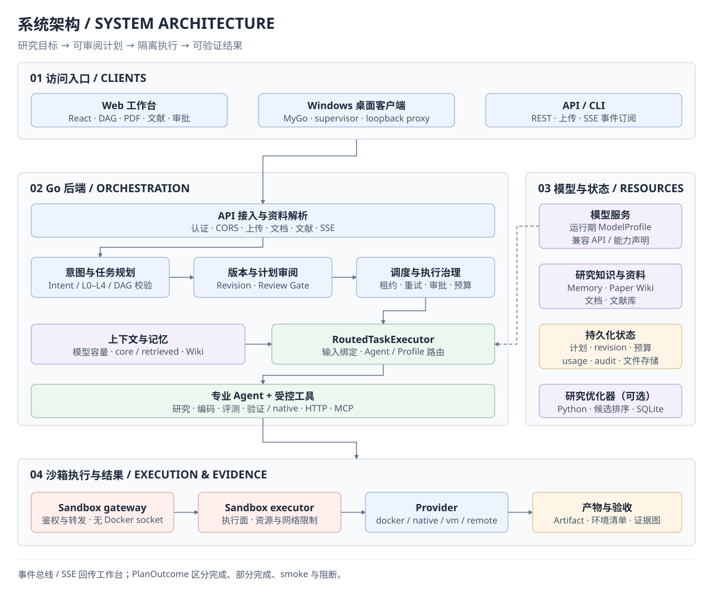
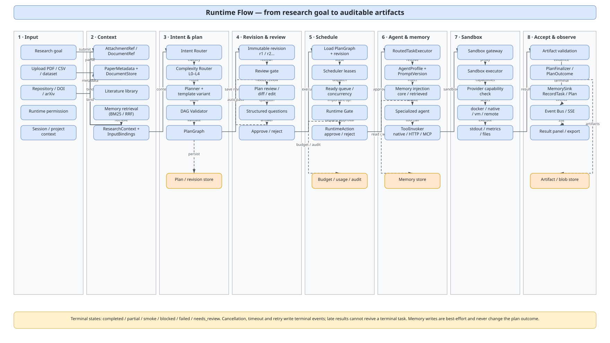
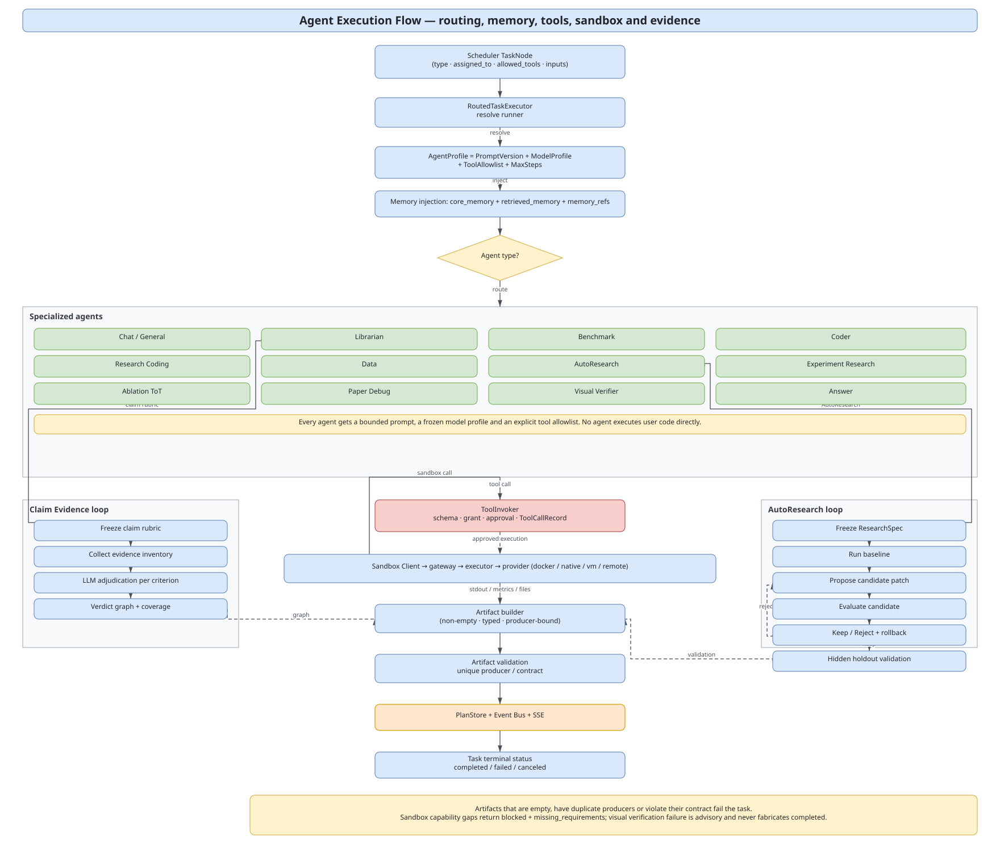
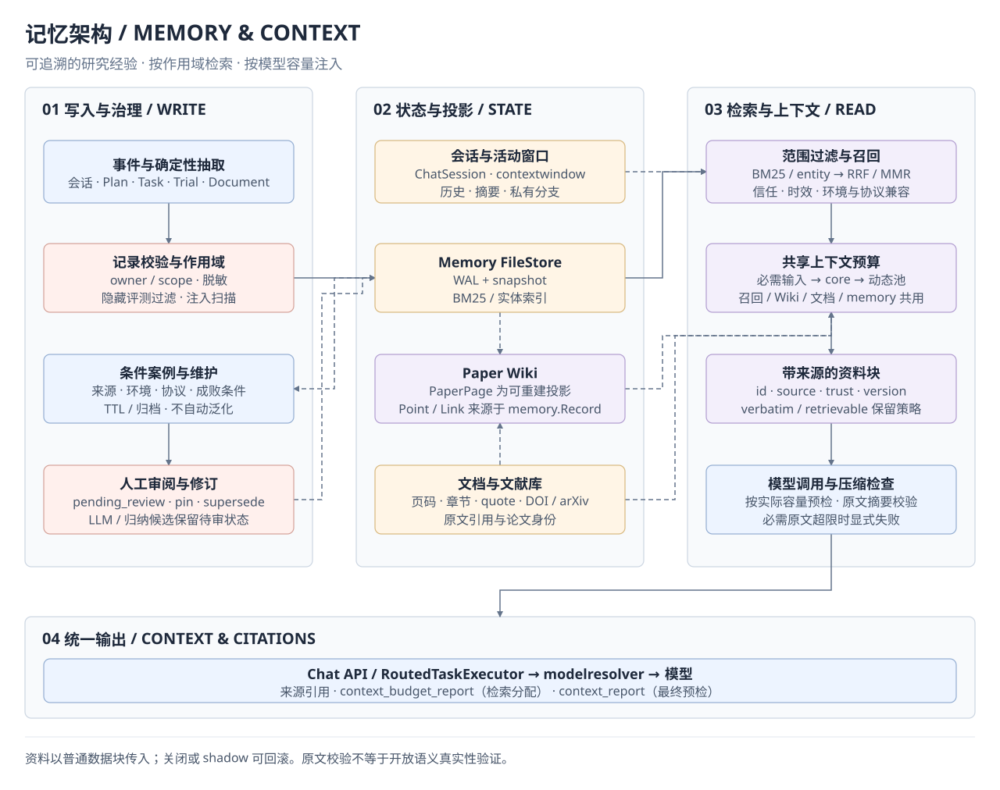

# Project documentation

[简体中文](README.md) | English

This directory holds cross-module architecture diagrams, design documents, audits, and project-level notes. Module-specific documentation stays in each module's `README.md`.

## Architecture and flow diagrams

| Diagram | draw.io source | SVG preview | Description |
|---|---|---|---|
| System architecture | [architecture.drawio](diagrams/architecture.drawio) | [architecture.svg](diagrams/architecture.svg) | Clients, desktop shell, React workbench, Go backend, agents, sandbox providers, memory/persistence, external dependencies |
| Runtime flow | [runtime-flow.drawio](diagrams/runtime-flow.drawio) | [runtime-flow.svg](diagrams/runtime-flow.svg) | End-to-end sequence from research goal to plan, review, scheduling, sandbox execution, artifacts, memory, and SSE |
| Agent architecture | [agent-execution-flow.drawio](diagrams/agent-execution-flow.drawio) | [agent-execution-flow.svg](diagrams/agent-execution-flow.svg) | Built-in runners and domain loops, custom AgentProfile, context binding, model/tool/sandbox execution, and result acceptance |
| Memory architecture | [memory-system.drawio](diagrams/memory-system.drawio) | [memory-system.svg](diagrams/memory-system.svg) | Validated writes, reviewed cases, sessions and knowledge projections, retrieval budgets, materials, and model preflight |

### Archify interactive diagrams

| Diagram | File | Description |
|---|---|---|
| System architecture | [system-architecture.html](diagrams/system-architecture.html) | Components, persistence boundaries, desktop shell, sandbox providers, external dependencies |
| Multi-agent execution workflow | [multi-agent-workflow.html](diagrams/multi-agent-workflow.html) | Agent routing, scheduling approvals, tool calls, sandbox execution, evidence chain |

Both are self-contained HTML files (inline SVG/styles/scripts) that open directly in a browser, with light/dark themes, zoom/pan, and PNG/SVG export. See [diagrams/README.md](diagrams/README.md) for files and editing.

### Preview

## Project status

- [CHANGELOG.md](CHANGELOG.md): commit-oriented change log (since 2026-10-22).
- [verification.md](verification.md): latest build/test/acceptance status, known defects, and rerun commands.
- [../reports/README.md](../reports/README.md): local acceptance-report directory (reports are local-only and not committed).

## Design documents

### Architecture and runtime

| Document | Content |
|---|---|
| [Runtime model configuration and visual verification](design/runtime-model-config-and-visual-verification.md) | Per-user + global model profiles, vision capability probing/routing, verify_result image checks (inconclusive/fail semantics) |
| [Intent complexity routing and plan-generation selection](design/intent-complexity-routing.md) | Option C: fold complexity into intent classification; L0-L4 routing, template variants, skeleton + agent enhancement, acceptance and risks |
| [Agent chain optimization (General / Prompt / Repair / Token budget)](design/2026-10-27-agent-chain-optimization.md) | Four concrete optimizations with problem/why/how, code locations, and acceptance checklist |
| [N-01/N-02/N-03: plan library, reproducible export, cost console](design/n01-n03-plan-library-reproducibility-cost.md) | Incremental design over existing plan list/export/usage: indexes, manifest/checksum, budget gates, acceptance |
| [N-05 plan review and human-in-the-loop](design/n05-plan-review-hitl.md) | Revisions, pre-execution review, structured questions, approval inbox, and diff |
| [N-13 agent/tool ecosystem (MCP)](design/n13-agent-tool-ecosystem-mcp.md) | Tool registration/permissions/audit, MCP onboarding, custom agents, and prompt versions |
| [N-14 literature workflow and skill-template MCP (draft)](design/n14-literature-mcp-skill-ecosystem.md) | **Design draft, not implemented**: literature/zotero/science MCP and SkillManifest roadmap |

### Memory and knowledge

| Document | Content |
|---|---|
| [Agent memory system (M0–M3)](design/2026-11-01-agent-memory-system.md) | Layered memory, storage, retrieval, injection, extraction, consolidation, security boundaries, acceptance |
| [Memory implementation report](improvement-2026-11-01/MEMORY-IMPLEMENTATION.md) | Design vs actual implementation, implemented scope, rollback switches, security boundaries |
| [Memory test report](improvement-2026-11-01/MEMORY-TEST-REPORT.md) | Container tests, long-conversation/task E2E, and real-LLM verification |
| [Context-system audit](audit/context-system-audit-2026-11-01.md) | Item-by-item audit and gaps in existing context/memory capabilities |
| [Context and memory system review (2026-11-12, Chinese)](review/2026-11-12-context-memory-review.md) | Current implementation, container regression across nine packages, injection/summary/retrieval/budget/consolidation findings, and a controlled task-evaluation plan |
| [Context and memory implementation (2026-11-12, Chinese)](design/2026-11-12-context-memory-implementation.md) | Source-data boundaries, extractive summary checks, calibrated retrieval, shared budgets, pending case compilations, frozen A/B/C pilot and limits of long-task evidence |
| [Context and memory container acceptance (2026-11-13, Chinese)](test/2026-11-13-context-memory-container.md) | Container hot update, 25 live API assertions, real compaction/scheduling, page-margin evidence fix, default-model configuration and restart verification |
| [Paper knowledge wiki (Paper Wiki)](design/2026-11-02-paper-wiki-memory.md) | **Design draft v1.1, not implemented**: PaperPage / Point / Link research-memory view and cross-index |
| [Paper Wiki review](review/2026-11-02-paper-wiki-memory-review.md) | Review and revision recommendations for Paper Wiki v1.0 |

### Desktop and delivery

| Document | Content |
|---|---|
| [Desktop packaging and "beyond Docker"](design/2026-10-30-desktop-without-docker.md) | Packaging forms, docker/native/vm/remote providers, fidelity, and honest degradation |
| [Windows desktop client implementation](design/2026-10-30-windows-desktop-client.md) | Desktop shell, supervisor, proxy, settings, updates, installer, and real-machine acceptance |
| [Replacing Wails with MyGo](design/2026-11-02-mygo-desktop-shell.md) | Implemented: MyGo 0.7.4 default entry, bridge migration, packaging, and fallback |

### UI and experience

| Document | Content |
|---|---|
| [Literature library and PDF reading redesign](design/2026-10-27-literature-ui-redesign.md) | Direction exploration, key changes, and interaction motion |
| [Budget / HITL workbench](design/2026-10-29-budget-hitl-workbench.md) | Cost, budget, approval, and human-in-the-loop workbench design |
| [Aperture workbench](design/2026-10-30-aperture-workbench.md) | Workspace space and information-hierarchy directions and tradeoffs |
| [Workbench interaction improvements (Chinese)](design/2026-11-09-workbench-interaction-improvements.md) | **Proposal, not implemented**: review drafts, live run recovery, responsive layout, and PDF/chat workflow; scope, implementation steps, and acceptance cases |
| [Workbench implementation report (Chinese)](design/2026-11-09-workbench-implementation-report.md) | UI-01–04 implementation, automated and live backend validation, screenshot index, and limitations; recorded separately from the original proposal |
| [UI upgrade design notes](ui-research-console.md) | Research-instrument visual/interaction spec, three directions, and implementation record |

### Defects and remediation

- [Scheduler waiting states, failure propagation, and partial outcomes — repair report (2026-11-11, Chinese)](defect-remediation-2026-11-11-scheduler-results.md): implemented fixes plus backend, race, frontend and online acceptance evidence for approval waits, terminal-state races, persistent block reasons, and partial-outcome contracts.
- [Scheduler waiting states, failure propagation, and partial outcomes — plan (2026-11-11, Chinese)](defect-remediation-2026-11-11-scheduler.md): implemented (v1.1); original problems, repair boundaries, state contracts and acceptance-case design.
- [Defect remediation (2026-10-25)](defect-remediation-2026-10-25.md): D1–D10 "why fix / what was wrong / how to fix", with rollout order and acceptance checklist.
- [ADR template](adr/000-template.md): copy this when adding an architecture decision record.

## Round reports (2026-10-26 improvement audit and later)

| Document | Content |
|---|---|
| [01 Top-10 priorities](improvement-2026-10-26/01-top-10-priorities.md) | Audit baseline: user-visible blockers, security, resource, and reproducibility issues |
| [02 Remaining issues](improvement-2026-10-26/02-remaining-issues.md) | Sources and impact of R-01..R-17 |
| [03 New feature proposals](improvement-2026-10-26/03-new-feature-proposals.md) | Feature proposals from research prototype to research platform |
| [Top-10 fix report](improvement-2026-10-26/FIX-REPORT.md) | Fixes and measurements for the 2026-10-26 Top-10 defects |
| [Round 2 (R-01 ~ R-17)](improvement-2026-10-26/FIX-REPORT-ROUND2.md) | Sandbox network and hard limits, API hardening, observability, documents/literature |
| [Round 3 (runtime model config and visual verification)](improvement-2026-10-26/FIX-REPORT-ROUND3.md) | modelprofile/modelresolver, dynamic models, vision probing, verify_result |
| [Round 4 (N-04 literature + N-07 document intelligence)](improvement-2026-10-26/FIX-REPORT-ROUND4.md) | Literature providers/library/citation graph, PDF OCR/layout/tables/figures/quality |
| [Round 5 (agent chain optimization + complexity routing)](improvement-2026-10-26/FIX-REPORT-ROUND5.md) | A/B/C/D optimizations and L0-L4 routing, differences, evidence, rollback switches |
| [Round 6 large-scale test report](improvement-2026-10-26/TEST-REPORT-ROUND6.md) | Full regression, focused tests, defects, cleanup |
| [Round 8 (N-01/N-02/N-03)](improvement-2026-10-26/FIX-REPORT-ROUND8.md) | Plan library, reproducible export v2, cost/budget console |
| [Round 9 (N-05)](improvement-2026-10-26/FIX-REPORT-ROUND9.md) | Plan revisions, review gate, structured questions, approval inbox |
| [Round 10 review](improvement-2026-10-26/FIX-REPORT-ROUND10.md) | Independent review of N-01/N-02/N-03/N-05 and 12 classes of fixes |
| [Round 11 (N-13)](improvement-2026-10-26/FIX-REPORT-ROUND11.md) | Tool registry, MCP, ToolGrant, ToolCallRecord, AgentProfile/PromptVersion |
| [Round 26 final closure](improvement-2026-10-26/FIX-REPORT-ROUND26.md) | 13 E2E suites + full regression across four modules and environment boundaries |
| [Literature relevance fix](improvement-2026-10-26/FIX-REPORT-LITERATURE-RELEVANCE.md) | Cross-provider relevance ranking, candidate pool, provider timeout fixes |
| [ROUND4 spec](improvement-2026-10-26/ROUND4-SPEC.md) / [plan](improvement-2026-10-26/ROUND4-PLAN.md) / [tasks](improvement-2026-10-26/ROUND4-TASKS.md) | Round 4 requirements, plan, and task breakdown |

## Other documents

- [Root README](../README.md): positioning, quick start, API summary, operating boundaries
- [research-assistant/README.md](../research-assistant/README.md): main product implementation
- [research-assistant/docs/phase1.md](../research-assistant/docs/phase1.md): PDF reading, selection translation, result readability
- [research-assistant/docs/phase2.md](../research-assistant/docs/phase2.md): data-driven catalog and frontend regression tests

## Documentation conventions

- When architecture/flow changes, update `docs/diagrams/*.drawio` first, then the SVG previews, Archify HTML (`system-architecture.html`, `multi-agent-workflow.html`), and related READMEs.
- `plan.md`, `spec.md`, `tasks.md`, and generated content under `reports/` are development artifacts and are gitignored.
- READMEs keep stable usage guidance and boundaries; commit-oriented changes go to [CHANGELOG.md](CHANGELOG.md), test conclusions to [verification.md](verification.md), and temporary run logs never go into READMEs.
