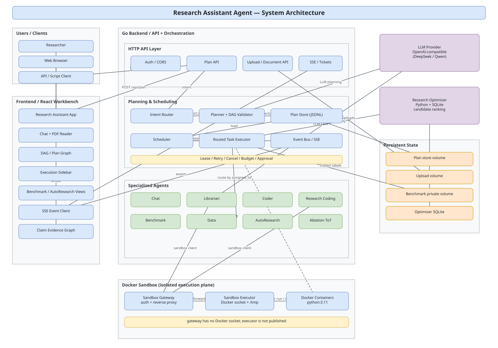
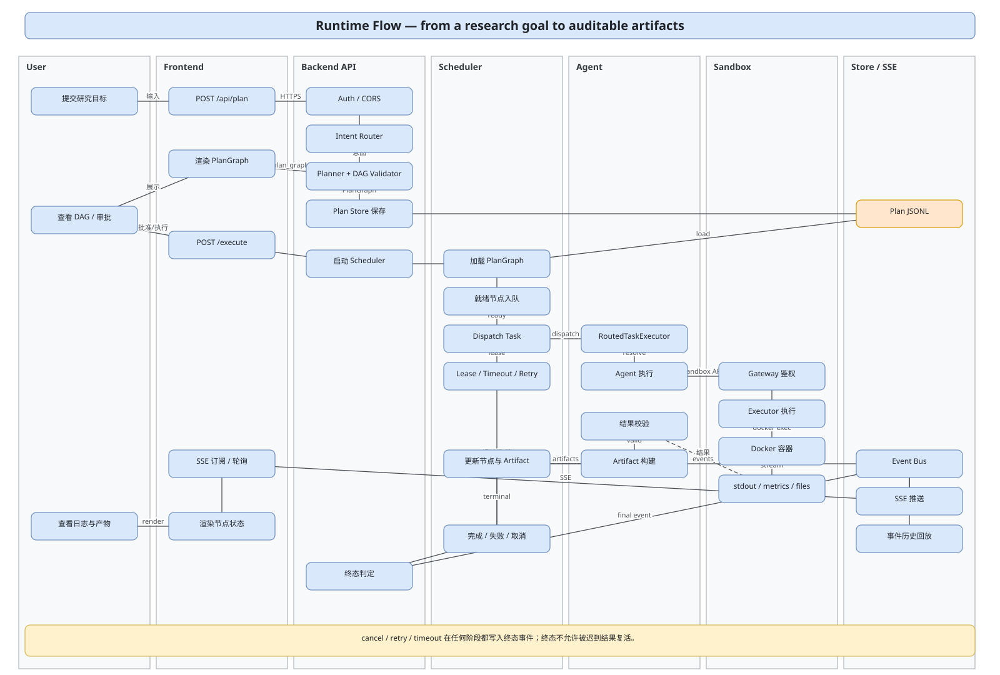
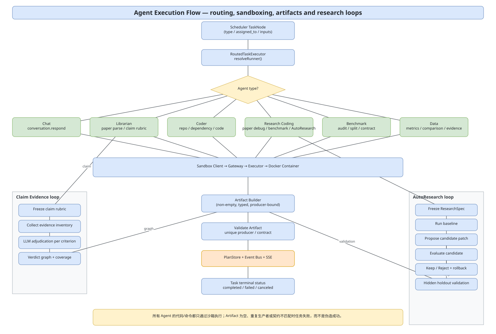

# 项目文档

本目录集中放置跨模块的架构与流程图，以及项目级说明。模块内部文档仍放在各自目录的 `README.md`。

## 架构与流程图（draw.io）

| 图 | draw.io 源文件 | SVG 预览 | 说明 |
|---|---|---|---|
| 系统架构图 | [architecture.drawio](diagrams/architecture.drawio) | [architecture.svg](diagrams/architecture.svg) | 前端、后端、Agent、沙箱、优化器、LLM 与持久化状态的分层关系 |
| 运行流程图 | [runtime-flow.drawio](diagrams/runtime-flow.drawio) | [runtime-flow.svg](diagrams/runtime-flow.svg) | 从用户目标到 PlanGraph、调度、沙箱执行、Artifact 与 SSE 的完整时序 |
| Agent 执行流程图 | [agent-execution-flow.drawio](diagrams/agent-execution-flow.drawio) | [agent-execution-flow.svg](diagrams/agent-execution-flow.svg) | RoutedTaskExecutor 的 Agent 路由、沙箱调用、Artifact 校验，以及 Claim Evidence / AutoResearch 子循环 |

### 预览

打开方式：

- 使用 [diagrams.net](https://app.diagrams.net/) 或 VS Code 的 Draw.io Integration 插件打开 `.drawio` 文件；
- 修改后可从 draw.io 导出新的 SVG/PNG，或运行 `python3 docs/diagrams/generate_diagrams.py` 重新生成当前版本的 SVG 预览。

## 其他文档

- [UI 升级设计说明](ui-research-console.md)：科研仪器风格的视觉与交互规范、三个方向的取舍与实现记录
- [缺陷修复文档（2026-10-25）](defect-remediation-2026-10-25.md)：D1–D10 的「为什么修 / 哪里有问题 / 怎么修」，含落地顺序与验收清单
- [根 README](../README.md)：项目定位、快速开始、API 摘要与运行边界
- [research-assistant/README.md](../research-assistant/README.md)：产品主实现
- [research-assistant/docs/phase1.md](../research-assistant/docs/phase1.md)：PDF 阅读、划词翻译与结果可读性
- [research-assistant/docs/phase2.md](../research-assistant/docs/phase2.md)：数据驱动 catalog 与前端回归测试
- [reports/README.md](../reports/README.md)：验收报告目录说明（报告默认本地生成，不提交）

## 文档约定

- 架构/流程变更时，先更新 `docs/diagrams/*.drawio`，再同步 SVG 预览与相关 README。
- `plan.md`、`spec.md`、`tasks.md` 和 `reports/` 下的运行产物属于开发过程资料，已加入 `.gitignore`，不进入版本库。
- README 中只保留稳定的使用说明与边界，不粘贴会快速过期的运行日志。