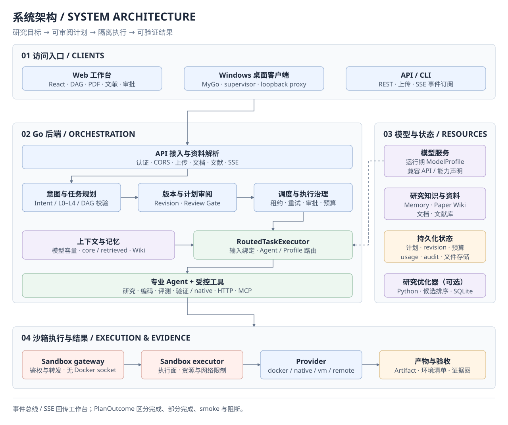
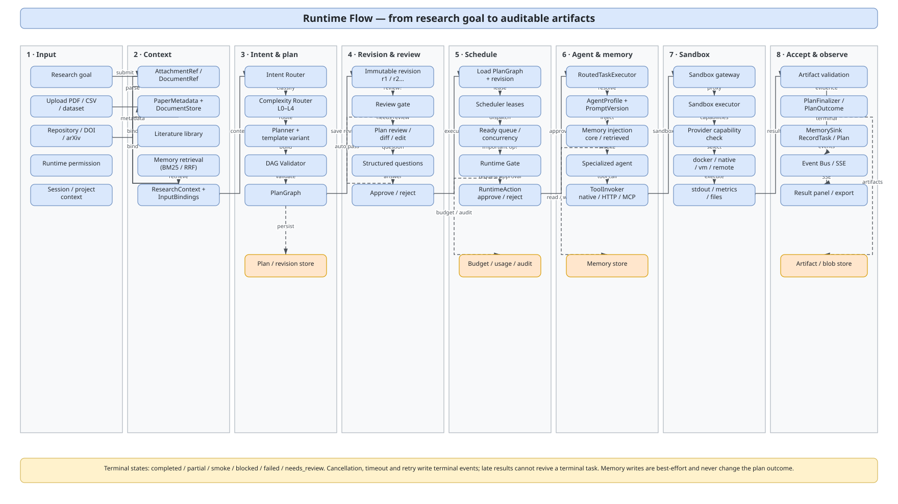
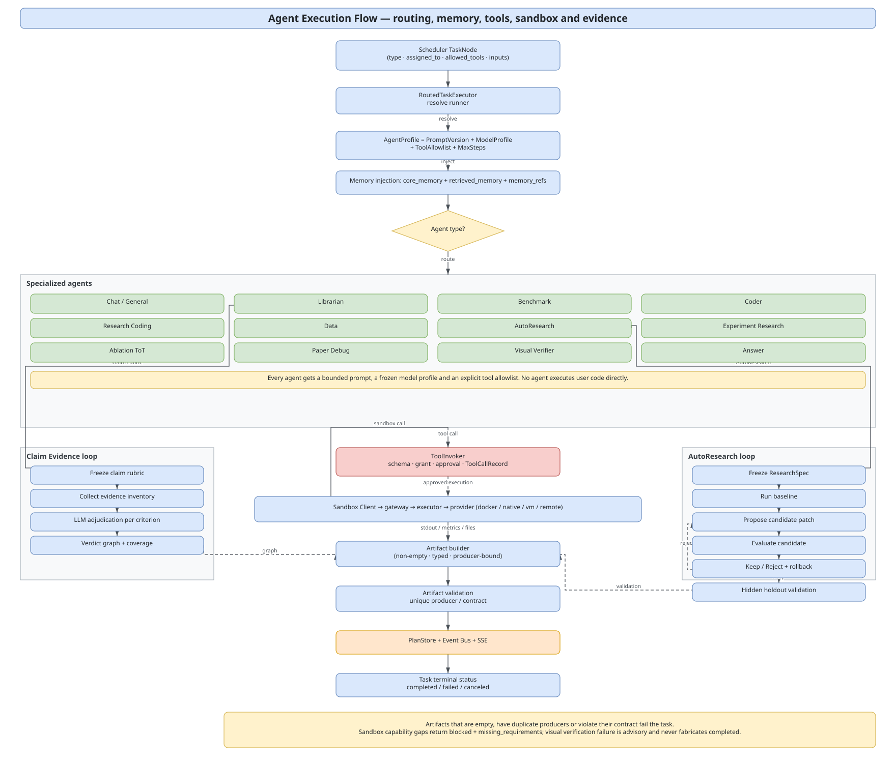

# 项目文档

简体中文 | [English](README.en.md)

本目录集中放置跨模块的架构图、设计文档、审计与项目级说明；模块内部文档仍在各自目录的 `README.md`。

## 架构与流程图

| 图 | draw.io 源文件 | SVG 预览 | 说明 |
|---|---|---|---|
| 系统架构图 | [architecture.drawio](diagrams/architecture.drawio) | [architecture.svg](diagrams/architecture.svg) | 客户端、桌面外壳、React 工作台、Go 后端、Agent、沙箱 Provider、记忆与持久化、外部依赖 |
| 运行流程图 | [runtime-flow.drawio](diagrams/runtime-flow.drawio) | [runtime-flow.svg](diagrams/runtime-flow.svg) | 从研究目标到计划、审阅、调度、沙箱执行、Artifact、记忆与 SSE 的完整时序 |
| Agent 执行流程图 | [agent-execution-flow.drawio](diagrams/agent-execution-flow.drawio) | [agent-execution-flow.svg](diagrams/agent-execution-flow.svg) | RoutedTaskExecutor 的 Agent 路由、记忆注入、工具调用、沙箱执行与证据/搜索子循环 |

### Archify 交互式图

| 图 | 文件 | 说明 |
|---|---|---|
| 系统架构图 | [system-architecture.html](diagrams/system-architecture.html) | 组件、持久化边界、桌面外壳、沙箱 Provider 与外部依赖 |
| 多角色 Agent 执行工作流 | [multi-agent-workflow.html](diagrams/multi-agent-workflow.html) | Agent 路由、调度审批、工具调用、沙箱执行与证据链 |

两图为自包含 HTML（内联 SVG/样式/脚本），浏览器直接打开，支持明暗主题、缩放平移与 PNG/SVG 导出。图形文件与编辑方式见 [diagrams/README.md](diagrams/README.md)。

### 预览

## 项目状态

- [CHANGELOG.md](CHANGELOG.md)：按提交整理的变更记录（2026-10-22 起）。
- [verification.md](verification.md)：最近一次构建/测试/验收状态、已知缺陷与复跑命令。
- [../reports/README.md](../reports/README.md)：本地验收报告目录说明（报告默认本地生成，不提交）。

## 设计文档

### 架构与运行机制

| 文档 | 内容 |
|---|---|
| [运行期模型配置与通用视觉校验](design/runtime-model-config-and-visual-verification.md) | per-user + 全局默认模型配置、视觉能力探测与路由、verify_result 通用图像校验（inconclusive/fail 语义） |
| [意图复杂度路由与计划生成选择](design/intent-complexity-routing.md) | 方案 C：把复杂度判断合并进 intent 分类；L0-L4 路由、模板变体、skeleton + agent 增强、验收与风险 |
| [Agent 链路优化（General / Prompt / Repair / Token 预算）](design/2026-10-27-agent-chain-optimization.md) | 四个具体优化点的“问题在哪、为什么、怎么做”、代码位置与验收清单 |
| [按模型配置计算上下文窗口与 Compaction](design/2026-11-06-model-aware-context-compaction.md) | 设计 v2.0；动态预算、独立/服务端压缩、摘要与活动窗口底座已实施，实际能力与真实网关限制见 [实现说明](design/2026-11-07-context-implementation.md) |
| [Agent 能力改进方案](design/2026-11-07-agent-capability-improvement.md) | 设计 v1.0；AG-01–AG-06 已有增量实现，保留原验收目标与未交付范围 |
| [Agent 能力六线实施与验收](design/2026-11-08-agent-capability-implementation.md) | Profile 原生工具循环、共享恢复额度、可信数值、上下文集成、任务评测与修复记忆；配置、验收映射及真实任务未验证边界 |
| [Agent 上下文集成与恢复实施说明](design/2026-11-08-agent-context-implementation.md) | **AG-04 增量已实施**：共享上下文、科研修复模型路由、revision 隔离、失败诊断持久化、摘要来源恢复与容器回归结果 |
| [分类恢复与修复记忆](design/2026-11-08-recovery-memory.md) | AG-02/06：typed 失败、跨层恢复预算、受审重规划提案、有证据的 procedure 候选与兼容过滤 |
| [Claim Evidence 数值验收](design/2026-11-08-claim-verification.md) | AG-03：测量前冻结、真实执行来源与原始预测重算；程序自报指标待审，不以模型提案替代验证 |
| [Agent 任务质量基线](test/2026-11-08-agent-quality-baseline.md) | AG-05：template/model/task、严格 grader、真实 native 工具执行与 8 例冻结离线反例基线；零分母 N/A |
| [N-01/N-02/N-03：计划库、可复现导出与成本预算控制台](design/n01-n03-plan-library-reproducibility-cost.md) | 基于现有计划列表/导出/usage 的增量设计，含索引、manifest/checksum、预算闸门与验收 |
| [N-05 计划审阅与人在回路](design/n05-plan-review-hitl.md) | revision、执行前审阅、结构化提问、审批收件箱与 diff 的设计 |
| [N-13 Agent/工具生态（MCP）](design/n13-agent-tool-ecosystem-mcp.md) | 工具注册/权限/审计、MCP 接入、自定义 Agent 与 Prompt 版本的设计 |
| [N-14 文献工作流与 Skill 模板化 MCP（草案）](design/n14-literature-mcp-skill-ecosystem.md) | **设计稿，未实现**：literature/zotero/science MCP 与 SkillManifest 的规划 |

### 记忆与知识

| 文档 | 内容 |
|---|---|
| [Agent 记忆系统（M0–M3）](design/2026-11-01-agent-memory-system.md) | 分层记忆、存储、检索、注入、抽取、consolidation、安全边界与验收 |
| [记忆系统实现对照](improvement-2026-11-01/MEMORY-IMPLEMENTATION.md) | 设计 vs 实际实现、已实现范围、回滚开关与安全边界 |
| [记忆系统测试报告](improvement-2026-11-01/MEMORY-TEST-REPORT.md) | 容器内测试、长对话/长任务 E2E 与真实 LLM 验证 |
| [上下文系统审计](audit/context-system-audit-2026-11-01.md) | 现有上下文/记忆能力的逐项审计与差距 |
| [论文知识 Wiki（Paper Wiki）](design/2026-11-02-paper-wiki-memory.md) | 设计稿 v1.1（W0–W3/W2.5 已实现，见 [实现对照](improvement-2026-11-02/IMPLEMENTATION.md) 与 [测试报告](improvement-2026-11-02/TEST-REPORT.md)）：PaperPage / Point / Link 的科研记忆视图与交叉索引 |
| [Paper Wiki 评审](review/2026-11-02-paper-wiki-memory-review.md) | 对 Paper Wiki v1.0 的评审与修订建议 |
| [记忆系统压力测试方案](test/2026-11-03-memory-stress-test-plan.md) | **已执行**：长任务 / 长论文 / 交叉论文三条战线的 166 条压力用例、四套剧本、指标与验收门槛，以及代码级风险登记（附 [CSV 用例表](test/2026-11-03-memory-stress-test-cases.csv)；实测见 [压力测试报告](../../reports/memory-stress-2026-11-03-stress-2026-11-03-r1/REPORT.md)） |
| [记忆系统压测缺陷修复方案](test/2026-11-03-memory-stress-fix-plan.md) | v1.0：19 条缺陷、13 类根因、A~D 四批修复、数据迁移与回归验收映射 |

### 桌面与交付

| 文档 | 内容 |
|---|---|
| [桌面端打包与「去 Docker」方案](design/2026-10-30-desktop-without-docker.md) | 打包形态、docker/native/vm/remote Provider、保真度与诚实降级 |
| [Windows 桌面客户端实施方案](design/2026-10-30-windows-desktop-client.md) | 桌面外壳、supervisor、proxy、settings、更新、安装包与真机验收 |
| [用 MyGo 替换 Wails 桌面外壳](design/2026-11-02-mygo-desktop-shell.md) | 已实施：MyGo 0.7.4 默认入口、bridge 迁移、打包与回退方案 |

### 界面与体验

| 文档 | 内容 |
|---|---|
| [文献库与 PDF 阅读体验改版](design/2026-10-27-literature-ui-redesign.md) | 文献库与 PDF 阅读的方向探索、关键改动与交互动效 |
| [预算 / HITL 工作台](design/2026-10-29-budget-hitl-workbench.md) | 成本、预算、审批与人在回路的工作台设计 |
| [Aperture 工作台](design/2026-10-30-aperture-workbench.md) | 工作台空间与信息层级的方向与取舍 |
| [UI 升级设计说明](ui-research-console.md) | 科研仪器风格的视觉与交互规范、三个方向的取舍与实现记录 |

### 缺陷与整改

- [并发幂等、锁恢复与 PDF 翻译浮层修复方案（2026-11-06）](defect-remediation-2026-11-06.md)：三项已复现问题的根因、实施步骤、失败边界与回归验收，状态为待实施。
- [缺陷修复文档（2026-10-25）](defect-remediation-2026-10-25.md)：D1–D10 的“为什么修 / 哪里有问题 / 怎么修”，含落地顺序与验收清单。
- [ADR 模板](adr/000-template.md)：新增架构决策记录时复制该模板。

## 轮次报告（2026-10-26 改进审计及后续）

| 文档 | 内容 |
|---|---|
| [01 最值得先修的 10 个点](improvement-2026-10-26/01-top-10-priorities.md) | 审计基线：用户可见阻断、安全、资源与可复现性问题 |
| [02 剩余未修问题清单](improvement-2026-10-26/02-remaining-issues.md) | R-01..R-17 的来源与影响 |
| [03 新增功能建议](improvement-2026-10-26/03-new-feature-proposals.md) | 从研究原型走向研究平台的功能建议 |
| [Top-10 修复报告](improvement-2026-10-26/FIX-REPORT.md) | 2026-10-26 Top-10 优先级缺陷的修复与实测 |
| [第二轮修复报告（R-01 ~ R-17）](improvement-2026-10-26/FIX-REPORT-ROUND2.md) | 沙箱网络与硬限制、API 加固、可观测性、文档与文献能力 |
| [第三轮修复报告（运行期模型配置与视觉校验）](improvement-2026-10-26/FIX-REPORT-ROUND3.md) | modelprofile/modelresolver、动态模型、视觉探测与 verify_result 落地 |
| [第四轮修复报告（N-04 文献 + N-07 文档智能）](improvement-2026-10-26/FIX-REPORT-ROUND4.md) | 文献 provider/文献库/引用图、PDF OCR/版面/表格/图注/质量报告 |
| [第五轮修复报告（Agent 链路优化 + 复杂度路由）](improvement-2026-10-26/FIX-REPORT-ROUND5.md) | A/B/C/D 四个优化点与 L0-L4 路由的落地、差异、验证证据与回滚开关 |
| [第六轮大规模测试报告](improvement-2026-10-26/TEST-REPORT-ROUND6.md) | 全量回归、专项测试、缺陷与清理记录 |
| [第八轮修复报告（N-01/N-02/N-03）](improvement-2026-10-26/FIX-REPORT-ROUND8.md) | 计划库、可复现导出包 v2、成本与预算控制台 |
| [第九轮修复报告（N-05）](improvement-2026-10-26/FIX-REPORT-ROUND9.md) | 计划 revision、审阅门、结构化提问、审批收件箱 |
| [第十轮复核报告](improvement-2026-10-26/FIX-REPORT-ROUND10.md) | N-01/N-02/N-03/N-05 独立复核与 12 类问题修复 |
| [第十一轮修复报告（N-13）](improvement-2026-10-26/FIX-REPORT-ROUND11.md) | 工具注册表、MCP、ToolGrant、ToolCallRecord、AgentProfile/PromptVersion |
| [第二十六轮最终收口](improvement-2026-10-26/FIX-REPORT-ROUND26.md) | 13 套 E2E + 四模块全量回归与环境边界 |
| [文献检索相关性修复报告](improvement-2026-10-26/FIX-REPORT-LITERATURE-RELEVANCE.md) | relevance 跨 provider 排序、候选池与 provider 超时的修复与验证 |
| [ROUND4 规格](improvement-2026-10-26/ROUND4-SPEC.md) / [计划](improvement-2026-10-26/ROUND4-PLAN.md) / [任务](improvement-2026-10-26/ROUND4-TASKS.md) | 第四轮的需求、实施计划与任务拆分 |

## 其他文档

- [根 README](../README.md)：项目定位、快速开始、API 摘要与运行边界
- [research-assistant/README.md](../research-assistant/README.md)：产品主实现
- [research-assistant/docs/phase1.md](../research-assistant/docs/phase1.md)：PDF 阅读、划词翻译与结果可读性
- [research-assistant/docs/phase2.md](../research-assistant/docs/phase2.md)：数据驱动 catalog 与前端回归测试

## 文档约定

- 架构/流程变更时，先更新 `docs/diagrams/*.drawio`，再同步 SVG 预览、Archify HTML（`system-architecture.html`、`multi-agent-workflow.html`）与相关 README。
- `plan.md`、`spec.md`、`tasks.md` 和 `reports/` 下的运行产物属于开发过程资料，已加入 `.gitignore`，不进入版本库。
- README 只保留稳定的使用说明与边界；按提交整理的变更写入 [CHANGELOG.md](CHANGELOG.md)，测试结论写入 [verification.md](verification.md)，避免把临时运行日志粘进 README。
