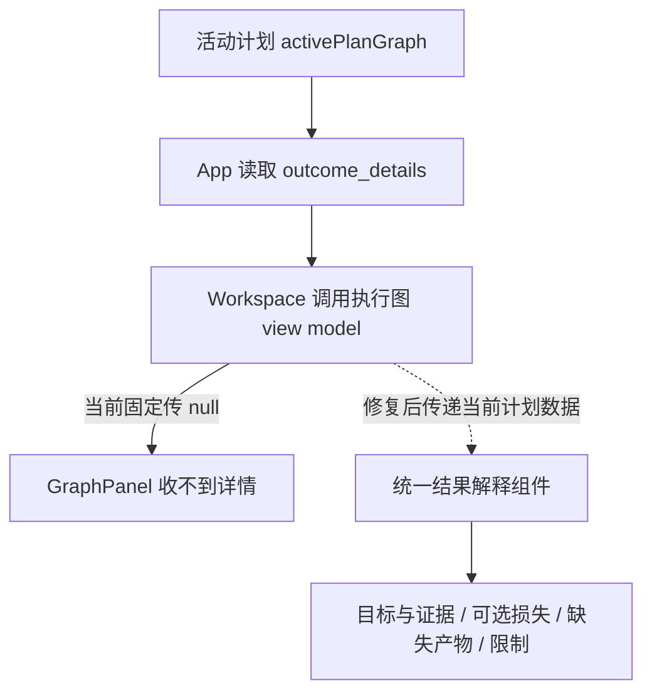

# 部分成功解释信息展示修复方案

状态：**已实施，2026-11-25 容器针对性端到端验收通过**；实际结果、过程失败与未测边界见[实施与验收报告](defect-remediation-2026-11-24-partial-outcome-results.md)。版本：1.1。方案日期：2026-11-24。

审阅与实施基线：`4d85ac24dbb05148c3b808da314d85e344689267`，分支 `master`。本文保留实施前的源码分析、设计约定和验收要求；代码位置对应此基线，修复实现与实际测试以验收报告为准。

历史背景来自[项目评分与上下文交接](project-assessment-handoff-2026-11-18.md)。历史评分基线为 `d4d2af1`，综合评分 7.55/10，展示为 7.6/10；历史测试通过项不能视为当前版本或本文方案已经通过验收。

初版编写时只做了源码、测试代码和脚本配置检查。后续已按本文完成实现，将源码与产物 cp 进容器，完成前端全量门禁与两项真实浏览器端到端验收；本轮未重跑后端全量或真实模型科研评测。下文保留的实施步骤与命令是原方案，不应代替验收报告中的实际记录。

## 1. 问题与修复目标

主执行图能收到计划的 `outcome = partial`，因此能够显示“部分完成”；但应用中间层将 `outcome_details` 固定传为 `null`，导致主图收不到可选工作损失、失败原因和结论限制。系统生成的结果解释没有完整到达用户界面。

用户因此难以回答以下问题：

- 哪些核心目标已通过验收，依据是什么？
- 哪些可选任务没有完成，是失败、被阻断还是取消？
- 未完成的具体原因是什么？
- 哪些验收产物缺失或不可信？
- 当前结论受哪些限制，哪些内容不能宣称完整？

修复目标：主执行图直接展示当前活动计划已有的结果判定、结果原因和结构化解释；历史计划缺少详情时明确降级；切换计划、更新快照或清空详情时不残留旧说明。

### 1.1 范围与优先级

| ID | 问题 | 证据与优先级 | 本方案处理方式 |
|---|---|---|---|
| PO-01 | 应用向执行图 view model 固定传入 `activePlanOutcomeDetails: null` | 当前源码确认；建议 P1，直接切断已有解释链路 | 接回当前计划详情，增加经过真实应用接线的回归测试 |
| PO-02 | 主执行图调用链没有传递 `outcome_reason` | 当前源码确认；建议 P2，历史计划尤其缺少原因回退 | 从活动计划一路传到详情展示组件 |
| PO-03 | 主图没有展示 `accepted_goals` 中的目标与证据 | 当前源码确认；建议 P2，接通详情后仍无法完整解释验收依据 | 复用并完善已有 `OutcomeDetailsList`，分别展示已通过和未验证目标 |
| PO-04 | 原组件测试直接传入详情，绕过应用丢字段的位置 | 当前测试源码确认；建议随 PO-01 一起处理 | 增加应用组合测试，增强现有组件行为断言 |

PO-02、PO-03 是完整展示所需的配套修改，不应混写成“固定 `null`”的同一个根因。仅修 PO-01 可以恢复主图已实现的损失和限制展示，但不能据此宣称验收目标、证据和旧计划原因均已补齐。

本方案涉及前端主应用、执行图 view model、结果解释组件及其测试。不修改后端终态判定、验收契约、API JSON 字段和持久化格式。通知、导出、记忆以及其他页面的结果展示不在本轮实施和验收范围内。

## 2. “部分成功”的业务含义

`partial` 依据验收契约判定：执行前已经声明核心目标和可选工作，核心目标有可信证据且验收必需产物满足要求，只有可选工作发生损失。不能按成功任务数量或百分比重新计算结果。

| 场景 | 应保留的结果语义 |
|---|---|
| 核心实验和必需报告验收通过，可选指标计算失败 | 可以为 `partial` |
| 核心任务执行失败 | `failed`，不能由其他任务成功抵消 |
| 核心任务因缺少必需条件受阻 | 按后端判定展示 `blocked` 等结果 |
| 执行结束，但核心目标没有充分证据、必需产物缺失或不可信 | 按后端判定展示 `needs_review`，不能宽松降级为 `partial` |
| 没有验收契约证明核心目标成立，可选任务又失败 | 不能仅凭“其余任务完成”认定为 `partial` |
| 冒烟或模拟运行伴随可选工作损失 | 保留 `smoke` / `mock`，前端不能改写成 `partial` |

`status` 与 `outcome` 描述不同层面的状态。例如 `status = completed`、`outcome = partial` 表示流程已结束，但成果存在可选工作损失。UI 不能只读取 `status` 就显示“全部成功”。

参考现有后端场景：核心实验 A 完成，可选指标 B 因数据集缺失失败，报告 C 完成且满足验收。B 保留真实的 `failed` 状态，计划整体为 `completed + partial`。场景与断言见 [partial_outcome_test.go](../research-assistant/backend/internal/scheduler/partial_outcome_test.go)，第 14、42 行起。

## 3. 当前调用链与根因

### 3.1 详情数据已经存在于模型和生成流程中

| 层次 | 当前实现与位置 |
|---|---|
| 后端字段 | [models/acceptance.go](../research-assistant/backend/internal/models/acceptance.go)，第 39 行起定义 `OutcomeDetails` |
| 后端生成 | [scheduler/outcome_details.go](../research-assistant/backend/internal/scheduler/outcome_details.go)，第 57 行起基于验收证据生成目标评估、可选损失、缺失产物与限制 |
| 后端终态 | [scheduler/scheduler_reconcile.go](../research-assistant/backend/internal/scheduler/scheduler_reconcile.go)，第 503 行起提交终态字段，第 565 行将详情放入终态事件 |
| 前端契约 | [contracts/api.ts](../research-assistant/frontend/src/contracts/api.ts)，第 415 行起定义 `OutcomeDetails`；计划对象携带可选的 `outcome_details` |

上述为方案编写时的源码事实，当时没有运行验收。后续真实后端生成、API、SSE 与浏览器实测见验收报告，不由此处静态描述推断通过。

### 3.2 直接丢失点

[ResearchAssistantApp.tsx](../research-assistant/frontend/src/app/ResearchAssistantApp.tsx) 第 567 行，外层应用已经从当前计划读取详情：

```tsx
activePlanOutcomeDetails: chatFlow.activePlanGraph?.outcome_details ?? null,
```

但同文件第 137 行，内部 `ResearchAssistantWorkspaceContent` 调用 `useGraphExecutionViewModel` 时使用固定空值：

```tsx
activePlanOutcomeDetails: null,
```

后续 [useGraphExecutionViewModel.ts](../research-assistant/frontend/src/app/viewModels/useGraphExecutionViewModel.ts) 第 149 行继续把该值作为 `GraphPanel.outcomeDetails` 传出。



### 3.3 标签仍然存在，解释内容为空

[GraphPanel.tsx](../research-assistant/frontend/src/features/plan-graph/GraphPanel.tsx) 第 293 行调用 `summarizePlanOutcome`，第 737 行起针对终态的 `partial`、`blocked`、`needs_review` 渲染说明区。

`outcome` 正常传入，所以标题可以显示“部分完成”；`outcomeDetails` 为空，所以可选损失、缺少产物和限制说明无法由该通道生成。这是主执行图的计划级解释缺失，不能由此推断所有日志、API 返回或其他入口都缺失信息。

### 3.4 配套缺口

1. `summarizePlanOutcome` 已支持 `outcome_reason`，但主应用的工作区参数、view model 参数和 `GraphPanel` props 没有完整传递它。单独修改摘要函数无法补上数据来源。
2. 主图目前只渲染摘要、损失和限制，没有渲染 `accepted_goals`。仓库已有 [PlanOutcomeBits.tsx](../research-assistant/frontend/src/features/shared/PlanOutcomeBits.tsx) 中的 `OutcomeDetailsList`，但主图尚未使用它。
3. `OutcomeDetailsList` 目前只列出已验证目标，没有呈现未验证目标及原因；且 `summary.detail` 已包含可选损失，后面再列损失列表会重复展示同一内容。
4. [GraphPanelOutcome.test.tsx](../research-assistant/frontend/test/components/GraphPanelOutcome.test.tsx) 直接给组件传入 `outcomeDetails`，没有经过原始丢失点。首个测试虽然提到核心目标，但未断言目标、证据、失败原因和限制的实际文本。

## 4. 修复后的展示约定

### 4.1 数据来源与结果权威性

- 结果、原因和详情来自同一个活动计划快照；不拼接前一计划的数据。
- UI 直接展示服务端 `outcome`，不根据节点颜色、成功数量、空详情或本地模型推断新的结果。
- 失败节点保持真实状态；展示部分成功不意味着将失败节点改成成功。
- 仅 `verified === true` 的目标可列入“已通过的核心目标”；其他目标保留未验证语义。
- `accepted_goals` 字段在当前实现中包含目标评估结果，不能仅根据字段名称把全部条目标记为已通过。
- 证据引用展示为原有引用标识。没有实现对应跳转能力前，不添加看似可用的证据链接。

### 4.2 说明区的信息顺序

| 顺序 | 展示项 | 内容规则 |
|---|---|---|
| 1 | 结果标题 | 使用现有结果标签，例如“部分完成”“缺少条件”“已结束·待复核” |
| 2 | 结果原因 | 展示非空 `outcome_reason` 原文，不编造解释 |
| 3 | 已通过的核心目标 | 目标陈述与 `evidence_refs`；无证据引用时不编造证据 |
| 4 | 尚未通过验证的核心目标 | 目标陈述、已有验证原因；证据引用明确表示引用信息，不暗示已经可信 |
| 5 | 未完成的可选工作 | 名称，缺少名称时回退到任务 ID；状态与原因沿用现有格式化规则 |
| 6 | 缺少或不可信的验收产物 | 列出 `missing_artifacts`；本项可用于解释待复核结果 |
| 7 | 结论限制 | 原样展示 `limitations`，不扩展为更具体的科研结论 |

非空分组才显示标题和列表。长文本必须换行，长列表必须可滚动访问，不遮挡执行图主要操作。相同可选损失不要同时在摘要段落和列表重复渲染；后端 `outcome_reason` 自带相关内容时保留原文，不通过字符串猜测删除其含义。

当前后端的 `limitations` 为通用句式，例如“缺少可选工作 可选指标，相关结论不能宣称完整”。本次修复使这类已有说明可见，不引入自动生成科研影响分析的能力。

`mode`、`claims_verified`、`claims_total` 保留在现有契约中，本方案不新增对应的模式徽章、计数或验收承诺。

### 4.3 展示入口与兼容边界

保留当前主图的说明区条件：业务状态为终态，且结果属于 `partial`、`blocked`、`needs_review`。普通完成、失败、取消、冒烟和模拟保留各自现有展示行为；本轮不扩大这些结果的说明区入口。

因此，本轮对 `smoke` / `mock` 的要求是语义不被误改，不承诺在主图新增完整损失说明。后续若要扩展，应单独定义入口并增加对应验收。

| 详情情况 | 预期表现 |
|---|---|
| 有完整详情 | 显示实际存在的各组内容 |
| 只有 `outcome_reason` | 显示结果与原因；提示未提供结构化验收详情 |
| 没有原因，也没有详情 | 保留结果标签，显示“该计划未提供结构化验收详情” |
| 详情为 `null`、缺省或仅有空数组 | 正常降级；不能解释为“没有损失”或“全部验证通过” |
| 详情只有 `mode` 或声明计数 | 本轮没有可展示的结构化分组，按缺少展示详情降级 |
| 从有详情更新为空详情 | 清除之前的目标、证据、损失、产物和限制 |
| 切换计划或回到非终态 | 清除上一计划或上次终态的说明区内容 |

不要只用 `Boolean(outcomeDetails)` 判断是否存在可展示详情，应检查本轮实际展示的目标、损失、产物、限制列表。

## 5. 按文件的实施方案

### 5.1 接回 `outcome_details`

修改 [ResearchAssistantApp.tsx](../research-assistant/frontend/src/app/ResearchAssistantApp.tsx) 内部工作区调用：

```diff
- activePlanOutcomeDetails: null,
+ activePlanOutcomeDetails: chatFlow.activePlanOutcomeDetails ?? null,
```

保留外层从 `activePlanGraph.outcome_details` 提取字段的来源，避免新增一份独立详情 state。这样结果详情会随当前计划快照更新，也能在上层清空时自然清空。

### 5.2 补齐 `outcome_reason` 的整条链路

| 文件/接口 | 拟修改内容 |
|---|---|
| `ResearchAssistantWorkspaceContentProps.chatFlow` | 新增 `activePlanOutcomeReason?: string \| null` |
| 外层 `ResearchAssistantApp` | 从 `chatFlow.activePlanGraph?.outcome_reason ?? null` 赋值 |
| 内部 `ResearchAssistantWorkspaceContent` | 调用 view model 时传入当前 `activePlanOutcomeReason` |
| `UseGraphExecutionViewModelOptions` | 新增可选参数 `activePlanOutcomeReason` 并解构 |
| view model 的 `graphPanelProps` | 新增 `outcomeReason: activePlanOutcomeReason ?? null` |
| view model 的 `useMemo` 依赖 | 加入 `activePlanOutcomeReason`；原有详情依赖继续保留 |
| `GraphPanelProps` | 新增 `outcomeReason?: string \| null` 并传入统一详情组件 |

预期链路：

```text
activePlanGraph.outcome_reason
  → Workspace.chatFlow.activePlanOutcomeReason
  → useGraphExecutionViewModel.activePlanOutcomeReason
  → GraphPanel.outcomeReason
  → OutcomeDetailsList.outcomeReason
```

新增参数保持可选，兼容现有直接渲染 `GraphPanel` 和调用 view model 的测试。不能只传参数而漏掉 `useMemo` 依赖，否则同一计划仅更新原因时可能保留旧文本。

### 5.3 统一使用并完善已有详情组件

推荐复用 `PlanOutcomeBits.tsx` 的 `OutcomeDetailsList`，不在 `GraphPanel` 内再维护一份完整的目标/损失/限制展示实现。

主图保留现有终态条件、说明区容器、`data-testid="plan-outcome-details"` 和 `data-outcome`，将容器内容替换为统一组件。以下为拟实施结构：

```tsx
<OutcomeDetailsList
  outcome={outcome}
  outcomeReason={outcomeReason}
  details={outcomeDetails}
/>
```

组件内部完成以下改动：

1. 按 `verified` 划分已通过和未验证目标；未验证项展示已有 `reason`。
2. 独立展示结果原因、目标与证据、损失、缺失产物和限制，按第 4 节排序。
3. 保留已有损失状态中文映射、任务名称回退和真实错误原因。
4. 不再将包含损失列表的 `summary.detail` 与损失列表同时渲染。组件可继续使用摘要函数生成标题、损失和限制，但结果原因与缺失产物分别展示。
5. 保持 `summarizePlanOutcome` 现有返回字段与语义兼容，尤其不要为去重直接删掉 `detail` 中的损失和产物信息。
6. 对空详情提供明确的降级说明，不生成虚构目标、产物或限制。
7. 所有文本按 React 文本节点渲染；不为错误原因或证据标识引入原始 HTML 渲染。
8. 列表使用稳定且不冲突的 key，避免相同名称、相同原因或重复文本导致 React 警告。

替换后删除 `GraphPanel` 中仅服务于旧说明区、已经不再使用的 `outcomeSummary` 计算和导入，避免出现两套解释逻辑或重复标题。无需调整执行、审批、恢复和取消按钮逻辑。

### 5.4 快照刷新、计划切换与空值更新

当前已有两类刷新入口：

- [useResearchAssistantChatFlow.ts](../research-assistant/frontend/src/app/hooks/useResearchAssistantChatFlow.ts) 第 766 行起的 `refreshActivePlan`，通过 `getPlan` 更新当前会话快照，具有请求序号和计划匹配检查。
- [useResearchAssistantRuntime.ts](../research-assistant/frontend/src/app/hooks/useResearchAssistantRuntime.ts) 的终态处理会调用 `refreshPlanState`；应用已将其接到 `chatFlow.refreshActivePlan`。

本轮先复用这些入口，不因展示修复新增独立轮询或另一个事件结果缓存。组合测试验证“新快照进入应用后正确展示”；真实终态事件是否成功触发刷新，需要浏览器/API 集成验证，不能由 mock 快照测试代替。

若实施中发现刷新或同一计划重跑存在独立缺陷，应记录具体复现条件和修改范围后补测。本文没有运行验证这些边界，也没有确认存在新的运行期缺陷。

## 6. 验收样例与预期文案

以下 JSON 是展示用计划字段节选，不是完整 `PlanGraph`，不能直接当作创建计划的请求体。测试中应并入合法的基础计划 fixture。

```json
{
  "id": "plan-partial-example",
  "status": "completed",
  "outcome": "partial",
  "outcome_reason": "核心目标已通过验收，可选指标计算未完成",
  "outcome_details": {
    "mode": "acceptance",
    "accepted_goals": [
      {
        "id": "g1",
        "statement": "核心实验复现成功",
        "evidence_refs": ["report"],
        "verified": true
      }
    ],
    "optional_losses": [
      {
        "task_id": "b",
        "name": "可选指标",
        "status": "failed",
        "reason": "metric dataset missing"
      }
    ],
    "limitations": [
      "缺少可选工作 可选指标，相关结论不能宣称完整"
    ]
  }
}
```

主图应可读到以下信息，具体标点可随现有样式调整：

> 部分完成
>
> 核心目标已通过验收，可选指标计算未完成
>
> 已通过的核心目标：核心实验复现成功；证据：report。
>
> 未完成的可选工作：可选指标；失败：metric dataset missing。
>
> 结论限制：缺少可选工作 可选指标，相关结论不能宣称完整。

另建 `needs_review` fixture：一个目标 `verified = false`、附带验证原因，并在 `missing_artifacts` 中列出 `report`。该样例必须显示待复核、未验证原因与缺失产物，不能把该目标列入已通过分组。不要将这个样例的结果设为 `partial`。

## 7. 回归测试设计

### 7.1 必须覆盖原始丢字段位置

拟新增 `research-assistant/frontend/test/components/ResearchAssistantAppOutcome.test.tsx`，保留真实的：

```text
ResearchAssistantApp 默认组件
  → 内部 ResearchAssistantWorkspaceContent
  → useGraphExecutionViewModel
  → GraphPanel
  → OutcomeDetailsList
```

允许 mock 与该缺陷无关的重型 hook、后台接口、桌面桥和画布。`ResearchAssistantAppShell` 可替换为轻量宿主，但宿主必须渲染真实的 `GraphPanel`，并只传递应用实际生成的 props：

```tsx
<GraphPanel {...props.graphExecutionViewModel.graphPanelProps} />
```

测试不能直接给轻量宿主或 `GraphPanel` 补入 fixture 详情，否则又会绕过原始缺陷。只测试 view model、只渲染外壳或检查源码字符串，也不足以作为 PO-01 的关闭证据。

至少一个用例必须在旧实现下因缺少可选任务名称、错误原因或限制而失败，在修复实现下通过。应通过局部对照确认：只临时恢复固定 `null` 这一行，其他修复保留时，该用例能够失败；完成后恢复正确实现并复跑。不要用会同时引入类型错误的大范围回退替代此验证。

### 7.2 测试隔离要求

- mock `useResearchAssistantChatFlow` 时，保留模块的真实 `AutoRunOnCreateContext` 导出。
- mock runtime、layout、PDF assist、budget hook；提供实际使用的 `executionState`、`selectedTaskState` 和 actions，避免依赖模型、桌面进程、网络与 PDF。
- runtime 的 `observedPlanId`、服务端状态与 fixture 保持一致，或不提供可信观测；避免旧运行态覆盖目标计划状态。
- `listApprovals` 返回 `{ items: [] }`；桌面 bridge 可返回 `needsOnboarding: async () => false`，避免引入重试定时器和首次引导。
- 参照现有 `GraphPanelMobileNode.test.tsx` mock `GraphCanvas`。
- 使用不可变的新快照配合 `rerender` 更新计划；切换计划时同步 ID、状态和图对象。
- 新测试放在 `test/components/`。当前 Vitest 只收集该目录下的 `*.test.ts` / `*.test.tsx`；放错目录可能导致未执行。

### 7.3 分层补充现有测试

| 测试文件 | 应补充的断言 |
|---|---|
| `ResearchAssistantAppOutcome.test.tsx`，拟新增 | 应用真实接线、同计划更新、跨计划清空、空详情与原因回退 |
| `useGraphExecutionViewModel.test.tsx` | `outcomeDetails` 与 `outcomeReason` 正确转交；只更新原因也刷新 props，覆盖 memo 依赖 |
| `GraphPanelOutcome.test.tsx` | 完整文本可见、终态显示条件、不同结果语义、空详情降级 |
| `OutcomeDetailsList.test.tsx`，拟新增 | 已验证/未验证分组、证据、缺失产物、损失与限制、列表不重复 |
| `planOutcome.test.ts` | 保留现有摘要行为；名称回退、损失状态与原因、产物和限制仍可正确汇总 |

优先断言用户可见文本和所属分组，使用 `within` 限定已通过/未验证目标列表。不能只断言 `data-testid` 存在或提交大段快照。jsdom 测试不证明窄屏、滚动和视觉可见性，布局另做浏览器验收。

结果原因的 memo 依赖必须用直接 `renderHook` 测试：固定 runtime context value、nodes、edges、layout、ref、所有回调和详情对象等其他依赖的引用，只替换原因字符串后 rerender。应用每次渲染可能生成新回调，导致 memo 即使漏了原因依赖也重新计算，因此应用组合测试只能补充验证原因接线，不能替代这个依赖回归测试。

## 8. 验收矩阵

下列为原验收设计；本轮逐项覆盖、实际结果和证据映射见验收报告第 6 节。

| ID | 输入或操作 | 必须满足的结果 | 验证层次 |
|---|---|---|---|
| PO-T01 | 应用加载合法 `partial`，包含完整详情 | 显示部分完成、核心目标、证据、损失名称、真实原因和限制 | 应用组合测试 |
| PO-T02 | `partial` 有原因但没有详情 | 显示原因与缺少结构化详情的提示，不伪造验收依据 | 应用组合测试 |
| PO-T03 | 详情为 `null`、缺省、空数组对象或只有 `mode` | 不异常；正确降级，不宣称没有损失 | 组件参数化测试 |
| PO-T04 | `needs_review` 且必需产物缺失 | 显示缺失产物与未验证目标原因，保留待复核结果 | 组件测试 |
| PO-T05 | 同一详情有已验证与未验证目标 | 两组分别呈现；未验证项不出现在已通过列表 | 组件测试 |
| PO-T06 | 损失包含失败、阻断、取消；任务名称为空 | 显示真实状态与原因，空名称回退到任务 ID | 摘要/组件测试 |
| PO-T07 | A 计划有完整详情，切换到无详情的终态 B | A 的目标、证据、损失、产物、限制全部消失 | 应用组合测试 |
| PO-T08 | A 计划终态切换到运行中的 B | 旧终态说明区不出现，运行状态不被结果说明改写 | 应用组合测试 |
| PO-T09 | 同一计划替换详情，ID/状态/结果不变 | 新原因和限制出现，旧内容消失，覆盖详情更新依赖 | 应用组合测试 |
| PO-T10 | 同一计划详情从有值变为 `null` 或缺省 | 原详情清空，按当前结果和原因降级 | 应用组合测试 |
| PO-T11 | 只更新 `outcome_reason`，其他所有 memo 依赖引用保持稳定 | 原因同步更新，不因 memo 漏依赖保留旧文案 | view model 直接 renderHook 必测；应用组合补充 |
| PO-T12 | 新快照将运行中计划更新为 `completed + partial` | 终态说明随新快照显示；此前不提前展示旧结果 | 应用组合测试 |
| PO-T13 | 普通完成、失败、取消、冒烟、模拟 | 原有标签和展示策略保留，不统一显示为部分完成；普通完成不新增警告说明区 | 组件测试 |
| PO-T14 | `blocked` 的计划终态 | 保留缺少条件语义，显示后端实际提供的原因和详情 | 组件测试 |
| PO-T15 | 可选损失、产物和限制都存在 | 每个分组完整显示，不在摘要和列表重复渲染同一份损失 | 组件测试 |
| PO-T16 | 长目标、长错误原因、多项损失，桌面与窄屏查看 | 文本可换行、列表可访问，操作区未被遮挡 | 浏览器人工验收 |
| PO-T17 | 打开服务端已有终态计划、刷新页面后再打开 | 从真实 API 恢复相同的结果说明，无跨计划残留 | 浏览器/API 集成验收 |
| PO-T18 | 真实终态事件后拉取新计划快照 | 无需手工重建会话即可看到详情；记录事件与计划响应证据 | 浏览器/API 集成验收 |

PO-T17、PO-T18 可使用确定性的本地测试计划或隔离的测试服务，不需要真实付费模型任务。fixture 注入或 mock 测试通过，不能写成真实事件刷新与持久化恢复已通过。

## 9. 验证命令与执行边界

以下命令用于实施后验证。新增测试文件尚未创建时，不应把命令中列出的文件视为已有覆盖。

### 9.1 前端专项回归

在 PowerShell 中进入前端目录：

```powershell
Set-Location -LiteralPath 'D:\项目\Research Assistant agent\research-assistant\frontend'
npm run test:components -- test/components/ResearchAssistantAppOutcome.test.tsx test/components/GraphPanelOutcome.test.tsx test/components/OutcomeDetailsList.test.tsx test/components/planOutcome.test.ts test/components/useGraphExecutionViewModel.test.tsx
```

当前项目要求 Node.js `>=22.13.0`。使用仓库锁文件准备依赖，不为本次展示修复升级依赖。Vitest 使用 `jsdom`，并通过 `test/setup.ts` 加载 jest-dom、清理每个测试的渲染结果。

### 9.2 前端整体门禁

专项通过后执行：

```powershell
npm run test
npm run lint
npm run build
npm run check:bundle
```

`npm run test` 已包含 Node 单元测试和 Vitest 组件测试。`check:bundle` 使用本次构建产物，因此放在 build 之后。遇到失败应记录具体用例和原因，不能使用历史测试数量替代本轮结果。

浏览器验收记录运行方式、视口、计划 ID、输入快照和截图。只有实际运行 Playwright 用例时才报告自动化 E2E 通过；人工打开页面不能标为 Playwright 通过。

### 9.3 可选的后端语义回归

如果仅修改前端，这组检查用于补充确认既有语义，不替代前端接线验收，也不要求为展示修复重复执行全后端测试：

```powershell
Set-Location -LiteralPath 'D:\项目\Research Assistant agent\research-assistant\backend'
go test ./internal/scheduler -run '^(TestOptionalFailureYieldsPartialWithLosses|TestCoreFailureIsNeverPartial|TestLegacyPlanWithoutOptionalFieldsStaysStrict|TestDegradedEvidenceIsNeedsReviewNotPartial|TestSmokePlanKeepsSmokeWithOptionalLoss|TestTerminalNoContractCannotBePartial|TestTerminalDiagnosticArtifactNeverVerifiesGoal)$' -count=1
```

以上测试名称已从当前源码核实，本次未执行。若实施中修改后端字段、判定或事件处理，应按实际改动扩大检查范围，不能继续沿用“纯展示修复”的测试边界。

## 10. 实施顺序与交付物

1. 在当前实际提交重新确认 PO-01～04，检查工作区现有改动，记录实施基线。
2. 先增加经过真实应用接线的组合测试，确认当前固定空值能导致详情文本断言失败。
3. 修复详情转交，补齐结果原因字段与 memo 依赖；完成统一详情组件及已验证/未验证目标分组。
4. 补齐空值、切换计划、同计划更新和展示语义的专项测试，并完成局部恢复固定空值的对照验证。
5. 完成前端整体门禁和浏览器验收，记录实际执行结果、截图及未测项。
6. 新增独立的实施与验收报告，建议命名为 `docs/defect-remediation-2026-11-24-partial-outcome-results.md`；更新本文状态，并在中英文文档索引中链接报告。

### 10.1 预计修改文件

| 文件 | 作用 |
|---|---|
| `src/app/ResearchAssistantApp.tsx` | 修复详情转交，补充结果原因来源和工作区参数 |
| `src/app/viewModels/useGraphExecutionViewModel.ts` | 转交结果原因，维护完整依赖 |
| `src/features/plan-graph/GraphPanel.tsx` | 接收原因，使用统一详情组件，移除重复展示逻辑 |
| `src/features/shared/PlanOutcomeBits.tsx` | 完善目标、证据、损失、产物、限制和降级展示 |
| `test/components/ResearchAssistantAppOutcome.test.tsx` | 新增应用接线回归 |
| `test/components/OutcomeDetailsList.test.tsx` | 新增详情组件行为测试 |
| 现有 view model、GraphPanel、摘要测试 | 补充行为与状态更新断言 |
| 本文、后续验收报告、文档索引 | 维护设计与实际交付状态 |

上表前端路径均相对 `research-assistant/frontend/`。`planOutcome.ts` 已支持结果原因和详情，只有实施确需调整内部复用逻辑时才修改；保持原有公开返回语义。

## 11. 风险、兼容与回退

| 风险 | 控制方式 |
|---|---|
| 把所有 `accepted_goals` 误标为已通过 | 按 `verified` 分组，以混合目标结果测试锁定行为 |
| 改造共享组件后摘要或列表重复 | 保持摘要 API，主图统一渲染一个组件，断言实际分组内容 |
| 新增结果原因但 memo 漏依赖 | 只更新原因、其他引用稳定的用例必须通过 |
| A 计划或同计划旧详情残留 | 不缓存派生详情，使用快照替换与清空测试 |
| 详情过长挤占执行图 | 采用换行和可滚动内容区，做真实浏览器视口验收 |
| 将数据缺省解释为验收成功 | 明确降级提示，保留服务端结果，不生成证据 |
| 将普通展示修复扩展成状态机重写 | 前端只读消费结果；发现独立刷新缺陷另行记录与测试 |

本方案不引入新 API 或数据迁移。回退时仅回退本轮前端代码和测试改动；不删除计划、不重置历史结果、不重写后端存储。若只完成紧急的 PO-01 修补，应在报告中明确其余目标、原因和证据展示尚未完成。

## 12. 关闭标准与结果记录

### 12.1 完整修复关闭标准

- [x] PO-01～04 已逐项对应实现和测试；结果、原因、详情都来自当前活动计划。
- [x] 应用组合测试保留真实丢字段位置，局部恢复固定 `null` 能使关键文本断言失败。
- [x] 核心目标和证据可见；未验证目标不被标记为已通过。
- [x] 可选损失、真实原因、缺失产物和已有限制均按实际数据展示。
- [x] 历史计划、空详情、同计划更新和跨计划切换符合验收矩阵。
- [x] `partial`、`blocked`、`needs_review` 和其他结果没有被前端重新判定或混淆。
- [x] 前端整体门禁通过，或对每一失败项有具体记录；不得将尚未解决的失败写成通过。
- [x] 浏览器验收有桌面/窄屏截图与实际数据证据，真实 API 恢复和终态刷新分别记录。
- [x] 独立验收报告写明提交、环境、命令、结果、已知失败与未测范围。

如果没有完成真实 API 或浏览器集成验证，只能标记“代码与组件/组合回归完成，集成验收待完成”，不能笼统写“全部修复验收通过”。

### 12.2 后续验收报告最小模板

```text
实施提交：
操作系统、Node/npm（如执行则补 Go）版本：
PO-01～04 对应修改与测试：
固定 null 局部对照：具体失败断言与修复后结果：
专项测试：命令、实际数量、通过/失败：
整体门禁：test / lint / build / check:bundle：
浏览器验收：视口、计划 ID、API/事件证据、截图路径：
验收矩阵 PO-T01～18：逐项结果和证据位置：
已知失败与处理：
未测范围：
最终状态：已完成 / 部分完成 / 待验收，并说明原因：
```

本方案不重新评定项目总分，也不以这次展示链路修复证明真实科研成功率、恢复率、记忆收益、长期稳定性或多副本能力。相关历史边界继续以交接文档为准。
