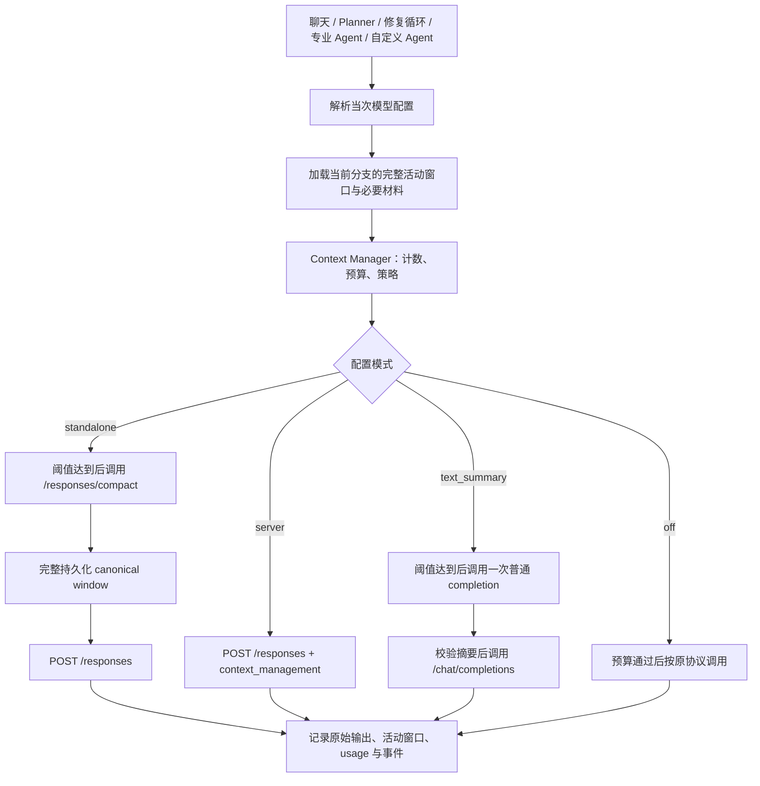

# 按模型配置计算上下文窗口与 Compaction 方案

版本：v2.0；日期：2026-11-06；状态：设计基线。2026-11-07 的代码落地、验证及实际交付边界见 [实施说明](2026-11-07-context-implementation.md)，本文中拟定能力不代表服务商已验证支持。

本文覆盖普通聊天、DAG 专业 Agent、Planner、修复会话与自定义 AgentProfile。目标是让上下文预算跟随实际模型配置，在长任务中使用模型辅助压缩，并保持可恢复、可审计和已有工具权限边界。

## 1. 设计结论

1. **统一按当次实际模型计算窗口**：模型解析、预算、压缩、业务调用共用一个不可变的模型配置快照，不再使用全局固定 128k、聊天固定 24k 或固定消息条数作为模型容量。
2. **Responses 模型默认使用独立 Compaction**：达到本地阈值后调用一次 `POST /responses/compact`，完整保存其返回窗口，再传给后续 `POST /responses`。压缩请求额外一次，业务生成仍是另外一次请求。
3. **服务端自动压缩作为可选模式**：在 `/responses` 中设置 `context_management`；不额外调用 `/responses/compact`，也不在同一会话中叠加本地自动压缩。一次客户端生成请求不代表服务端没有额外压缩计算、费用或延迟。
4. **现有 Chat Completions 模型保留显式兼容方案**：一次普通 completion 生成结构化工作摘要；它与原生加密 Compaction 是两种不同状态格式。不能因为接口声称 OpenAI-compatible，就假设支持 Responses 或原生 Compaction。
5. **原始记录和模型活动窗口分开保存**：模型只使用当前窗口，用户历史、代码、实验指标和证据仍保存原件。原生压缩项是不可解释的协议状态，不能当作论文证据或事实记忆。

首版默认推荐组合为 `responses + standalone + stateless input-array chaining + store=false`，原因是本项目已有本地持久化、重启恢复、revision 和审计需求；这是项目选择，不是官方对所有产品的推荐。

## 2. 依据与协议边界

### 2.1 资料来源

本版原生 Compaction 语义以用户本轮提供的 OpenAI 官方《Compaction》正文为依据，对应文档入口：<https://developers.openai.com/api/docs/guides/compaction>。此前环境访问该站返回 403，本文不声称本轮重新在线读取成功。

用户提供的正文足以确定两种压缩模式、窗口处理规则、`context_management` / `compact_threshold` 以及 `store=false` 的说明。具体模型支持范围、计费、完整 REST/SSE schema、计数接口和加密项跨模型兼容性不由该正文建立，实施时必须再按所选服务商核验，不在本文猜测。

### 2.2 必须遵守的官方规则

| 事项 | 服务端压缩 | 独立压缩 |
|---|---|---|
| 接口 | `POST /responses` 配置 `context_management` | `POST /responses/compact` |
| 触发 | 渲染后的 token 数跨过 `compact_threshold` 时由服务端处理 | 客户端选择时机显式调用 |
| 是否额外请求压缩接口 | 不需要 | 需要一次 |
| 压缩结果 | 响应输出包含加密 compaction item；流式响应中亦需保留该项 | 返回一个新的完整窗口，通常还包含被保留的旧 items |
| 无状态 input-array 链接 | 追加输出 items；允许丢掉最新 compaction item 之前的 items | **完整返回窗口是下一轮的权威窗口，不能裁剪** |
| `previous_response_id` 链接 | 只传新消息并沿用 ID，不能手动裁剪服务端历史 | 首版不与 ID 链接混用 |
| 输入边界 | 仍需正确设置阈值和请求预算，不能承诺任意超长输入都会被救回 | 提交窗口必须仍能装入所选模型上下文 |
| 隐私说明 | 官方说明 `store=false` 时 ZDR-friendly | 官方说明该端点完全无状态且 ZDR-friendly |

加密 compaction item 保留继续推理所需的先前状态，但它不面向人类解释。上述 ZDR-friendly 描述不等同于本项目本地历史不落盘，也不能仅凭一个字段推断账户、代理或部署已经满足所有数据保留条件。

本版取代 v1.0 中“普通文本摘要作为默认路径、原生接口待确认”的推荐；保留文本摘要作为 Chat Completions 兼容分支。

## 3. 当前项目需要改什么

下表以仓库根目录为基准。

| 位置 | 已有行为 | 本次设计要求 |
|---|---|---|
| `research-assistant/backend/internal/modelprofile/profile.go` | `ContextWindowTokens`、`MaxOutputTokens`，注释约定零值窗口回退 128000 | 显式窗口、窗口来源、API 格式和压缩能力配置 |
| `research-assistant/backend/internal/modelresolver/resolver.go` | 每次解析主模型；计划创建时记录模型快照；环境 bootstrap 写死 128000 | 返回完整的当次能力快照；环境模式也要求明确容量 |
| `research-assistant/backend/internal/agent/dynamic_model.go` | 生成时重新解析模型 | 复用预检时解析的同一份配置，避免预算与调用错位 |
| `research-assistant/backend/internal/scheduler/executor.go` | 使用计划创建时的模型快照组装预算 | 改成当次调用预算，计划快照只保留历史审计用途 |
| `research-assistant/backend/internal/prompts/budget.go` | 128000/8192/2000 默认值；极小预算强行取 1024 | 生产路径必须显式传预算，非法组合返回错误 |
| `research-assistant/backend/internal/prompts/task_prompt.go` | section 优先级截断 | 拆分完整材料构建与最终预算检查，压缩前不先丢弃旧材料 |
| `research-assistant/backend/internal/api/chat_runtime.go` | 单条 16000、历史 24000、历史最多 20 条 | 根据剩余窗口动态取历史，当前输入也按实际模型校验 |
| `research-assistant/backend/internal/memory/chat_store.go` | 规则提取用户陈述、最多 1200-token 摘要 | 保留原始历史，新增独立活动窗口；规则摘要不再是压缩主路径 |
| `research-assistant/backend/internal/agent/conversation/session.go` | 默认 `MaxTurns=6` 丢弃中间消息，Snapshot 只保留 ID/轮数/hash | 改成 token 预算触发压缩，保存可恢复的活动窗口引用 |
| `research-assistant/backend/internal/agentprofile/runner.go` | 单次调用，不使用共享上下文预算 | 接入统一运行时，按该 profile 绑定的模型计算 |
| `research-assistant/backend/internal/oaichat/oaichat.go` | 自定义消息只含 role/text/images，仅有 `/chat/completions` | 保持兼容客户端，新增独立 Responses 客户端，禁止用 Text 承载加密项 |
| `research-assistant/backend/internal/llmclient/llmclient.go` | 默认最多 3 次 HTTP 尝试 | 独立压缩首版最多 1 次 HTTP 尝试，无自动摘要修复请求 |

HTTP 请求体大小、文件上传大小、工具输出字节限制和安全扫描继续独立存在；它们是传输和资源边界，不应伪装成模型窗口上限。

## 4. 模型配置、容量来源与迁移

### 4.1 配置模型

保留现有 provider 兼容性标识，增加与之独立的协议选择。下列字段是本项目拟新增配置，不是发给 OpenAI 的参数。

```json
{
  "api_format": "responses",
  "context_window_tokens": 128000,
  "context_window_source": "manual",
  "max_output_tokens": 8192,
  "compaction_mode": "standalone",
  "compaction_trigger_ratio": 0.80,
  "text_summary_target_ratio": 0.55,
  "capabilities": {
    "responses": "yes",
    "standalone_compaction": "yes",
    "server_compaction": "unknown",
    "rendered_input_count": "unknown"
  }
}
```

`api_format` 取 `chat_completions | responses`。`compaction_mode` 取 `off | standalone | server | text_summary`；首版不提供含糊的 `auto` 模式，也不把 endpoint 的名称当能力探测结果。

合法组合：

| API 格式 | 压缩模式 | 条件 |
|---|---|---|
| `responses` | `standalone` | 已确认 `/responses`、`/responses/compact` 及所选模型支持 |
| `responses` | `server` | 已确认服务端 `context_management` 支持 |
| `responses` | `off` | 仍进行窗口检查，超限不自动丢历史 |
| `chat_completions` | `text_summary` | 通过普通 completion 生成可读摘要 |
| `chat_completions` | `off` | 保留原协议及容量检查 |

`unknown` 与 `no` 不触发原生调用。配置不合法时直接说明原因，不静默切换协议、模型或压缩方法。某种模式被拒绝时，只回滚到用户明确选择且能从原始历史重建的兼容模式。

### 4.2 容量来源

按以下优先级确定有效容量并记录依据：

1. 用户明确配置的部署容量或部署限制。
2. 经核验的服务商能力接口，按 endpoint、模型/部署 ID、账号可见范围缓存。
3. 经维护并有版本来源的模型目录，仅用于明确匹配的模型与部署。
4. 未知时返回 `model_context_unknown`，要求补充配置。

若同时掌握部署限制与服务商已确认的上限，取不超过两者的值；手动配置不能突破已知硬上限。模型名可能是代理别名，标准兼容接口不应被假设总能返回窗口字段。不能向模型提问“你的窗口多大”来作为能力事实。

自动按配置计算预算，与自动发现模型真实能力是两个功能。第一阶段保证前者，能力发现按服务商后续增加，不阻塞明确配置的模型使用。

### 4.3 旧配置迁移

- 已有显式正数窗口沿用，并标记为现有配置；它表示当前运行假设，不自动宣称已核验服务商上限。
- 缺失/零值配置标为“容量待确认”，取消隐藏的 128k 默认；管理员可批量补齐后启用严格模式。
- bootstrap 增加明确的环境容量设置，例如 `MODEL_CONTEXT_WINDOW_TOKENS`，并迁移原 `PROMPT_CONTEXT_WINDOW` 的显式值。缺少两者时提示配置，不写死 128000。
- 原 `PROMPT_MAX_OUTPUT_TOKENS` 可迁移为“默认请求输出预算”，但不能当作服务商最大输出能力。
- 原 `ChatSession.Summary` 保留为旧摘要，不转换为 native compaction item。新会话/分支只选择一种活动窗口格式。
- 前端数值框不再自动填写 128000；展示容量来源、协议、压缩模式、能力状态和模型 revision。

### 4.4 当次调用保持一致

解析得到不可变的 `ResolvedCall`：owner、profile ID、profile revision、endpoint 标识、模型/部署、API 格式、容量、请求输出预算、能力和压缩模式。凭据只在内存持有。

先解析这一份状态，再计数、压缩和生成。生成前不再重新解析另一个 revision；下一次逻辑调用才读取新配置。自定义 Agent 使用自己的 `ModelProfileID`，不能套用 owner 主模型的容量。

计划原有 `ModelSnapshot` 继续保存创建时信息；每次任务调用另存实际 profile/revision。运行时换模型允许发生在调用之间，同一次调用不得混用两份配置。

## 5. 动态窗口与触发策略

### 5.1 预算公式

```text
W = 当前模型/部署有效上下文容量
O = 本次生成实际预留的输出预算
S = 计数误差与尚未纳入的格式开销余量
B = W - O - S                        # 可用输入预算
T = floor(B × trigger_ratio)          # 本地压缩触发线/服务端阈值初始值
```

上下文容量同时约束输入和模型生成；推理 token 是否占用输出额度、如何预留，按所选服务商适配规则处理，不能在不同协议下重复扣除或漏扣。

`O` 取任务请求预算，并验证不超过已知最大输出；普通聊天、代码生成和压缩可以使用不同的 O。参数组合导致 `B <= 0` 时返回 `invalid_context_budget`，不通过强行取 1024 掩盖错误。

`S` 随计数可信度调整：匹配 tokenizer/服务商计数时主要预留协议误差；启发式估算时使用更高比例。建议首版启发式余量为 W 的 5%，精确或经校准计数为 2%；这些是项目初值，必须通过实测校准，并非官方保证。

计数包含系统/开发者指令、消息、当前输入、工具定义、工具参数/结果、记忆、文档和多模态输入。可验证的协议开销应直接计入，S 只覆盖残余不确定性。

### 5.2 初始阈值与示例

建议 `trigger_ratio=0.80`，用较早压缩为下一轮输入和输出留下空间。下面统一假设 O=8192、S=5%W，用来说明动态变化，不代表三个窗口适用同一个输出策略。

| 配置窗口 W | 输出 O | 安全余量 S | 可用输入 B | 触发线 T |
|---:|---:|---:|---:|---:|
| 32,000 | 8,192 | 1,600 | 22,208 | 17,766 |
| 128,000 | 8,192 | 6,400 | 113,408 | 90,726 |
| 200,000 | 8,192 | 10,000 | 181,808 | 145,446 |

阈值由配置派生，不固定填写官方示例里的 200000。服务端实际采用“渲染后的 token 数”判定；本地估算与其口径可能不同，应通过 usage/计数反馈校准。不要把 T 当成可绕过 W 的硬扩容机制。

`text_summary_target_ratio=0.55` 只控制本地可读摘要的压缩目标；**原生 `/responses/compact` 返回大小由服务端决定，本文不向原生 API 发送未经文档确认的目标比例参数，也不承诺压到 55%。**

### 5.3 加密项的计数

加密 compaction item 的序列化字节长度不等于模型渲染后的 token 数，不能使用 Base64 长度或现有中文/英文估算器计量。

计数适配器返回 `tokens + source + confidence`：普通明文使用匹配 tokenizer 或估算器；含 opaque items 时优先使用经核验、支持该状态格式的服务商计数能力。可用 usage 只能在口径明确时作为观测值，不能把压缩前的 input usage 冒充压缩后窗口大小。

若缺少精确计数，保留 `estimated/unknown` 状态，并在服务端判定范围内运行；未知状态不能绕过最终容量错误处理。独立压缩之后若无法确认返回窗口加新增内容可用，要求服务商适配补齐计数/有效上界，或返回可恢复错误，不依据密文字节编造精确占用。

若计数需要另调 HTTP 接口，必须单独计入请求数和延迟，不能宣传整轮仍只有“压缩 + 生成”两个请求。优先使用本地可验证计数、已有服务端观测或缓存；能力预检与正文生成不隐式增加付费探测。

### 5.4 大输入和本身超限

- 新问题、硬约束或工具定义本身超过 B 时，压缩旧历史不能解决，返回 `context_required_items_too_large`。
- 新材料单次太大时，文档/日志可先存 Artifact 并按任务检索；这是材料选择策略，不能声称所有内容已被压缩保留。
- 若旧活动窗口仍可放入压缩模型，可以先压缩旧窗口，再追加新的消息，复核预算。
- 若旧活动窗口已经超出压缩模型容量，一次 `/responses/compact` 不足以处理全部历史。明确返回需要切换大窗口模型或分段重建，分段重建不计入“一次压缩”的承诺。
- `max_turns` 可作为反失控的执行步数限制，但不再用于提前丢掉长任务的消息；传输层资源限制继续单独生效。

## 6. 总体架构与统一调用入口



拟新增：

| 组件 | 职责 |
|---|---|
| `internal/contextwindow` | Budget、Counter、Policy、Prepare、压缩策略、状态版本与错误类型 |
| `internal/responses` | Responses create/compact、原生 items、完整流式事件解析、协议化 usage |
| `ContextStore` | 原始 items、活动窗口 generation、压缩记录和模型兼容信息；网络 I/O 在锁外 |
| `ModelRuntime` | 解析一次模型，调用 Context Manager 和协议适配器，接入费用与审计 |

Eino 的 agent 编排可以保留，但 Responses 会话必须通过运行时访问原生状态，不能在每轮经过现有 `schema.Message.Content` 的有损转换。简单文本任务可以返回归一化文本供现有 Agent 消费；完整输出 items 另存会话状态，不能只保存 `output_text`。

持久化建议使用带类型的 envelope 加原生 `json.RawMessage`。未知可选字段保留，以免丢失服务商新增的加密状态；提交前按适配器验证。工具仍通过已有 `ToolInvoker` 执行，压缩调用不执行工具，也不改变审批与 ToolGrant。

## 7. 独立 Compaction：首版默认路径

### 7.1 正常流程

1. 解析当次 `ResolvedCall`，加载该会话/任务分支的活动窗口版本。
2. 构造本次新消息、必须显式发送的当前约束、工具定义和生成预算，估算“旧窗口 + 新内容”的完整占用。
3. 低于 T：直接生成；达到 T 且确有可压缩历史：冻结当前旧窗口，提交一次 `/responses/compact`。提交内容必须是合法、可放入所选模型的原生窗口。
4. 读取 `compacted.output` 的**全部 items**，保持顺序及协议所需字段，完整提交为新 generation；不提取其中某一项作为所谓“摘要”。
5. 将尚未包含的新消息追加到该窗口，带上生成时必要的独立请求配置，再进行预算检查和 `/responses` 调用。
6. 将生成的全部合法输出 items 追加为下一轮活动状态，保存文本结果、工具交互和 usage。

本文主流程选择“压缩旧窗口，再追加当前输入”，因此当前用户问题不会被压缩。若适配器选择将当前问题一并提交 compact，必须记录其已被覆盖，后续不能再次追加同一个问题。一次逻辑 turn 使用稳定 ID 防止重复。

### 7.2 请求示意

以下仅使用用户提供正文中明确展示的请求字段；实际模型必须是当前服务商已确认支持该接口的配置值。

```javascript
const compacted = await client.responses.compact({
  model: resolved.model,
  input: activeWindow,
});

// 完整保留 output，不能仅提取 compaction item 或剪掉 retained items。
const nextInput = [
  ...compacted.output,
  { role: "user", content: currentQuestion },
];

const response = await client.responses.create({
  model: resolved.model,
  input: nextInput,
  store: false,
});
```

生产适配器还需补充并核验输出预算、顶层指令、工具和其他字段；示例不表示仅传这几项即可覆盖完整 Agent 协议。

### 7.3 输出与容量要求

- compact 的完整输出是权威窗口；不删旧 message、不裁剪工具项、不改写 encrypted content，不按最新 compaction item 位置二次整理。
- 该窗口可作为前缀追加新 user/tool items；**追加新内容不等于裁剪或重排 compact 输出**。
- 原生压缩没有本地 JSON 摘要契约；只校验协议、响应完整性和下一轮可用性，不要求解密，不尝试“修复密文”。
- 压缩后仍过大或无法确认可用时不马上无限循环调用 compact；本轮最多一次，返回 `compaction_insufficient` 或 `context_size_unknown`。
- compact 成功后可先持久化新 generation。后续生成失败不会丢掉已得到的有效窗口，也不需下次再次压缩同一段历史。

## 8. 服务端自动 Compaction：可选路径

### 8.1 输入数组链接

```javascript
const nextInput = [
  ...activeWindow,
  { role: "user", content: currentQuestion },
];

const response = await client.responses.create({
  model: resolved.model,
  input: nextInput,
  store: false,
  context_management: [
    { type: "compaction", compact_threshold: derivedThreshold },
  ],
});

// toInputItems 代表经协议验证的输出到下一轮输入转换。
// 不能仅保留 response.output_text。
activeWindow = [...nextInput, ...toInputItems(response.output)];
```

`derivedThreshold` 由第 5 节预算计算得出，并校验符合该模型和服务商范围。在此模式中不另外调用 `/responses/compact`。

完整接收并保存输出后，允许依官方规则删去**最新 compaction item 之前**的活动 items，保留该项及其后的全部 items。只有明确标记为 `server` 模式产生的状态才能使用这条整理规则；不能把它套到独立 compact 输出上。

流式情况下先收集完整 item 和完成事件再提交，不能在只收到一段 encrypted content 时就删除旧窗口。串流中出现 compaction 后还可能有继续推理、文本或工具输出，全部应按原序保留。

### 8.2 `previous_response_id` 链接

官方正文允许在此模式每轮只传新用户消息并沿用 response ID；不手动裁剪服务端历史。新增工具结果按相应协议续接，不将完整本地 transcript 再与 response ID 重复提交。

首版不将此方式设为默认，因为本项目需要本地恢复和明确的窗口版本。若以后开放，单独实现 `chain_mode=previous_response_id`，核验存储、过期和恢复语义后再启用；不假设 ID 永久有效，也不未经核验把该模式与 `store=false` 或独立 compact 混在一起。

### 8.3 两种原生模式的区别必须进入代码

活动窗口保存 `origin_mode` 与 `chain_mode`，输出处理使用不同函数：

```text
ApplyStandaloneResult(allOutputItems)     # 原样作为新权威窗口
ApplyServerOutput(allOutputItems)         # 追加输出，可按最新 compaction 整理
ApplyResponseID(nextResponseID)           # 不操作服务端历史
```

禁止使用一个“保留最新压缩项”的通用函数处理所有模式。

## 9. Chat Completions 的文本摘要兼容分支

现有主调用链主要使用 Chat Completions。为避免强制所有部署切协议，保留 `text_summary`，但需用户明确选中；它不产出原生 encrypted compaction item，也不具备原生状态格式的互操作保证。

### 9.1 单次调用与预算

保留系统指令、当前请求、不可压缩的约束和最新完整交互，将“上一份有效摘要 + 尚未覆盖的旧交互”提交一次普通 completion。首版默认使用同一模型；单独指定摘要模型时，必须验证它的窗口能够容纳压缩输入，不能默认小模型能处理大模型的历史。

```text
R = floor(B × text_summary_target_ratio)
摘要允许长度 = R - 必须保留原文的 token 数
```

摘要允许长度还须受摘要模型输出上限约束，并为 JSON 结构预留空间。如果无法满足，不默默砍掉必要约束，返回明确错误或请求用户改用合适容量的模型。

一轮触发最多一次摘要请求，无 JSON repair 循环。传输超时、空输出、格式不合法、输出不完整、来源不存在或长度超限时，沿用上一份有效状态。原请求仍可装入 B 才能继续生成；否则保留输入并返回可恢复错误。

### 9.2 工作摘要契约

摘要记录可继续执行的工作状态，区分用户要求、真实观察与模型推测：

```json
{
  "version": "context.summary/v1",
  "goal": "当前目标",
  "constraints": [{"text": "约束", "source_ids": ["message-1"]}],
  "facts": [{"text": "已观察事实", "source_ids": ["artifact-1"]}],
  "decisions": [{"text": "已经确定的选择", "source_ids": ["message-2"]}],
  "attempts": [{
    "action": "已尝试动作",
    "outcome": "实际结果及失败原因",
    "source_ids": ["task-1"]
  }],
  "hypotheses": [{"text": "待验证解释", "source_ids": ["message-3"]}],
  "open_questions": ["仍缺少的信息"],
  "next_steps": ["下一步"],
  "artifact_refs": ["artifact-1"]
}
```

压缩提示词只要求总结资料，不执行历史任务；不允许发明数值、路径、引用或权限。后端验证 JSON 和引用存在性，但这不能证明所有语义都正确，仍需用第 16 节任务评测检查遗漏和失真。

摘要作为派生资料注入，不提升为系统指令，也不自动变成长期记忆。原始消息、代码、实验结果和冻结契约始终是权威来源。

## 10. 原始历史、活动窗口与并发持久化

### 10.1 三类记录分离

| 记录 | 内容 | 生命周期 |
|---|---|---|
| 原始执行日志 | 用户输入、原生模型输出、工具调用/结果、产物引用 | 按现有 owner/session/project 权限与保留策略保存 |
| 活动窗口 | 当前模型实际使用的原生 items 或文本摘要及近期交互 | 每次完成生成/压缩产生新 generation |
| 业务事实与证据 | 用户事实、论文引用、冻结实验契约和真实指标 | 继续由 memory、wiki、Artifact 和证据校验机制管理 |

活动窗口用于继续推理，不能代替证据存档。加密状态不展示给用户阅读，不进入搜索索引、Prompt 日志或普通文本导出；持久化按本项目敏感会话数据处理。保留原件让后续能从历史重建，但不保证一定能在一次 API 内重建。

### 10.2 拟保存的状态字段

```text
ContextState
  owner_id, project_id, session_id
  plan_id?, task_id?, branch_id
  revision, generation, active_window_ref, origin_mode, chain_mode
  provider_endpoint_fingerprint, model, profile_id, profile_revision
  capability_revision, instruction_version, tool_schema_fingerprint
  source_cursor, source_hash, last_completed_turn_id
  token_observation {tokens?, source, confidence, observed_at}
  latest_compaction_record_id?, previous_response_id?

CompactionRecord
  id, logical_turn_id, request_attempts
  mode, status, source_generation, result_generation?
  source_hash, output_hash?, compacted_window_ref?
  resolved_model_ref, count_before?, count_after?, count_source
  usage?, cost?, latency_ms, error_code?, committed_at?
```

原生窗口中 items 用原生类型/`json.RawMessage` 保存，不转成自定义可读摘要。协议必填字段校验、输入输出转换规则按 Responses 适配器实现；未确认的 REST 字段不在此设计中手写猜测。

### 10.3 并发提交

1. 同一 owner、会话、任务分支和 source generation 使用 singleflight；不同分支可独立处理。
2. 在存储锁内读取 source revision/hash，锁外执行网络请求。
3. 接口返回后以 CAS 校验 source revision/hash；成功则提交新 generation，失败则丢弃候选状态，不能覆盖更新的窗口。
4. 若压缩进行时新增消息，可以保留旧窗口的压缩结果作为有来源边界的候选，重新对齐后只追加未覆盖的消息；不自动再调用第二次压缩。
5. 两个相互冲突的用户生成 turn 按会话序列执行或显式分叉，不能把它们各自的 response 乱序追加到同一个窗口。

singleflight/CAS 只保证本地状态一致，不能承诺网络断开时服务端绝对没有完成或扣费。压缩路径不默认自动重试，状态可标为 `outcome_unknown` 供后续处理，不伪造“未发生”。

### 10.4 流式输出与重启

原始流可写暂存记录；活动窗口只在收到完整且协议有效的结果后提交。独立 compact 成功并落盘后，即使业务生成失败，仍保留压缩 generation。生成中断时保留上一份完整窗口和本轮未完成状态。

重启从最后一个已提交 generation 恢复，不根据 UI 可见文本重新拼出原生状态。恢复期间不得重新执行已经完成的有副作用工具；继续使用现有工具调用 ID、执行账本、租约与审批记录。

## 11. 模型、协议和模式切换

用户提供的官方正文没有承诺加密项跨模型、跨代理、跨账号或跨服务商可重用。因此默认以 endpoint/部署身份、账号可见范围、模型和协议为兼容边界，不把 opaque 状态转发给另一个 provider。

| 变化 | 处理 |
|---|---|
| 仅请求输出预算或本地阈值变化 | 下一轮重新计算，不改写已提交原生窗口 |
| 同模型容量配置变小 | 复核窗口；旧窗口若装得下可尝试一次压缩，否则要求重建 |
| 模型/部署、endpoint 或服务商变化 | 只有适配器明确验证兼容才能沿用；否则从原始记录构建新分支 |
| Chat Completions ↔ Responses | 按目标协议从原始可见历史及工具记录重建；不能把加密项当文字搬运 |
| standalone ↔ server | 在新 generation 的边界上切换，保留来源模式；未验证兼容时重建 |
| 顶层指令或工具 schema 变化 | 使用最新权威配置并校验旧工具交互的协议合法性，不修改旧结果或历史权限 |

旧窗口不能被目标模型读取时，可由仍可用且兼容的原模型基于原始历史生成显式交接摘要；这是单独的迁移操作，记录成本并与例行 Compaction 区分。原模型不可用时从可读原始记录重建，不尝试本地解密。

切换后若需要分段处理，不能静默扩大“一次额外请求”的含义。UI 提示当前分支容量、压缩格式和需要重建的原因。

## 12. 任务与科研契约的保真要求

### 12.1 始终由程序维护的状态

- 用户目标、明确约束、当前请求、预算和审批状态。
- 冻结的 ResearchSpec、Metric/Reward 契约、Claim Rubric 的版本与 hash。
- 当前使用的数据划分、单位、指标定义、仓库 commit、环境 manifest。
- 最新工作产物引用、已完成任务状态与有副作用工具的执行记录。

这些状态保存在业务模型中，不能依赖加密项是否记住。每轮按当前权威状态显式传入所需最小约束/版本引用，较大原件按权限读取；生成后的指标和结论继续经过确定性验收。原生 Compaction 不提供“逐字保留所有约束”的本项目保证。

若新增约束作为 input items 发送，只能追加当前权威的新项，不能通过修改 canonical output 的旧项实现。顶层指令、工具定义及请求参数每轮由运行时提供，不假设 compaction item 会替代这些配置。

### 12.2 修复会话

移除作为容量策略的 `MaxTurns=6` 中间历史裁剪。保留最新可运行代码/补丁引用、上一轮反馈和错误；旧尝试随合法历史进入压缩。每次压缩后评测是否记得失败原因，避免重复使用已经证伪的修复。

`Session.Snapshot()` 保存 ContextState 的引用与 generation，不能只存轮数/hash 就宣称可恢复。多个候选实验、Beam/ToT 分支和不同 DAG 节点使用各自的 branch ID，不能共享一份会被覆盖的压缩状态。

### 12.3 文档与工具材料

文献全文、长日志、图片和源码首先进入 Artifact/Document 存储，再选择本轮相关内容。压缩用于已有交互状态，不能替代大文档检索。

工具调用与结果作为完整协议交互处理。对原生 compact 返回的 retained items 不做本地截断；对新材料限制长度时在创建合法工具结果之前完成，并附可读取的原件引用。压缩不重新执行工具、不增加工具权限、不解除现有审批。

## 13. 失败处理与费用预算

| 情况 | 行为 |
|---|---|
| 未知模型容量/不支持配置模式 | 生成前返回配置错误，不猜窗口或静默换模式 |
| 压缩超时、网络断开、429/5xx | 本轮无隐式重试；保留已提交状态，记录失败/结果未知及可获得的 usage |
| 原生返回不完整或协议非法 | 不提交候选，不剪掉旧历史，不把字符串修成原生 item |
| 文本摘要 JSON/来源/长度不合格 | 不提交候选，不追加 repair 调用 |
| 压缩失败但原窗口仍在预算内 | 可在相同模型下原样继续，附状态；不能无声丢失材料 |
| 压缩失败且原窗口不在预算内 | 返回可恢复错误，保留用户输入与原始材料 |
| 压缩后仍放不下新请求 | 本轮不再次压缩；返回 `compaction_insufficient` |
| 计数未知且没有可信可用性边界 | 返回 `context_size_unknown`，或按已核验的服务端能力处理，不伪造精确计数 |
| CAS 冲突 | 不覆盖新版本，复用/重对齐已有结果或要求重试，不自动重复付费 |
| 费用/调用预算不足 | 不发起压缩；原请求可装入且业务预算允许才继续，否则暂停或阻塞 |
| 原生状态被另一模型拒绝 | 启动明确的重建流程，不能直接把该状态发送到 fallback provider |

“一次 API 压缩”在独立与文本摘要模式定义为每轮最多一次**客户端压缩 HTTP 尝试**，业务请求另计。服务端模式没有客户端单独压缩请求，不对服务内部的压缩次数作承诺。网络失败无法保证恰好执行一次，记录实际不确定性。

压缩用途统一记为 `context_compaction`，与业务 `generation` 分开记录但计入同一计划/会话费用约束。压缩原生 usage/计费明细若未提供则记录 `unknown`，不写 0 成本；明确哪些数字为估算值。

独立模式预派发时同时考虑压缩和后续生成的预算预留，结束后按实际核销；服务端模式按其可核验的 usage/费率核算，不虚构一个独立请求价格。重复压缩使用 generation/hash 去重，避免每轮在同一个阈值上反复压缩无变化窗口。

## 14. 前端与可观测性

模型设置提供“API 协议、模型上下文容量、容量来源、请求输出预算、压缩模式、触发比例”。只在协议与能力兼容时开放对应模式，不用一次 PONG 连通性测试冒充压缩能力验证。

工作台显示：

- 当前调用模型及上下文容量，输入使用量及精确/估算/未知标记。
- 压缩状态、最近压缩时间与模式、可获得的前后 token 观测。
- 额外耗时、调用次数和已知成本；失败时保留本次输入并说明下一步。

可读摘要可作为诊断材料查看；原生加密内容不展示为“摘要正文”。若不知道压缩后 token 数，不能展示精确百分比进度条。

拟增加事件 `context_budget_resolved`、`context_compaction_started`、`context_compaction_completed`、`context_compaction_failed`、`context_window_rebuilt`。事件包含窗口 generation、模式、模型 revision、计数来源和状态，不包含密文、凭据、完整输入或压缩原文。

指标覆盖调用/失败数、输入估算误差、压缩延迟、可获得的压缩比例、溢出数及任务成功率。Prometheus 标签使用受控的模式/错误码，session、原始 endpoint、hash 等高基数字段放结构化审计，不作指标标签。

## 15. 实施阶段与交付边界

| 阶段 | 交付 | 完成条件 |
|---|---|---|
| P0：统一预算 | ResolvedCall、容量来源与迁移、Counter/Budget，接入全部现有调用入口 | 两种不同容量模型得到不同预算；同一次调用模型 revision 一致；生产路径没有隐藏的固定窗口 |
| P1：Responses 基础 | create/compact 客户端、原生 item 与流式解析、ContextStore，聊天 standalone | canonical output 无损持久化和重放；阈值上方一次 compact + 一次生成；重启后可继续 |
| P2：Agent 接入 | Planner、Coder/其他专业 Agent、修复会话、自定义 profile 与分支隔离 | 不在压缩前按固定轮数丢历史；工具协议合法；最新工作产物与契约可恢复 |
| P3：兼容摘要 | text_summary、来源校验、用途记账与失败恢复 | Chat Completions 明确选中后可使用；不与原生状态互转或叠加 |
| P4：服务端压缩 | server + stateless、SSE 事件与专用整理规则 | 不发 compact 请求；保留服务端 compaction items；与 standalone 的处理分开测试 |
| P5：质量评测 | 科研长任务对照、成本/延迟/保真指标 | 达到第 16 节门槛后再扩大默认启用范围 |

P0 与 P1 是首个可交付版本；P2 是达到全 Agent 覆盖的必要阶段。只完成聊天不能称为全项目已统一。`previous_response_id`、服务商自动能力发现和跨模型加密状态迁移不进入首版范围，避免未验证协议混入主路径。

上线按 profile/owner 小范围选择启用，不用全局强制切换所有现有会话。回滚切回原协议/模式前从原始历史恢复可读状态；不把 opaque items 交给旧客户端，也不把长期事实记忆删除。新增 generation 保留只读，不覆盖现有历史。

## 16. 验收与回归清单

### 16.1 确定性测试

| ID | 场景 | 通过条件 |
|---|---|---|
| C01 | 32k/128k/200k profile | 按 W/O/S 算出各自 B/T，不使用固定 24k/128k |
| C02 | 配置缺失、负数或 O+S≥W | 明确报错，不强行保留 1024 或隐式回退 |
| C03 | 主模型与自定义 profile 不同 | 各用自己绑定模型的容量和协议 |
| C04 | 预算解析后 profile 被修改 | 本轮预算/压缩/生成仍使用同一 revision，下一轮读取新 revision |
| C05 | 阈值以下/以上 | 以下无额外请求；standalone 以上只有一次 compact 尝试，再进行一次业务生成 |
| C06 | standalone 返回 retained items + 加密项 | 顺序、字段、所有 items 无损保存；下一请求保留完整输出，无删前缀逻辑 |
| C07 | server 输出含多个 item 与后续文本/工具项 | 追加所有输出；可删除最新 compaction 之前的 items，不能删之后内容 |
| C08 | server 模式 | 配置 `context_management`，不调用 compact；阈值来自当前模型 |
| C09 | 断流/空响应/无效响应 | 不提交不完整窗口；上一 generation 可恢复 |
| C10 | compact 成功、业务生成失败后重启 | 恢复已提交压缩窗口；不重复追加用户输入或压缩同一旧窗口 |
| C11 | 并发压缩与新增用户输入 | singleflight 去重、CAS 不覆盖新状态；消息顺序不乱 |
| C12 | opaque token 数未知 | 不以 JSON/Base64 长度假装渲染计数，不展示虚假精确占用 |
| C13 | 一次新输入超过 W，或旧窗口已超过压缩模型 W | 不发无效 compact，不宣称一次可处理任意长度 |
| C14 | 模型/服务商/协议切换 | 未确认兼容的密文不跨边界复用，重建过程保留原始历史 |
| C15 | 压缩失败与费用耗尽 | 按第 13 节处理；无隐式重试、无限循环、静默截断或零成本伪报 |
| C16 | 工具交互、审批和执行账本 | call/result 关系合法，副作用不重放，压缩不绕过 ToolGrant/审批 |
| C17 | DAG/实验候选多分支 | 一个分支的压缩不覆盖另一个分支；owner/session/project 隔离 |
| C18 | 兼容摘要与来源 | JSON、来源、长度可验证；失败不污染原生窗口或用户事实记忆 |
| C19 | 固定条数/早期截断回归 | 历史超过 20 条、修复会话达到原 `MaxTurns=6` 裁剪条件后，仍按 token 策略工作；必要资料未提前丢弃 |
| C20 | 隐私与审计 | 日志/指标不包含凭据、完整原生密文、完整上下文；本地记录按现有权限读取 |

HTTP 请求计数由 mock server 统计，C06/C07 使用不同形状的 fixtures，防止两种协议处理规则被误合并。真实服务测试按明确配置和预算启用，不让单元测试默认访问付费模型。

### 16.2 科研长任务评测

对照三组：当前规则裁剪、文本摘要、原生 standalone；server 模式能力核实后另加。固定模型、工具、任务输入与预算，每个场景多次运行，保存原始证据。

至少覆盖四类剧本：

1. 长论文复现：早期定义数据划分、单位、容差，后期改变部分计划，检查冻结契约与最新要求是否仍准确执行。
2. 长修复循环：前期记录失败方法和环境约束，后期要求继续，检查重复失败次数与最新补丁是否丢失。
3. 多轮调研：相似论文与相互冲突的结果交替出现，检查来源引用、用户事实和模型假设是否混淆。
4. 多分支实验：不同候选与隐藏 holdout，检查分支隔离、既有 holdout 边界和结果归属。

发布门槛：协议/持久化/权限用例全部通过；冻结契约和关键数值由程序保证一致；压缩后任务成功率与结论正确率不出现未经解释的明显下降。成本、延迟、上下文错误和重复尝试按各模式实测报告，不先承诺固定压缩比或质量零损失。

## 17. 实施前仍需核验的外部能力

1. 实际使用的模型/代理是否分别支持 Responses、独立 compact 和服务端 compaction，能力的来源与有效期。
2. REST/SSE 的完整 item schema、输出到输入的合法转换、`store=false` 下所需状态字段，以及工具/推理/多模态 items 的保留要求。
3. 对 opaque compaction state 是否有精确输入计数能力或可信可用性上界，usage 能观察哪个阶段的 token 数。
4. 独立与服务端压缩的实际费用、失败计费和限流；API 未提供的数字明确标未知。
5. 加密状态跨模型版本、凭据轮换和模式切换的兼容性；未确认前按第 11 节保守重建。

上述事项是协议适配任务，不影响先实施“按已配置模型容量统一预算”。原生模式必须在所选部署能力确认后启用。
