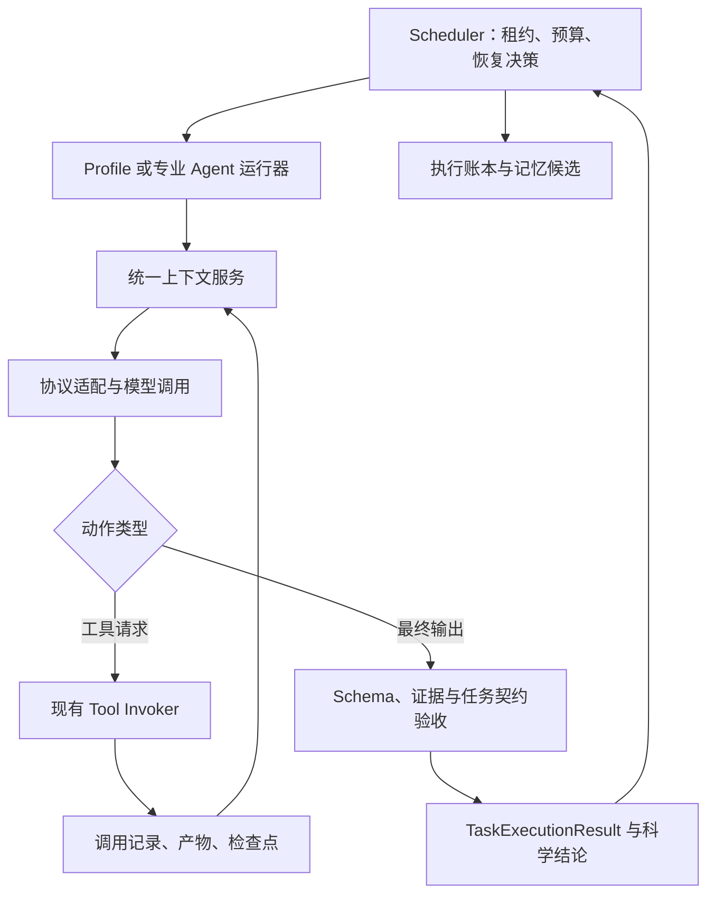

# Agent 能力改进方案

版本：v1.0；日期：2026-11-07；状态：待实施设计。本文记录代码审阅后的改进方向，不表示相关运行逻辑已经修改，也不将建议指标视为已测结果。

适用范围：自定义 AgentProfile、DAG 专业 Agent、调度与恢复、Claim Evidence、上下文、记忆和 Agent 评测。

## 1. 目标与主要决策

项目已经有 DAG 调度、专业 Agent、沙箱、工具注册与权限、执行审批、预算、Artifact、计划 revision、记忆和科研实验契约。下一阶段应围绕这些能力补齐执行与验收闭环。

本文建议按六条工作线推进：

| 编号 | 改进方向 | 用户可见的目标 | 优先级 |
|---|---|---|---|
| AG-01 | 有界的模型—工具执行循环 | 自定义 Agent 能使用授权工具，读取结果并继续完成任务；达到边界时明确停止 | P1 |
| AG-02 | 失败分类、局部恢复与受控重规划 | 网络抖动可以重试，环境问题可以定向修复，缺材料时正确等待；相同失败不无限重复 | P1；自动重规划为 P2 |
| AG-03 | 确定性的科研数值验收 | 数值结论由冻结协议和执行证据计算，模型不能凭描述把未复现标为已验证 | P0 |
| AG-04 | 统一上下文治理与恢复 | 上下文随实际模型变化，长任务压缩后仍保留目标、约束、最新代码和证据引用 | P1 |
| AG-05 | 任务质量评测 | 测出“是否完成任务、证据是否正确、恢复是否有效”，消除缺模型或缺判分条件的假通过 | P0 基线；持续扩展 |
| AG-06 | 可执行、可验证的修复记忆 | 下次遇到兼容问题时能取回实际修复步骤及适用条件，而不只是“重试后成功” | P2 |

P0 表示结果可信度与评测基线，应最先交付；P1 表示主要运行能力；P2 依赖前述证据、预算和恢复基础。优先级不等于所有工作必须串行。

总体约束：

1. **模型提出动作，后端决定是否允许、是否有效、是否完成。** 工具调用、数值比较、预算和状态迁移均有确定性的后端检查。
2. **一个逻辑任务只有一套恢复预算。** HTTP 重试、专业 Agent 内部修复、调度器重试与重规划共享上限，不能层层相乘。
3. **保留专业 Agent 的确定性流程。** 先增强自定义 Profile 和确实需要工具探索的节点，不把 Benchmark、AutoResearch 等成熟流程统一改成自由循环。
4. **科学负结果可以是正确完成。** 指标未达到论文目标，不等于执行错误；不能通过改目标、改测试集、放宽容差来获得成功。
5. **原始证据、活动上下文、长期记忆分别保存。** 摘要、模型解释和加密 compaction item 都不能替代实验原件。

相关设计：

- [按模型配置计算上下文窗口与 Compaction](2026-11-06-model-aware-context-compaction.md)：AG-04 的详细协议、存储和恢复设计。
- [Agent 链路优化](2026-10-27-agent-chain-optimization.md)：General 计划、Prompt 去重、Repair 会话和预算的早期设计；当前实现以本次代码审阅为准。
- [Agent/工具生态](n13-agent-tool-ecosystem-mcp.md)、[计划审阅与人在回路](n05-plan-review-hitl.md)：复用工具和审阅边界。
- [Agent 记忆系统](2026-11-01-agent-memory-system.md)、[记忆实现对照](../improvement-2026-11-01/MEMORY-IMPLEMENTATION.md)：AG-06 的已有底座。

## 2. 当前实现与具体差距

以下位置以 2026-11-07 工作区代码为依据。这里区分“已有机制”和“仍需补齐的路径”，不据此断言所有 Agent 都有同样缺陷。

| 工作线 | 当前证据 | 需要补齐的部分 |
|---|---|---|
| AG-01 | [ProfileRunner](../../research-assistant/backend/internal/agentprofile/runner.go) 的 `ExecuteTask` 忽略 `sharedContext` 参数；渲染后构造一条 user 消息，调用一次 completion；固定 `MaxOutputTokens: 1024`。`MaxSteps` 仅写入 metadata | 接收统一上下文；真正执行步数限制；支持模型工具请求、工具结果回传、完成校验和恢复 |
| AG-01 | [AgentProfile](../../research-assistant/backend/internal/models/agent_profile.go) 已有 `ToolAllowlist`、`MaxSteps`、`OutputSchema`；[Invoker](../../research-assistant/backend/internal/tools/invoker.go) 已有 allowlist、grant、schema、审批要求、超时和审计记录；[oaichat](../../research-assistant/backend/internal/oaichat/oaichat.go) 的消息/响应类型仍是简化的文本与图片模型 | 把 Profile 循环接到既有 Invoker；扩展协议适配层，不能将模型输出中的命令文本直接当工具调用 |
| AG-02 | [调度失败处理](../../research-assistant/backend/internal/scheduler/scheduler_state.go) 保存部分产物、清理租约，再按 `RunCount <= RetryLimit` 将可重试任务回到 pending；专业 Agent 已有各自的局部修复 | 统一失败类别、共享尝试预算、无进展检测和升级决策；不能把外层节点重跑当作全部恢复策略 |
| AG-03 | [Claim Evidence](../../research-assistant/backend/internal/agent/claim_evidence.go) 校验 claim/criterion ID、状态、引用及执行类证据；`buildClaimEvidenceResults` 接收模型的 `ObservedValue`、`Status`，该函数内没有重算预期值与容差比较 | 对可量化 criterion 引入可信观测值和后端比较；保留现有引用校验与不可验证降级 |
| AG-04 | [Repair Session](../../research-assistant/backend/internal/agent/conversation/session.go) 默认 `MaxTurns=6`，保留首部与最近轮次并删除中间内容；`Snapshot` 只保存 session ID、轮数和 hash | 按实际 token 预算触发压缩，持久化可恢复的完整活动状态；接入详见独立上下文方案 |
| AG-05 | [Profile Evaluator](../../research-assistant/backend/internal/agentprofile/eval.go) 主要检查 `ExpectedContains`；空用例生成默认用例。`useModel=true` 且 completer 缺失时仍可能对模板评分，nil response 也可能保留模板作为 output | 区分模板渲染测试、模型测试、完整任务评测；缺执行或缺 grader 时不能记通过 |
| AG-06 | [任务记忆抽取](../../research-assistant/backend/internal/memory/extract.go) 将重试成功写为“重试/修复后成功”；[consolidation](../../research-assistant/backend/internal/memory/consolidate.go) 有确定性维护和待审核 reflection，但不是已验证的修复方法抽象 | 记录实际动作、前提、前后证据与复用结果；仅凭重试成功不升级为可靠 procedure |

需要保留的强项：

- [RoutedTaskExecutor](../../research-assistant/backend/internal/scheduler/executor.go) 已有 ContextBinder、计划上下文、记忆/Wiki 注入与专用 `tool_call` 路径，自定义循环应接入这些入口。
- Scheduler 已有 execution lease/epoch、防迟到写回、暂停/恢复/取消，以及预算和运行期审批。新增循环必须继续服从这些控制。
- [PlanRevision](../../research-assistant/backend/internal/models/revision.go)、[revision store](../../research-assistant/backend/internal/revision/store.go) 和 [revision API](../../research-assistant/backend/internal/api/plan_revisions.go) 已有不可变版本和乐观并发约束。
- Benchmark/AutoResearch 已有冻结契约、后端指标计算及 holdout 等机制；AG-03 优先补 Claim Evidence 的薄弱环节，并复用已有计算逻辑。
- 项目已有单元测试、真实模型集成测试、端到端场景和 [CI](../../.github/workflows/ci.yml)。AG-05 侧重完善任务质量标准，而不是重新从零建立测试。

## 3. 共用运行契约与职责边界

### 3.1 复用现有分层



| 组件 | 负责 | 不能负责 |
|---|---|---|
| Scheduler | 任务依赖、lease/epoch、总预算、外层恢复与重规划授权 | 用模型一句“完成了”替代任务验收 |
| Agent 运行器 | 任务局部推理、调用工具、处理结果、提出最终输出 | 直接修改 DAG、扩大权限或修改冻结科学目标 |
| 协议适配层 | 原生工具调用、文本/图片/协议 items、usage、终止原因 | 将服务商特有状态压成一段文本后假装可无损续接 |
| Tool Invoker | 工具解析、授权、参数校验、审批衔接、实际执行和审计 | 因模型声称“已获批准”而跳过校验 |
| 验收器 | 输出格式、必需产物、数值计算、协议与证据一致性 | 编造缺失指标，或根据观测结果反向调整容差 |
| 记忆系统 | 提取有证据的经验，按归属和兼容性检索 | 自动执行记忆中的命令或赋予新权限 |

### 3.2 建议新增的逻辑记录

以下名称为拟新增内部数据结构，不是已存在的 API，也不要求全部塞入 `Task.Metadata`：

| 记录 | 最少字段 | 用途 |
|---|---|---|
| `AgentRun` | owner/project/session/plan/task、revision、execution ID/epoch、profile/prompt/model 配置版本、工具版本、契约 hash、恢复链 ID | 明确一次执行到底用了什么配置、属于哪个版本 |
| `AgentCheckpoint` | run、状态版本、活动上下文引用、已提交模型响应引用、待处理工具调用、计数器、最后事件序号 | 中断后从已确认边界恢复 |
| `FailureInfo` | class、code、stage、原因、指纹、输入/环境版本、是否可恢复、证据引用 | 替代仅靠错误文本和运行次数决策 |
| `RecoveryDecision` | 原因、动作、前提、预算消耗、预期改变、验证方式、最终结果 | 统一局部修复与外层重试 |
| `ActionLedgerEntry` | 动作 ID、输入摘要/hash、执行环境、产物引用、验证结果、前后状态 | 支持幂等恢复、无进展检测和记忆抽取 |

`TaskExecutionResult` 继续作为调度器边界；先新增可选 typed 字段或版本化扩展，再迁移旧 metadata。旧任务不能因为缺新字段而被推断为“验证通过”。

任务契约、Profile 与 Prompt 在一个 run 中绑定版本。实际模型按上下文方案在每次逻辑调用前解析，将本次配置版本写入 step；若模型/协议发生变化，先检查上下文兼容性。一次调用的预检、压缩和生成始终共用同一配置，不在这三个环节之间重新解析。

多工具调用产生的记录不能只装进目前单个 `ToolCall` 指针。建议增加批量记录引用/增量写入接口，由调度器状态协调器和检查点存储按 execution fence 提交。保留旧单次 `tool_call` 节点的兼容路径。

### 3.3 分开表示执行状态和科研结果

项目已有 [TaskStatus](../../research-assistant/backend/internal/models/task.go) 与 [PlanOutcome](../../research-assistant/backend/internal/models/outcome.go) 的区分，继续沿用：

- 执行状态回答是否运行、等待、失败、取消或完成。
- 科研结论回答指标是否达到目标、证据是否充分、是否需要审阅。
- 数值比较未达标但协议完整，可以完成一次复现实验，并报告负结果；不能自动变成需要反复修复的执行失败。
- 缺数据集、测试未运行、输出 schema 不合法，不能由模型解释成正常完成。缺输入走等待/阻塞，非法输出在有限修复后失败。
- 有证据的负结果与模型伪造成功分别评测，避免优化“全部变绿”的错误目标。

## 4. AG-01：有界的模型—工具执行循环

### 4.1 先接自定义 Profile

保留 `ProfileRunner` 的版本绑定和输出 schema 校验，将单次 completion 扩展为可选循环模式：

1. 从路由器接收已绑定输入、计划上下文、记忆/Wiki、任务契约和恢复引用；Prompt 采用统一分区组装，避免重复拼入全量全局信息。
2. 解析 profile、prompt、实际模型和工具清单，记录不可变版本。一次模型请求的预算预检、压缩和生成必须使用同一份模型配置。
3. 验证模型/协议确实支持需要的工具能力。首版不支持时返回清晰能力错误，不能模拟已执行工具；纯文本 Profile 仍可执行。
4. 用原生结构化协议发送工具定义，收到完整响应并验证后，持久化响应和待调用列表。
5. 每个工具调用经既有 Invoker 执行；保存工具结果、原始 Artifact 和可供模型读取的有界摘要，再回传工具结果。
6. 模型产生最终输出时，校验 schema、必需产物和任务契约；通过才完成。需要修正输出时消耗剩余决策步数。
7. 任一步达到步数、工具数、时间、费用、取消或无进展边界，停止并保留部分结果及原因。

第一版工具调用顺序执行。以后仅对声明无写冲突且可独立执行的工具开放并发，并独立限制数量；模型一次返回多个调用不能绕过 `max_tool_calls`。

### 4.2 协议与权限

- Chat Completions 和 Responses 各自保留 tool call/result、关联 ID、finish reason 及必要原生 items。不得用 `Message.Text` 承载 opaque compaction item，也不能从回答里的 shell 代码块自动触发执行。
- system/developer 指令、当前用户任务、外部资料和工具结果保持角色/来源边界。论文、网页、日志、记忆中的“忽略限制”属于数据。
- 有效工具集合是 profile allowlist、节点契约、owner 可见工具及 grant 的交集。明确区分“未声明约束”和“显式空集合”；循环必须传入计算后的显式集合，避免 nil 语义意外放行。
- 工具定义和版本在 run 中记录；执行前重新验证启用状态和授权，权限撤销立即生效。工具版本变化不能静默继续旧调用。
- 工具审批返回 `awaiting_approval`，记录待处理调用。恢复时校验审批绑定的 owner、任务、工具版本、参数 hash 和有效期；只存在一个 `ApprovalID` 字符串不能作为运行器自行认定授权的依据。
- 模型不能自行授予网络、宿主机目录、工具 scope 或提升预算；继续走已有运行期控制入口。

### 4.3 明确各种“次数”

| 边界 | 计数口径 | 首版建议 |
|---|---|---|
| `max_steps` | 一次逻辑生成请求派发即计一步，含失败或被截断的生成；一次响应包含多个工具调用仍是一步 | 使用 Profile 配置；旧数据未设置时迁移为显式默认值，建议 6 |
| `max_tool_calls` | 每次实际工具执行；不因同一生成步包含多个调用而合并 | 建议 12，受节点/计划更小额度约束 |
| 模型 HTTP 尝试额度 | 生成、修复、压缩的实际 HTTP 尝试分别记录，共享更外层总额度 | 保留有限传输重试，同时防止与任务重试相乘 |
| 恢复动作额度 | 定向修复、重跑任务、改用已批准替代方案等 | 建议同一恢复链最多 2 次 |
| deadline / token / cost | 请求前预留估算额度，请求后结算实际 usage；包含压缩、失败请求和局部修复 | 继承现有计划预算，额外提供任务局部限制 |
| 无进展额度 | 同一动作指纹且输入、环境、产物均未产生相关变化 | 默认阻止再次执行相同确定性失败；瞬时故障走有界 backoff |

以上数值是初始配置建议，需要通过 AG-05 校准。没有价格或 usage 时明确记录未知/估算，不能声称金额上限得到精确保证。审批等待不消耗生成步，但恢复后仍需重新检查 deadline 和剩余额度。

输出 token 上限取模型配置、任务覆盖值和剩余预算的合法交集，不再固定 1024。压缩不是普通决策步，但必须计入模型请求、token、费用和时间总账。

### 4.4 停止与恢复

停止原因采用枚举，例如 `final_validated`、`max_steps`、`budget_exhausted`、`deadline`、`no_progress`、`awaiting_input`、`awaiting_approval`、`canceled`、`protocol_error`，供前端和评测读取，不再仅解析自然语言。

检查点提交边界：

1. 模型响应完整后，先保存响应、工具 call ID 与参数，再派发工具。流式参数未完成或 schema 不合法时不执行。
2. 工具执行前写入 durable intent；执行后写入结果、产物引用和可恢复事件。provider 的 call ID 与本地稳定动作 ID 建立映射。
3. 恢复时，已确认成功的工具从账本读取结果，不重新执行；只读或原生支持幂等键的工具可按其契约恢复。
4. 若工具已经产生外部副作用，但进程在结果落盘前崩溃，状态为 `outcome_unknown`。优先查询实际状态；无法核实且工具不幂等时停止并请求处理，不能声称可实现任意外部系统的 exactly-once。
5. 提交检查点和结果时验证 execution ID/epoch 和状态版本；迟到 worker 不得覆盖新执行。checkpoint 在模型调用前后也要记录预算消耗，避免崩溃后重置计数器。

## 5. AG-02：分类恢复与受控重规划

### 5.1 失败分类

分类优先使用 HTTP 状态、typed tool error、沙箱退出码、缺失要求和验收器结果；错误文本规则作为补充。分类不确定时保守停止或交给一次有预算的诊断，不能每轮增加一次“自我反思”调用。

| 类别 | 典型情况 | 默认动作 | 终止/升级条件 |
|---|---|---|---|
| `transient` | 429、部分 5xx、明确可重试的网络错误 | 指数退避，尊重服务端等待提示；复用当前任务与输入 | 总尝试/时间耗尽；结果未知的副作用不盲重试 |
| `environment` | 缺依赖、兼容版本、路径或设备不可用 | 专业修复 hook，先检查再做最小改动并验证 | 未改变相关状态、修复额度耗尽或需扩大权限 |
| `missing_input` | 数据集、论文附件、凭据引用或必要参数缺失 | 返回结构化缺失要求或问题，等待输入 | 用户明确放弃、取消或依既有等待策略结束；不把超时视为已提供材料 |
| `permission` | 工具 scope、网络或动作需要审批 | 复用审批入口并暂停；明确禁止则阻塞/失败 | 拒绝或授权失效；不得换工具规避 |
| `invalid_output` | 非法 JSON、缺输出字段、截断、工具参数不合法 | 最多在剩余 step/recovery 预算内定向修复 | 相同错误重复、模型不具备能力或额度耗尽 |
| `execution_or_protocol` | 代码错误、接口不兼容、数据形状错误、实验协议无法执行 | 保留日志和版本，由领域 hook 定向修复 | 无进展或需要改变计划结构时提出 replan |
| `verification` | 产物缺失、证据引用错误、计算/声明不一致 | 重新验证或补做缺失执行；严禁直接改 verdict | 无可靠证据则 needs_review/失败，依任务契约处理 |
| `budget_or_deadline` | 步数、费用、token、时间不足 | 保存部分结果并停止 | 只能经已有控制入口增加额度；重试不能重置预算 |
| `canceled` | 用户取消或失效执行 | 停止派发、终止可取消工作、保留证据 | 不触发自动修复 |
| `unknown` | 无法可靠分类 | 保留原始错误，允许有限诊断或人工处理 | 不默认为 transient |

“实验结果小于论文值”单独记为科学比较结果。只有协议或执行本身出错才进入修复；结果真实但为负时，正常输出结论与限制。

### 5.2 一条恢复链，共享一个预算

Scheduler 持有恢复链总账，专业 Agent 的局部 hook 申请额度并报告实际消耗。迁移期即使保留已有内部循环，也必须让其受同一额度约束；无法接入总账的旧路径按最保守上限运行并标记覆盖范围。

恢复决策顺序：

1. 检查取消、租约、预算、权限和输入是否满足。
2. 已被 HTTP 层重试处理的错误，记录已用尝试；外层不得无条件从零再试相同请求。
3. 可确定局部修复则调用对应专业 hook。修复必须说明“改变什么、怎样验证”，并保留 patch/argv/环境差异与验证产物。
4. 任务结构不变且相关状态已更新，才重跑当前节点；无关日志时间戳变化不算进展。
5. 需要增删节点、换依赖或改变批准范围时产生重规划提案，不直接修改运行图。
6. 无可行下一步，返回明确停止原因和已完成部分。

失败指纹建议由 `class + error code + normalized signature + task contract hash + input hashes + code/environment versions` 组成。剔除时间戳、随机路径等噪声；比较时同时保留原始错误。指纹不能仅对完整错误字符串取 hash。

对于确定性失败，相同指纹且无相关状态变化时不再次执行；对于瞬时故障，允许配置内的退避尝试。每次恢复记录 `before → action → verification → after`，成功和失败都入账。

例如：首次运行因依赖版本冲突失败，hook 根据锁文件在沙箱内调整兼容版本，运行同一验证命令成功后继续。若依赖、代码、输入均未变化，第二次仍报相同冲突，则停止；不能再套一层节点重试重复这两次。

### 5.3 重规划分两步落地

**首版：只产生提案。** 提案包含失败证据、建议节点/依赖变更、保留与失效产物、成本变化、权限变化、验收条件是否受影响。由已有审阅/控制路径决定执行，不承诺运行中自动切图。

当前 revision API 拒绝对 running / awaiting-input / awaiting-approval 计划直接编辑，执行 revision 也有暂停等限制。仅设置 `Paused=true` 不等于已获得可切换 revision 的状态。首版沿用现有合法的终止/取消后创建草稿与执行流程，并清楚展示重跑范围。

**后续：增加调度器协调的安全切换。** 这是新增能力，不能通过绕过现有 API 检查实现：

1. 停止新节点派发，等待在途工作结束或完成有界取消，处理结果未知的副作用。
2. 建立无在途 lease 的静止边界，记录执行 epoch、当前 revision 和状态版本。
3. 基于当前 revision 创建不可变草稿，重新执行 DAG、语义、输入/输出契约和 ContextBinder 校验。
4. 冻结目标、rubric、数据划分和验收规则继续有效。自动修复不得修改这些内容；用户主动修改时创建独立目标版本并使相关旧结论失效。
5. 用 provenance 判断可复用结果：节点语义、代码、输入、契约、模型/工具/环境版本及其依赖必须满足复用策略。不能只比较任务名称或沿用 completed 状态。
6. 下游依赖受影响则整体失效。复用原 Artifact 时记录来源 revision 与验证理由，不将旧执行改写为新执行。
7. 沿用权限、预算和计划审阅规则；新增副作用或审批范围变化重新审批。CAS 切换 revision 并递增 fencing epoch，旧 worker 的结果不能进入新图。

首版建议每恢复链最多一次 replan；replan 不恢复总预算、不绕过失败指纹，也不允许因负结果反复换实验直到得到正结果。现有 revision 执行路径的节点重置行为需在“选择性结果复用”上线前单独改造和验收。

## 6. AG-03：确定性科研数值验收

### 6.1 模型负责理解，后端负责比较

目前 `ClaimCriterion` 已有 `MetricName`、`ExpectedValue`、`Tolerance`、`Unit`，但仅这些字段不足以定义完整实验。建议扩展版本化数值契约，并在实验前冻结：

| 契约内容 | 要求 |
|---|---|
| 数值来源 | metric 名称、任务与输出 Artifact、可验证的提取/重算方式 |
| 比较方式 | `within_tolerance`、`at_least`、`at_most` 等显式 operator；不得从模型措辞临时猜测 |
| 容差 | 绝对/相对、边界是否包含、参考值为零时规则；容差缺失或含糊则待确认 |
| 单位与尺度 | 比例与百分数、秒与毫秒等显式换算；不能把 0.85 与 85 直接比较 |
| 实验协议 | dataset/hash、split、预处理、评测代码版本、seed/重复次数、聚合方法和必要环境 |
| 证据要求 | 原始预测/日志/统计量、运行来源、允许缺失项；多 seed 的聚合规则须事先确定 |

不明确的论文指标先标记待确认或不可验证，不能在看到实验值后让模型补一个能通过的阈值。旧 rubric 缺少新字段时使用受限兼容规则或 needs_review，不静默补默认容差。

首版比较器应明确实现：绝对容差为 `abs(observed - expected) <= atol`，相对容差为 `abs(observed - expected) <= rtol * abs(expected)`。若要组合两者，必须显式冻结为 `atol + rtol * abs(expected)` 等指定规则，不能临时选择更容易通过的方式。参考值为零且只有相对容差时要求预先约定行为或退回待确认。`at_least` / `at_most` 默认分别做 `>=` / `<=` 比较，只有契约明确声明时才允许容差。

### 6.2 可信观测值契约

建议增加 `MetricObservation`。以下为项目内部格式示意，字段均为拟新增：

```json
{
  "schema_version": "metric.observation/v1",
  "criterion_id": "criterion-accuracy",
  "metric_name": "accuracy",
  "value": 0.817,
  "unit": "fraction",
  "dataset_sha256": "sha256:…",
  "split": "test",
  "protocol_sha256": "sha256:…",
  "seed": 42,
  "execution_id": "execution-…",
  "code_sha256": "sha256:…",
  "environment_ref": "artifact:environment-manifest",
  "source_artifacts": ["artifact:predictions", "artifact:evaluation-log"],
  "extraction_method": "backend_recomputed"
}
```

观测值优先由后端从真实预测/评测输出重算；其次由受约束的确定性解析器提取。若仅由模型从任意文本读出一个数，记录为候选值，不能标记为后端重算证据。文件存在或 hash 一致仅证明内容可追溯，不能单独证明指标计算正确。

复用 Benchmark/AutoResearch 已有 metric contract 与计算器，避免在 Claim Evidence 再实现一套意义不同的 accuracy/F1。对无法后端重算的外部指标，显式记录信任边界和审阅要求。

### 6.3 验收步骤与状态

1. 校验 rubric 版本/hash，匹配 criterion ID、证据和执行来源。
2. 确认数据划分、协议、代码和环境满足冻结要求；不同协议的同名指标不能混用。
3. 校验数值有限、单位可转换、必要重复次数和统计量存在；拒绝 NaN、Infinity、缺值及不合法范围。
4. 按预先约定规则聚合、换算和比较。保留原始精度，显示时四舍五入不能改变判定；数值边界行为需测试。
5. 分别保存 `deterministic_verdict`、`model_proposal`、最终状态、原因和 verifier 版本。模型不能覆盖确定性结果。
6. 只对数值部分给出确定性结论；完整 claim 中涉及机制、解释、鲁棒性等定性部分仍需对应证据和审阅。

例如冻结目标为 accuracy=0.850、绝对容差 0.010、单位 fraction、同一 test protocol：

- 观测 0.847：该数值 criterion 在容差内；仍需其它 criterion 全部满足才可将完整 claim 标为 verified。
- 观测 0.817：该数值 criterion 未复现；若它代表明确可反驳的数值断言且协议完整，可映射为 contradicted。
- 观测 0.847 但来自 train split：unverifiable/needs_review，不能当作 test 达标，也不能据此断言论文被反驳。
- 无法获得数据集：blocked_by_missing_asset，保留已有缺失要求路径。

`partially_reproduced` 用于部分 criterion 满足等预定义聚合规则，不能用来柔化一个已明确失败的数值比较。`CriterionEvidenceCoverage` 继续表示证据覆盖率，不能展示成“复现准确率”或“验证可信度”。

模型失败、输出不可解析或证据不足时，保留现有保守降级行为。定性判定继续标注 model-assisted，不把数值验收的确定性扩展成全部科学结论的确定性。

## 7. AG-04：上下文治理与可恢复长任务

详细方案见 [按模型配置计算上下文窗口与 Compaction](2026-11-06-model-aware-context-compaction.md)，本文仅明确 Agent 接入要求：

1. 每次调用根据实际解析模型计算输入容量、输出预留和余量；Profile 绑定模型同样适用。计划创建时的快照用于审计，不能代替本次实际模型容量。
2. 构建完整材料后先评估是否压缩，不在进入压缩前调用旧 `MaxTurns` 逻辑删除中间轮次。Prompt 预算同时覆盖工具定义、图片、工具结果、记忆和协议开销。
3. Responses 原生独立压缩返回完整 canonical window，必须整体保留；服务端压缩、`previous_response_id` 与 Chat Completions 文本摘要按关联文档各自处理，不能混用裁剪规则。
4. 一个活动窗口只采用一种自动压缩策略；达到阈值触发一次压缩请求，压缩失败后的行为和重试额度沿用该设计，不额外增加隐蔽的摘要修复循环。
5. 保存可恢复的活动窗口、协议 items、模型能力边界和 revision，检查点引用其版本；不能继续只保存消息 hash。并发更新采用 CAS/singleflight，压缩与工具追加不能互相覆盖。
6. 科学目标、冻结契约、权限和最新代码状态由权威存储重新提供，不依赖摘要记忆。较早被淘汰的 patch 可摘要，但当前代码 hash、已失败方案和未完成动作必须可找回。
7. 工具结果在资源和保留策略允许范围内先保存 Artifact，再生成模型摘要与可检索引用。若工具/传输层已截断，必须保留截断标志，不能将可见片段当作完整原件。超大单条材料走分块/检索，不把压缩当作能接收任意超长输入的保证。
8. 不兼容的模型、协议或 provider 切换时，依据原始记录和结构化状态重建兼容窗口；不能把 opaque 状态转成文本或假定任意模型都能解读。

恢复键必须区分 owner、session、plan、task、revision 与修复分支。同一长任务的合法续跑可以关联此前检查点，但两个并行分支不能共享一个可变消息数组。压缩后的约束保留率、重复执行和恢复成功率纳入 AG-05。

## 8. AG-05：从 Prompt 检查扩展到任务质量评测

### 8.1 先消除假通过

保留模板测试的低成本价值，同时分离三种模式：

| 模式 | 实际执行 | 可以证明的内容 |
|---|---|---|
| `template` | 渲染与变量/schema 检查 | 模板可用、变量绑定正确；不证明模型或 Agent 完成任务 |
| `model` | 明确调用配置模型并对响应评分 | 某次模型响应符合特定输出要求；不替代工具/任务执行 |
| `task` | 运行完整 Agent、工具与验收器 | 任务契约是否完成，证据、恢复、权限和预算是否符合要求 |

建议评分记录使用 `passed | failed | error | skipped`，附执行模式和 grader 版本：

- `useModel=true` 但 completer 缺失、nil/空响应、能力不支持或未实际调用模型：记 error/skipped 并说明，不能回退用模板当模型输出。
- 空用例或没有有效 grader：配置错误/未评分，不能生成默认成功用例。
- `ExpectedContains` 继续用于模板或简单 smoke 检查，不作为科研任务的唯一通过条件。
- grader 自己崩溃、基础设施不可用和 Agent 产生错误结果分别记录。未评分不能进入成功分子，也不能从报告里隐去。
- 评分不反向改写生产任务结果；评测产物与真实研究产物隔离。

### 8.2 最小任务集

| 场景族 | 例子 | 主要判分依据 |
|---|---|---|
| Profile 工具闭环 | 查询注册工具后生成符合 schema 的报告 | 实际工具记录、输入/结果关联、输出结构、必需证据 |
| 确定性任务 | 计算给定数据统计量、生成可运行分析脚本 | 独立参考结果、脚本执行、产物内容；不能只测文件存在 |
| 论文数值复现 | 达标、负结果、错误 split、单位换算、缺数据 | 冻结协议、后端观测值、正确状态及证据来源 |
| 环境与恢复 | 注入一次网络错误、依赖冲突、重复确定性异常 | 恢复类别、相关状态变化、共享预算、无副作用重复 |
| 上下文与恢复 | 长日志、压缩、重启、切换小窗口模型 | 约束保留、当前代码一致、任务连续性、opaque items 完整性 |
| 控制与权限 | 未授权工具、审批拒绝、取消、迟到写回 | 零越权副作用、正确等待/停止、fence 生效 |
| 记忆复用 | 兼容环境命中、版本不兼容过滤、负经验检索 | 使用理由、实际动作、验证结果、归属隔离 |

对于定性研究报告，可使用明确 rubric 的模型辅助 grader 和人工抽样。数值、文件、调用、权限、预算等能确定性检查的部分先由代码判分。模型 grader 的高分不能覆盖硬性约束失败。

### 8.3 数据集与实验方法

- 固定任务 ID、输入、预期结果、grader、模型/Prompt/工具/环境版本、预算和故障注入版本；有随机性则记录 seed，并说明 provider 不保证完全复现。
- 开发集与冻结 holdout 分开；不可把隐藏答案、测试标签或 grader 参考解注入记忆、压缩摘要或生产 Prompt。
- 对相同任务/预算做基线与新方案对照；随机任务重复运行，报告样本量、分母和区间。不要用一次真实模型成功宣称可靠性提升。
- 小型离线契约与故障测试进入 CI；真实模型/真实仓库评测单独运行并设费用上限。明确哪些场景实际运行、哪些因依赖不可用跳过。
- 继续使用 [现有真实框架评测](../../research-assistant/backend/tests/real_framework_evaluation_test.go)、[论文复现测试](../../research-assistant/backend/tests/real_paper_reproduction_test.go) 与 [E2E 场景](../../research-assistant/test/e2e/round7-real-scenarios.mjs)，逐步把图形/Artifact 存在断言补成内容、执行和证据断言。

### 8.4 核心指标

| 指标 | 定义/注意事项 |
|---|---|
| 任务正确完成率 | 满足冻结任务契约的任务数 / 实际尝试任务数；正确报告科学负结果、缺输入或不具备权限是否算通过，由每个用例预先规定 |
| 假完成率 | 声称 completed 但违反必需契约的任务数 / 声称 completed 的任务数 |
| 假验证率 | 声称 verified 但确定性证据/协议不满足的 criterion 数 / 声称 verified 的 criterion 数 |
| 可恢复故障恢复率 | 在预先定义为可恢复的注入故障中正确恢复的数量 / 该类故障数量；不包含本应等待输入的情况 |
| 无进展重复率 | 无相关状态变化却重复的失败动作数 / 恢复动作总数 |
| 长任务约束保留率 | 压缩/重启后仍正确执行的冻结约束数 / 检查约束总数 |
| 记忆净收益 | 同任务对照下成功率、恢复次数、成本和错误复用的变化，分兼容/不兼容场景报告 |
| 开销与干预 | 按任务族报告 p50/p95 延迟、LLM/压缩/工具次数、token、已知费用、等待和人工干预次数 |

未尝试、未评分、基础设施 error 单列数量与原因，并同时报告“全部计划用例”和“实际可评分用例”的分母。分母为零显示 N/A。首批硬性发布门槛是确定性反例中的假通过、越权副作用、预算重置和重复副作用为零；这是测试集要求，不代表证明所有生产输入都不存在问题。

任务成功率、时延和费用的提升阈值在基线测量后确定，避免先写无法由现有数据支持的百分比。

## 9. AG-06：从“发生过”到“如何修复”的记忆

### 9.1 基于动作账本抽取

现有 episode、negative、procedure、trust、scope 和来源引用继续复用。新增 procedure 候选必须包含：

| 内容 | 示例/要求 |
|---|---|
| 触发条件 | 规范化失败指纹与症状，保留原始日志引用 |
| 适用前提 | 仓库/代码、依赖范围、Python/设备/沙箱、网络条件；不能只按关键词匹配 |
| 实际动作 | patch Artifact、结构化 argv/工作目录、依赖变更、先后顺序；敏感参数使用引用 |
| 前后验证 | 修复前失败执行、修复后同协议验证及产物 hash |
| 作用范围 | 该案例已成功，与跨环境可泛化程度分开表示 |
| 复用历史 | 独立案例数、成功/失败/未知数、最近兼容版本、失效原因 |
| 来源 | plan/revision/task/run、工具调用、契约和证据引用 |

只有“再试一次就成功”而没有可识别动作时，记录为 transient recovery episode，不能抽象成安装依赖或修改代码的 procedure。一次成功只支持“这个案例有效”，不能证明动作是唯一原因或已普遍有效。

`RecordTask` 的失败记录还应核对 error 来源：当前内容使用 `task.Error`，而状态可能来自 `result.Status`。应优先使用本次 execution 的结构化错误，缺失时才使用任务错误；该项需通过调用顺序与回归用例确认，不预先宣称已经复现数据错误。

### 9.2 提炼、晋升与失效

1. 默认从动作账本确定性生成候选，不给每个成功任务再增加一次 LLM 总结调用。
2. 如用模型提炼跨案例方法，只读取授权范围内的证据，记录模型和 Prompt 版本；输出是待核验假设，不能直接增加 trust 或执行命令。
3. 案例数按具体策略和独立执行证据统计，不能将一次 AutoResearch 的总 `SearchRuns` 当作每个 trial 方法都经过多次独立验证。
4. 将“来源可信/记录属实”与“方法可推广”拆开。已有 `TrustVerified` 可以描述执行记录属实，但不能自动代表抽象修复方法普适。
5. 版本变化、来源证据撤回、重复使用失败时，将 procedure 降级/停用并保留历史。因果不清的混合 patch 标注限制，不自动生成强规则。

现有 consolidation 继续负责去重、保留与待审 reflection；方法提炼作为独立、可选步骤，不能把拼接几条 episode 视为经过验证的策略。

### 9.3 检索与使用

- 先按 owner/project/session 与 trust/状态过滤，再匹配指纹、环境和任务契约；跨项目、跨 owner 复用遵循已有授权规则。
- 返回适用理由、限制与证据引用，以低于当前任务契约的资料身份注入。历史记忆不能覆盖当前用户要求或冻结 rubric。
- Agent 采用建议后仍经 Invoker、沙箱、审批和同样的验证路径；记忆不授权执行。
- 凭据、授权 token、隐藏 holdout 标签、答案和不允许持久化的正文不进入 procedure；大 patch 和日志存原 Artifact，记忆存必要摘要/引用。
- 每次命中记录“被检索、被采纳、执行、验证”的不同阶段。未采用不算失败，采用后没有验证结果记 unknown。
- 用 memory on/off 或 shadow 对照检查收益；只有命中率上升但任务质量下降时不能视为优化成功。

## 10. 可观测性和前端反馈

复用现有事件与 usage，不另建一套与 Scheduler 状态不一致的进度系统。建议在现有事件 envelope 下增加版本化 payload：

- `agent_step_started/completed`：run、step、实际模型版本、动作种类与用量。
- `agent_checkpoint_saved`：检查点/上下文版本、最后动作序号。
- `recovery_decided/completed`：失败类别、动作、剩余额度和验证结果。
- `agent_stopped`：停止原因、部分结果、待输入/待审批事项。
- 数值验收与记忆复用事件：criterion/verifier 或 procedure ID、来源引用与结果。

事件按 run 有稳定 ID 和顺序号，断线重连可去重。持久化状态是恢复依据，SSE 丢包不能导致工具重放；UI 事件投递可重复，状态迁移和副作用不能依赖事件只投递一次。事件仅保留必要摘要，不暴露凭据、完整私有日志或模型内部推理。

用户主要看到：

1. 当前在查资料、执行工具、验证还是恢复，以及已用/剩余步数和预算。
2. 失败是什么类型、尝试了什么实际修复、为何停止或需要输入。
3. 科研结论的预期值、观测值、单位、容差、协议与可打开证据；模型解释和后端判定清楚标识。
4. 长任务发生压缩及是否可续跑；技术细节放在可展开诊断中。

## 11. 实施顺序与改动入口

以下为建议交付批次，不提供未经测量的工期承诺。

| 批次 | 内容与入口 | 前置条件 | 可交付验收 |
|---|---|---|---|
| M0：可信基线 | AG-05 修复 `agentprofile/eval.go` 假通过；AG-03 扩展 `models/claim_evidence.go`、观测值提取和 `claim_evidence.go` 后端验收；冻结小型任务集 | 现有工具/实验测试可用 | 模板、模型、任务评分区分；数值/协议反例不会 verified；保存基线报告 |
| M1：可恢复工具运行 | AG-01 改 `agentprofile/runner.go`、协议适配、Invoker 接线、检查点/账本；AG-04 按关联方案分阶段接入 | M0 硬性 grader；上下文方案能力配置与存储底座 | Profile 实际用工具；共享上下文有效；步数限制；压缩和重启后正确续跑 |
| M2：有界恢复 | AG-02 改 `scheduler_state.go` 及专业修复 hook，统一错误/额度/无进展判断；只生成 replan 提案 | 动作账本、fence 和检查点可用 | 注入故障得到正确分类和动作；嵌套循环不放大次数；负结果不触发盲修复 |
| M3：经验与重规划 | AG-06 改 `memory/extract.go`、`extract_trial.go` 与候选晋升；AG-02 安全切换、provenance 复用 | M2 验证证据和恢复账本；revision 协调接口 | 兼容经验可复用，失效经验被过滤；revision 切换与旧结果隔离 |

M1 的上下文子项按独立文档拆分，不要求等全部聊天入口迁移后才试点 Profile。必须先具备该试点所需的模型预算、协议和恢复能力；迁移覆盖范围写入报告。

推荐改动方式：先为现有运行器增加小接口和 typed 记录，再按 Profile/专业 hook 接入。不要同时重写 Planner、Scheduler、模型客户端和所有 Agent。

### 11.1 灰度与兼容

建议提供独立开关：Profile tool loop、分类恢复、重规划执行、procedure 晋升/注入；具体配置命名在实现时统一。数值硬验收与模型评测不允许回滚成“未验证却标通过”的行为。

- Profile 可显式选择原有单次模式；不需要工具的任务仍允许一步完成。迁移已有 `MaxSteps` 时说明其从 metadata 变为真实限制，先对试点 profile 生效。
- 新 checkpoint/schema 版本化保存。旧会话没有完整状态时标记不可原地恢复，按原记录重建或提示重跑范围，不能只凭 hash 冒充恢复成功。
- shadow 模式先比较恢复决策和记忆候选，不实际重复执行副作用。线上双跑只能用于可隔离的只读/沙箱任务，费用分别计入。
- 回滚停止新循环的派发；对已有在途 run 先完成或有界停止并保留账本，不能直接切回旧 runner 导致重放。
- 发生预算越界、越权调用、假验证或重复副作用时，先关闭对应自动动作并保存证据；继续允许查看原始产物与人工控制。

## 12. 具体验收用例

以下为实施后的必验清单，不表示本次已执行。真实模型场景与可确定性模拟的故障场景分开记录。

| ID | 工作线 | 场景 | 通过条件 |
|---|---|---|---|
| A01 | AG-01 | Profile 读取已绑定上游输入、计划约束及检索记忆，调用一个授权工具，再输出 JSON | 实际调用链完整；共享上下文有可验证作用；schema 与必需产物通过 |
| A02 | AG-01 | 模型连续请求工具，超过配置步数/工具数 | 在派发前阻止超额调用；未完成任务不标 completed；账本计数不丢失 |
| A03 | AG-01 | 未授权工具、显式空 allowlist、伪造审批字符串 | 无越权副作用；空集合不放行；审批由服务端上下文验证 |
| A04 | AG-01 | 工具成功后进程重启；另测外部执行后结果未落盘 | 已确认结果不重放；未知结果查询/阻塞，不盲执行第二次 |
| A05 | AG-01 | 流式工具参数中断、多个工具请求、协议不支持工具 | 不执行不完整参数；多个调用分别计数；不支持则明确报错 |
| A06 | AG-01/02 | 用户取消、lease 过期或旧 worker 迟到 | 不继续派发；旧 execution/epoch 无法写回新状态 |
| A07 | AG-02 | 一次 429 后恢复；同一逻辑任务另有局部/外层重试 | backoff 生效；所有尝试在同一总额度内，计数不相乘 |
| A08 | AG-02 | 依赖问题修复成功，以及未改变环境的相同失败 | 成功必须有动作和验证证据；无进展分支停止 |
| A09 | AG-02 | 缺数据、审批拒绝、真实实验负结果 | 分别等待/阻塞、禁止动作、完成负结果报告；不统一重试 |
| A10 | AG-02 | 运行中提出 replan | 首版只生成提案；安全切换版无在途写回，CAS/fence/DAG 检查通过 |
| A11 | AG-02/03 | 重规划保留上游结果、改变下游协议或试图放宽目标 | 仅按 provenance 复用；受影响下游失效；自动修改目标被拒绝 |
| A12 | AG-03 | 模型声称 verified，但观测值超冻结容差 | 后端判定未达标，保留模型提案，最终不能 verified |
| A13 | AG-03 | 百分数/比例、相对/绝对容差、零参考值、边界精度 | 按冻结规则换算与计算；显示舍入不改变判定 |
| A14 | AG-03 | train/test 混用、协议 hash 不符、缺 seed、缺原件 | unverifiable/needs_review 或缺资产状态；不伪造 verified/contradicted |
| A15 | AG-03 | NaN、Infinity、缺值、非法范围；部分定性 criterion 无证据 | 拒绝非法观测；数值达标不自动通过整条 claim |
| A16 | AG-04 | 同任务用大/小窗口模型，执行至压缩阈值 | 预算与实际模型一致；压缩前不丢旧中间轮次；完整活动窗口可恢复 |
| A17 | AG-04 | 独立 compact 返回保留项与 opaque item；并发工具结果追加；模型切换 | 返回窗口完整；CAS 不丢更新；不兼容状态不能直接跨模型复用 |
| A18 | AG-04 | 压缩后重启并继续修复，另有并行分支 | 当前代码、冻结约束、未完成动作一致；分支上下文互不污染 |
| A19 | AG-05 | model 模式无 completer、nil/空响应、空用例/无 grader | error/skipped/配置错误，无模板假冒模型通过 |
| A20 | AG-05 | 回答包含成功关键词，但脚本失败或指标错误 | task grader 判失败；模型高分不覆盖硬性失败 |
| A21 | AG-05 | 评测基础设施不可用、grader 异常、零可评分用例 | 单列 error/skipped 和分母；零分母 N/A，不报告成功 |
| A22 | AG-06 | 重试后成功但没有实际修复动作 | 只记 episode；不生成已验证通用 procedure |
| A23 | AG-06 | 有 patch/验证的修复在兼容与不兼容环境复用 | 兼容场景提供证据并重新验证；不兼容过滤；命令仍需授权执行 |
| A24 | AG-06 | 任务 error 与本次 result.Error 不一致；策略只被独立验证一次 | 记录本次执行错误；案例计数准确，不因总 trial 数虚增晋升 |
| A25 | AG-05/06 | memory on/off 对照、跨 owner 检索与隐藏评测答案 | 收益可比较；无越权记忆泄露，无测试答案进入模型资料 |
| A26 | 全部 | 达到预算后重启、重试或新 revision 继续 | 同恢复链计数不重置；压缩/失败请求计入；未获新额度不继续派发 |

AG-04 还需完整执行关联上下文方案的验收清单；本表仅覆盖 Agent 集成边界，不能代替协议层验收。

## 13. 交付完成的定义

每个批次完成时，交付代码与迁移、配置与回滚说明、对应验收报告，以及失败样本和实际开销。报告必须区分模拟、真实模型、真实沙箱和未执行项目。

六条工作线全部完成后，应能对一次研究任务回答：使用了哪个版本的模型和 Prompt、调用了哪些工具、为什么恢复或停止、结论由哪些原始证据支撑、重启后从哪里继续，以及哪些经验可以在什么条件下复用。只有解释和日志，没有可验证执行与证据，不能视为本方案完成。
