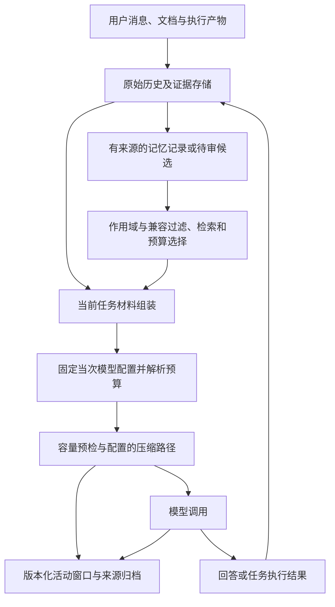

# 上下文与记忆系统评估及改进建议

- 日期：2026-11-12（Asia/Shanghai）
- 源码基线：`feature/scheduler-v3-remediation`，`279f4423951410083b92ec436d67ae00378d717c`
- 状态：评审完成；下文改进方案尚未实施。
- 依据：本地源码、同次评审中的隔离容器回归，以及明确标注日期的历史测试报告。

## 1. 总体判断

上下文系统的工程完整度较高，记忆系统在可追溯、隔离、修订和恢复方面已有扎实基础。当前最需要补强的是资料注入边界、摘要保真、语义召回，以及记忆对真实研究任务的实际收益验证。

目前最有依据的能力描述是：**系统能够持久保存原始材料，按实际模型管理活动窗口，并在明确作用域与证据约束下记录、检索和复用研究经历。** 对于“多次压缩后关键事实持续正确”“长期使用能形成可泛化方法”“开启记忆提高科研任务成功率”，现有证据还不足以给出同等强度的结论。

| 维度 | 当前评价 | 主要依据或限制 |
|---|---|---|
| 上下文预算与调用集成 | 工程完整度较高 | 实际模型预算、压缩模式、分支隔离、失败持久化与恢复已有实现和回归 |
| 记忆可靠性 | 基础扎实 | 来源、可信度、版本、有效时间、作用域、待审候选与使用阶段均有建模 |
| 语义理解与召回 | 仍需补强 | 主记忆路径以关键词、实体、时间和规则抽取为主 |
| 摘要内容保真 | 有结构检查，缺少充分内容检查 | 来源 ID 存在不等于来源支持摘要中的数值、否定和结论 |
| 经验归纳 | 案例记录较完整，归纳能力有限 | reflection 主要拼接近期经历；procedure 有证据门槛，但泛化收益未验证 |
| 真实任务收益 | 尚不能定量判断 | 现有真实模型样本有限，缺少受控的 memory on/off 长任务对照 |

## 2. 评审范围与证据边界

用户已明确说明现有容器中的代码尚未更新。因此，本次评审使用本地最新源码，旧服务镜像的行为不作为最新实现的验收依据。

回归使用 `golang:1.27.3-bookworm` 临时容器，只读挂载本地后端源码，并复用 Go 依赖和构建缓存；设置 `GOTOOLCHAIN=local`、`GOWORK=off`、`GOPROXY=off`，关闭容器网络。测试没有启用真实模型专项。

本次证据分为三类：

1. **本次代码检查和回归**：支持对当前实现、协议处理及确定性行为的判断。
2. **历史实测报告**：只支持对应日期、账户、模型、配置和用例的结果。
3. **代码推导出的风险及改进建议**：尚未通过本次真实模型实验测量影响，不作为已复现的线上故障。

本次未执行新的付费模型评测、72 小时长任务或多日浸泡测试。下文优先级表示建议的实施顺序，不代表已经复现相应严重程度的生产事故。

## 3. 已有架构与值得保留的设计



### 3.1 原始证据与活动窗口分开保存

`ContextStore` 独立保存来源归档、当前状态和版本化 generation；历史摘要或原生压缩状态不直接替代原始聊天和研究证据。提交包含 generation 检查，分支调用有串行化与文件锁保护。

这种分离使压缩失败、生成失败、重启和历史变化可以分别处理，也为后续检查摘要是否忠实提供了原件基础。

代码依据：[contextwindow/store.go](../../research-assistant/backend/internal/contextwindow/store.go)、[modelresolver/runtime.go](../../research-assistant/backend/internal/modelresolver/runtime.go)。

### 3.2 预算跟随实际模型，关键任务条件有独立保护

预算由所选模型窗口、输出预留和安全余量计算；运行时固定解析后的模型配置，并对超大必需材料显式报错。文本摘要路径保留首条可见消息与最近消息，工具调用路径保护调用与结果的完整组合。当前约束与冻结契约可在调用中单独重新发送。

已有回归还覆盖模型切换、历史编辑或缩短后重建、摘要成功但后续生成失败后的恢复，以及请求缓存不能绕过变化后的预算。

代码依据：[contextwindow/budget.go](../../research-assistant/backend/internal/contextwindow/budget.go)、[modelresolver/runtime_test.go](../../research-assistant/backend/internal/modelresolver/runtime_test.go)、[modelresolver/tools_runtime_test.go](../../research-assistant/backend/internal/modelresolver/tools_runtime_test.go)。

### 3.3 记忆有来源、修订和作用域

记忆记录包含类型、来源、可信度、证据引用、状态与有效时间。具有明确身份的事实可以建立修订链；模糊纠正不会仅凭相同标题直接覆盖已有事实。检索对 owner 执行硬隔离，项目、会话、计划和 Agent 作用域按显式匹配处理。

聊天抽取只读取用户消息。LLM 选择的逐字摘录默认进入 `TrustInferred / pending_review`；用户陈述、模型推断和实际执行证据已有区分。

代码依据：[memory/types.go](../../research-assistant/backend/internal/memory/types.go)、[memory/revisions.go](../../research-assistant/backend/internal/memory/revisions.go)、[memory/retrieve.go](../../research-assistant/backend/internal/memory/retrieve.go)、[memory/chat_extract.go](../../research-assistant/backend/internal/memory/chat_extract.go)。

### 3.4 修复经验区分记录、采用和验证

procedure 候选要求实际修复动作、变化前后状态、环境与协议 hash、执行身份及原始证据。一次成功修复默认仍是待审的单案例候选。使用记录区分 `retrieved / adopted / executed / verified`，验证失败可以降回待审。

这是较好的科研记忆边界：来源可查和一次执行成功，都不能自动证明方法具有普适性。改进归纳能力时应保留这些约束。

代码依据：[memory/procedure.go](../../research-assistant/backend/internal/memory/procedure.go)、[分类恢复与修复记忆实施说明](../design/2026-11-08-recovery-memory.md)。

## 4. 主要问题与建议

### CM-01 · P1：聊天资料以 system 消息注入，资料与指令的协议边界不一致

**代码事实**：`api/chat_runtime.go` 将 core memory、retrieved memory、聊天召回、Wiki 与文档内容包装为 `schema.System`。虽然主提示词明确声明这些内容只是资料，`CompleteManaged` 仍将全部 system/developer 消息合并为 `instruction`，历史摘要处理的是其余 `visible` 消息。

**影响判断**：这些资料获得了 system 消息的协议位置，并且不进入历史摘要处理范围。资料较多时会持续占用必需输入预算。现有脱敏和注入扫描提供了防护，本次没有据此证明可绕过工具权限或发生实际攻击。

**建议方案**：

- system/developer 层只放运行规则与稳定指令。
- 检索资料采用明确标记的数据块，使用适配器支持的普通消息或资料分区；仅在确有原生工具调用时使用与调用身份匹配的 tool result。
- 每个资料块保留来源、可信度、版本和 token 开销；明确哪些证据必须保留原文，哪些可重新检索或摘要。
- 历史中的资料块与当前新检索材料分别标识，避免资料过期后继续被当作当前结论。

**建议验收**：捕获最终发给模型的请求，检查资料消息的角色；长资料场景中检查预算和压缩选择；用含命令语气的资料验证其不能改变任务权限与冻结契约。

代码依据：[api/chat_runtime.go](../../research-assistant/backend/internal/api/chat_runtime.go) 的消息组装，以及 [modelresolver/runtime.go](../../research-assistant/backend/internal/modelresolver/runtime.go) 的指令分离与 `completeText`。

### CM-02 · P1：摘要校验验证来源身份，尚未充分验证来源是否支持内容

**代码事实**：`ValidateSummary` 检查 JSON 字段、版本、必要文本，以及 `source_ids` 和 `artifact_refs` 是否属于已有来源。它没有比较摘要文字与原文中的数值、单位、否定条件、事实状态和更正关系。部分自由文本字段也没有条目级来源约束。

**风险示例**：原文为“B23 的 macro-F1 为 0.58”，摘要写成“B23 的 macro-F1 为 0.85”，同时引用正确的来源 ID。仅按当前来源存在性规则无法识别这种错误。这是代码推导的反例，本次没有测量其在真实模型中的出现频率。

冻结契约已有单独发送与保护机制；这里的缺口主要是其他历史事实与实验细节。多次摘要又会使用旧摘要，早期错误存在继续传播的可能。

**建议方案**：

- 对关键实验事实保存结构化记录，至少关联实验身份、数据版本、划分、指标、聚合方式、数值、单位和来源。
- 约束、负结果与纠正分别建模；更正关联被替代的事实，保留生效时间与旧版本。
- 压缩后对明确识别的关键字段做程序化一致性检查，并为必要事实保留原文锚点。
- 对无法可靠程序校验的语义保留不确定状态；结构校验通过不能被报告为“语义验证通过”。

**建议验收**：构造“来源 ID 正确但数值错误”“否定翻转”“旧值覆盖更正”“不同实验结果混合”“假设变事实”等反例；连续触发多次压缩，检查关键事实和失败条件是否仍准确。新机制应能阻止错误摘要成为权威事实，并在容量允许时使用原始材料恢复。

代码依据：[contextwindow/summary.go](../../research-assistant/backend/internal/contextwindow/summary.go)、[modelresolver/runtime.go](../../research-assistant/backend/internal/modelresolver/runtime.go)。

### CM-03 · P1：检索仍以词面信号为主，相关性与去重需要共同校准

**代码事实**：主记忆检索使用 BM25、实体命中与条件触发的近期记录，经 RRF 融合后乘以可信度、重要性、时间、置信度与作用域权重，再执行 MMR。中文采用 bigram 分词。该路径中没有语义向量召回或语义重排。

MMR 当前使用 `0.7 * candidate.Score - 0.3 * maxSim`；融合分数和 0～1 的 Jaccard 相似度没有先统一尺度。对于普通未置顶候选，去重惩罚可能压过候选间的相关性差异。是否已经造成明显漏召回，需要专门评测。

聊天长期事实的默认抽取也受“记住、实测、纠正”等显式标记约束；可选 LLM 抽取默认关闭，抽取结果进入待审。这种保守策略有合理性，但自然表达的信息进入长期记忆的覆盖率需要单独统计。

**建议方案**：

- 先区分“没有记录”“没有召回”“排序或预算挤出”“已注入但回答没用”四种失败。
- 建立同义改写、中英文切换、历史纠正、多实验相似指标、负结果和无答案查询集。
- 对 MMR 相关性项做可解释的归一化或标定，与纯相关性排序及不同去重强度对照。
- 根据漏召回类型评估别名、查询改写、语义召回与重排的增量收益；所有新增路径继续执行原有可见性和兼容检查。
- 分别衡量抽取覆盖率、误晋升率和待审积压，避免通过批量激活推断记录换取表面召回率。

**建议验收**：记录 `Recall@K`、`nDCG@K`、无答案误召回、预算内证据覆盖、延迟及实际回答正确率；同时覆盖跨 owner/project 隔离。对同源但互相纠正或数值不同的事实，不能仅因文本相似就去掉必要证据。

代码依据：[memory/retrieve.go](../../research-assistant/backend/internal/memory/retrieve.go)、[memory/index.go](../../research-assistant/backend/internal/memory/index.go)、[memory/chat_extract.go](../../research-assistant/backend/internal/memory/chat_extract.go)、[memory/chat_recall.go](../../research-assistant/backend/internal/memory/chat_recall.go)。

### CM-04 · P2：聊天与 DAG 任务的检索预算设置不一致

**代码事实**：聊天以 `settings.RetrievedBudgetTokens` 减去 Wiki 和聊天召回开销；调度器使用固定的 `3000 - wikiTokens`，没有使用同一设置字段。调度器已经读取用户设置中的 TopK 和 core budget，检索预算这一项仍不统一。

**影响判断**：用户调整 retrieved budget 后，聊天与任务可能表现不同。统一模型总容量检查能够拦截最终超限，但不能替代各资料分区的分配语义。

**建议方案**：复用统一的分区预算解析入口，明确配置值、实际模型容量、当前任务必需材料和资料选择预算之间的关系。是否允许任务级覆盖需要形成显式规则并进入诊断报告。

**建议验收**：在相同用户设置下检查聊天与任务采用的预算；覆盖小窗口、Wiki 占满资料预算和用户修改设置后的下一次调用；预算报告能说明各分区的额度来源和实际消耗。

代码依据：[api/chat_runtime.go](../../research-assistant/backend/internal/api/chat_runtime.go) 的 `retrievedBudget`，以及 [scheduler/executor.go](../../research-assistant/backend/internal/scheduler/executor.go) 的固定 3000 token 分配。

### CM-05 · P2：reflection 主要汇编近期案例，尚未形成条件化经验归纳

**代码事实**：`Consolidator.RunOnce` 按作用域分组，在经历达到数量门槛后，选择最近三条，拼接标题与内容形成 `pending_review` reflection。当前没有比较共性条件、反例、独立案例数量或方法适用边界。

procedure 对实际动作与验证的要求更强，但默认单案例候选和精确兼容过滤也意味着：自动形成广泛适用经验仍是后续能力。

**建议方案**：

- 明确区分案例汇编、待验证假设和有独立案例支持的方法。
- 归纳时按问题、动作、环境、协议和结果组织证据，显式保存成功、失败及不适用案例。
- 新归纳保留来源和待审状态；推广依据应来自独立执行，不能使用检索命中数、候选数或重复重放次数替代。
- 复用后依据实际动作和验证结果更新支持或反对证据，继续沿用现有 procedure 使用阶段记录。

**建议验收**：同一方法在不同条件下成功和失败时，归纳能够显示条件差异；一次成功、纯传输重试和同一结果重复重放均不能被统计为多次独立验证。

代码依据：[memory/consolidate.go](../../research-assistant/backend/internal/memory/consolidate.go)、[memory/procedure.go](../../research-assistant/backend/internal/memory/procedure.go)。

### CM-06 · P1：缺少面向真实长任务的收益对照

**已知证据**：本次 9 个测试包通过；历史报告记录了结构压测和少量真实模型问答、摘要测试。它们分别证明实现回归、特定用例可用性，尚未建立记忆对真实科研结果的因果收益。

**建议方案**：在同一批冻结任务上设置以下对照，区分压缩收益与长期记忆收益。

| 组别 | 上下文处理 | 长期记忆 | 主要比较目的 |
|---|---|---|---|
| A | 完整历史，关闭压缩 | 关闭 | 作为可容纳场景的参考；超限也记录为结果 |
| B | 当前受管压缩 | 关闭 | 与 A 比较压缩的容量收益和质量变化 |
| C | 与 B 相同的受管压缩 | 开启 | 与 B 比较长期记忆的增量收益 |

固定任务契约、输入证据、模型配置与可用工具。各组从等价且隔离的数据快照开始；后续发生的记忆写入不得污染其他组。需要研究跨任务复用时，预先划分经验产生任务和评测任务。

建议首批选择 30～50 个真实或接近真实的任务，每个条件重复运行；具体重复次数根据成本预算和随机性确定。以上为拟议规模，本次未执行。

**建议指标**：任务验收通过率、关键数值与来源正确率、负结果保留、重复失败次数、权限与契约违背、实际证据采用率、token、延迟，以及已核验费率下的成本。费用未知时保留未知状态。

验收规则在运行前冻结，报告全部失败和超限任务，给出配对差异与不确定性。压缩比例、检索命中数或记忆条数不能单独作为收益结论。

## 5. 建议实施顺序

| 阶段 | 工作 | 产出及进入下一阶段的依据 |
|---|---|---|
| 第一阶段 | 建立 CM-06 的冻结基线；处理 CM-01 资料注入与 CM-04 预算一致性 | 可检查的最终请求、统一资料预算报告，以及修改前后可对照的数据 |
| 第二阶段 | CM-02 摘要保真与 CM-03 检索校准 | 关键事实反例集、压缩轮次评测、检索失败归因与排序对照 |
| 第三阶段 | 根据前两阶段结果增加语义能力，改进 CM-05 经验归纳 | 有独立案例支持的候选，以及 C 相对 B 的真实任务收益报告 |

这一路径优先解决资料进入模型的方式与质量，再用任务结果决定是否增加检索或归纳复杂度。阶段完成情况应由后续实现和验收文档记录，本文保持评审基线用途。

## 6. 本次回归结果与重现

以下 9 个包在同次评审的隔离容器中以 `go test -count=1` 执行，全部通过：

| 测试包 | 结果 |
|---|---|
| `./internal/contextwindow` | PASS |
| `./internal/modelresolver` | PASS |
| `./internal/memory` | PASS |
| `./internal/wiki` | PASS |
| `./internal/agent/conversation` | PASS |
| `./internal/agentprofile` | PASS |
| `./internal/prompts` | PASS |
| `./internal/api` | PASS |
| `./internal/scheduler` | PASS |

从仓库根目录在 PowerShell 重现：

```powershell
$reviewBackendPath = (Resolve-Path '.\research-assistant\backend').Path
docker run --rm --name ra-context-memory-review --network none `
  --mount "type=bind,source=$reviewBackendPath,target=/workspace,readonly" `
  --mount type=volume,source=ra-go-mod,target=/go/pkg/mod `
  --mount type=volume,source=ra-go-build,target=/root/.cache/go-build `
  -e GOTOOLCHAIN=local -e GOWORK=off -e GOPROXY=off `
  -w /workspace golang:1.27.3-bookworm `
  go test -count=1 `
  ./internal/contextwindow ./internal/modelresolver ./internal/memory `
  ./internal/wiki ./internal/agent/conversation ./internal/agentprofile `
  ./internal/prompts ./internal/api ./internal/scheduler
```

前提是本地已存在上述镜像及满足当前依赖的缓存；关闭网络时不会自动补齐依赖。命令验证的是挂载的源码，不代表现有服务镜像已经更新。测试中默认跳过的真实模型专项不计入本次真实服务商验证。

本次没有额外运行全后端 `go test ./...`、race、vet、前端检查或部署验收；对应历史报告中的结果不能算作本次新执行的检查。

## 7. 历史证据与交付边界

- [2026-11-03 记忆压力测试修复报告](../../reports/memory-stress-fix-2026-11-03/REPORT.md)：记录 166 条结构压测及 3 条真实模型补充用例。报告属于本地生成产物，其他检出环境可能没有此文件；本次没有重新执行该套压测。
- [2026-11-07 上下文实施说明](../design/2026-11-07-context-implementation.md)：模型预算、活动窗口、压缩路径与持久化的实施范围。
- [2026-11-07 真实模型压缩测试](../test/2026-11-07-real-context-compression.md)：一组合成记录的真实文本摘要及后续生成通过；当时的网关原生 compact 不可用，计数端点不存在，server 模式未观察到 compaction item。这些是当日部署结果，本次未重新探测。
- [2026-11-08 Agent 上下文集成](../design/2026-11-08-agent-context-implementation.md)：专业 Agent、修复分支、revision 隔离与恢复的增量交付。
- [2026-11-08 分类恢复与修复记忆](../design/2026-11-08-recovery-memory.md)：动作账本、共享恢复预算、procedure 候选及复用验证边界。

本文新增评审与建议，不宣称 CM-01～CM-06 已修复，也不将历史压测、单次摘要成功或确定性回归等同于真实长研究任务的效果提升。
